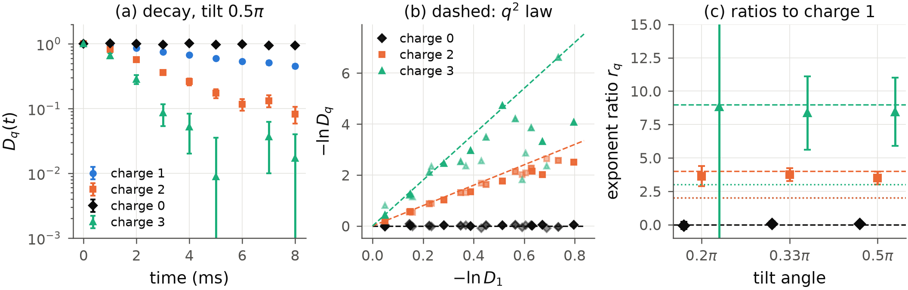

# 연구 안내서: 우리 연구와 그 배경 지식 (2026-11-19 기준)

이 문서는 연구를 처음 따라잡으려는 사람을 위한 안내서다. 양자역학의 기초(상태, 연산자, 스핀-1/2, 기댓값)는 안다고 가정한다.

- §1은 연구 전체를 한 장으로 요약한다.
- §2는 이 연구를 이해하는 데 필요한 배경 지식을 읽는 순서대로 설명한다.
- §3은 우리가 보인 것과 그 근거를 정리한다.
- §4는 용어집이다. 노트에 남아 있는 옛 이름과 원고의 이름을 대응시켜 두었다.
- §5는 더 읽을 문헌과 저장소 안의 파일 지도다.

내용은 기존 노트에서 모았다: `research-overview.md`, `results/summary.md`, `theory/*.md`, `literature/novelty-check.md`, `data/beqs-data-notes.md`. 수치는 모두 그 노트와 결과 파일(`results/*.json`)에 있는 값이다. 정리 번호는 PRA 원고의 번호이고, 이론 노트의 이름(정리 A, B1 등)은 §3.2 표에서 대응시켰다.

---

## 1. 한 장 요약

**질문.** 데이터에서 학습한 모형으로 아날로그 양자 시뮬레이터의 결과를 예측하면, 그 예측은 최대 얼마나 틀릴 수 있는가?
- 선행 연구 BEQS(Kraft 등, PRX 16, 031037 (2026))는 이 상한을 처음으로 실험과 함께 냈다.
- 그 상한은 어떤 불완전성에도 성립하는 대신, 시간에 비례해 커진다.
- BEQS는 대칭과 결어긋남 없는 부분공간의 활용을 열린 과제로 남겼다.

**답.** 대부분의 시뮬레이터가 가진 두 성질, U(1) 대칭(전체 자화 보존)과 집단 위상 이완(모든 큐비트에 같은 위상 잡음)을 쓰면 오차가 불완전성의 *전하*에 따라 정리된다.
- **대칭을 깨는 불완전성(전하 ≠ 0):** 전하 0 상태와 관측량의 예측에 2차로만 들어온다. 남은 효과는 집단 위상 이완이 모든 차수에서, 위상 이완 비율과 전하의 제곱에 비례하는 비율로 감쇠시킨다.
- **대칭 불완전성(전하 0):** 1차로 들어오고 보호되지 않는다. 비결맞음 스핀 플립이 여기에 속한다.
- **국소성:** 이 상한에는 계의 크기에 무관한 국소 형태가 있다.

**검증.**
- **정확한 시뮬레이션:** 큐비트 6개 사슬의 열린계 동역학과, 최대 200 자리의 자유 페르미온 계산을 썼다.
- **공개 실험 데이터 네 종:** Innsbruck 10-이온 학습 데이터, 51-이온 퀜치, 같은 장치의 Mpemba 위상 이완 데이터(이온 12개), Quantinuum 디지털 페르미–허버드 샷을 다시 분석했다.

**주요 수치.**

| 무엇 | 값 |
|---|---|
| 선택 규칙: 대칭을 깨는 불완전성의 세기를 두 배로 할 때 오차 | 3.97–4.00배(대칭을 지키는 불완전성은 2.04배) |
| 자유 페르미온 국소 상한 | 계 크기와 무관(N ≥ 50, 상대 흩어짐 0.7%), 전역 상한보다 700–1300배 촘촘 |
| 10-이온 데이터의 모형 선택 | U(1) 대칭 최소 모형의 예측 rms 오차 0.040, 제약 없는 적합 0.118 |
| 2 ms에서 U(1)을 깨는 결합의 영향 | 실제 오차 0.016, 교환자 상한 0.39, 하이젠베르크 묘사 상한 0.58, 전역 상한과 BEQS 편향 상한 15 |
| Mpemba 데이터의 감쇠 지수 비(전하 0, 2, 3) | 약 0, 3.5–3.75, 8.4–8.8. 집단 위상 이완의 예측은 0, 4, 9이고, 독립 위상 이완의 예측은 2, 2, 3 |

**지금 상태.**
- **PRA 원고:** 정리, 수치 검증, 데이터 분석이 끝났다. 원고(`paper/`)는 로컬에만 있고 공개 저장소에 올리지 않는다.
- **PRX 계획:** 보존 밀도가 있을 때의 시간 균일 상한(정리 E, F)과 기억이 있는 집단 잡음(정리 G)은 PRX 후속 논문 몫이다.

---

## 2. 배경 지식

각 항목은 다음 순서로 쓴다.
- **무엇:** 개념 자체
- **왜:** 이 연구에서 필요한 이유
- **원고:** 원고에서 이 개념이 나오는 곳
- **더 읽을 것:** 참고 문헌

### 2.1 아날로그 양자 시뮬레이터와 오차 범위

- **무엇.** 아날로그 양자 시뮬레이터는 조절 가능한 양자계로 다른 양자계의 동역학을 흉내 낸다.
  - 게이트를 차례로 거는 디지털 방식과 달리, 결합을 계속 켜 두고 계가 해밀토니언을 따라 저절로 진화하게 둔다.
  - "아날로그 대 디지털"은 구현 방식의 구분이고, "이온 트랩 대 초전도 대 중성 원자"는 하드웨어의 구분이다.
- **왜.** 시뮬레이터를 쓰는 이유는 고전 컴퓨터로 답을 구할 수 없는 영역을 보기 위해서다.
  - 그 영역에서는 정답을 따로 계산해 맞춰 볼 수 없다.
  - 그래서 "결과가 최대 얼마나 틀렸는가"를 증명된 숫자, 곧 오차 상한으로 주는 것이 결과를 믿을 근거가 된다.
- **원고.** Sec. I 첫 두 문단.
- **더 읽을 것.** Daley 등, Nature 607, 667 (2022). Monroe 등, Rev. Mod. Phys. 93, 025001 (2021).

### 2.2 포획 이온 장치

- **무엇.** Innsbruck 장치는 ⁴⁰Ca⁺ 이온 사슬이다.
  - 각 이온의 두 준위(바닥 상태와 준안정 준위 D5/2)가 큐비트를 이룬다.
  - 레이저가 이온 사이에 장거리 XY 결합 H = Σ J_ij (X_iX_j + Y_iY_j)/2를 만든다. J_ij는 거리의 멱함수로 줄어든다.
- **세 가지 성질.**
  - **XY 결합은 전체 자화를 보존한다.** 위 스핀이 한 이온에서 다른 이온으로 옮겨 갈 뿐, 그 개수는 그대로다.
  - **집단 위상 이완이 강하다.** 모든 이온이 같은 레이저와 자기장 속에 있어서 위상 잡음이 모든 이온에 공통으로 걸린다.
  - **자발 붕괴가 있다.** 준안정 준위의 수명은 τ = 1.168 s이다. 붕괴는 한 방향으로 자화를 바꾸는 느린 과정이다.
- **왜.** 이 세 성질이 이 연구의 재료다. 대칭(자화 보존)과 소산(집단 위상 이완)이 오차를 정리하고, 붕괴는 "약하게 대칭이지만 강한 대칭을 깨는" 과정의 예다(§2.5).
- **원고.** Sec. I 셋째 문단, Sec. VI.
- **더 읽을 것.** Jurcevic 등, Nature 511, 202 (2014). Monroe 등, RMP 93, 025001 (2021).

### 2.3 열린 양자계: 린드블라드 방정식과 하이젠베르크 묘사

- **밀도 행렬과 생성자.** 환경과 상호작용하는 계는 순수 상태가 아니라 밀도 행렬 ρ로 기술한다. 기억이 없는(마르코프) 환경이면 ρ는 GKSL(린드블라드) 방정식 dρ/dt = 𝓛(ρ)를 따른다.
  - 𝓛(ρ) = −i[H, ρ] + Σ_k (L_k ρ L_k† − ½{L_k†L_k, ρ})
  - H는 해밀토니언이고, L_k는 점프 연산자(잡음 채널)이다.
  - 𝓛처럼 연산자에 작용하는 선형 사상을 초연산자라고 부르고, 𝓛을 생성자라고 부른다.
- **위상 이완(dephasing).** L = √γ σ^z처럼 위/아래 확률은 그대로 두고 중첩의 위상만 흐트러뜨리는 잡음이다.
  - **집단 위상 이완:** 점프 연산자가 전체 자화 S^z 하나인 경우다. 모든 큐비트가 같은 위상 흔들림을 받는다.
  - **독립 위상 이완:** 큐비트마다 따로 흔들린다.
- **완전 양성, 대각합 보존.** 물리적인 진화 e^{t𝓛}은 완전 양성이고 대각합을 보존한다(CPTP). 그래서 상태 사이의 거리(대각합 노름)를 늘리지 못한다. 상한 증명의 기본 도구다.
- **하이젠베르크 묘사.** 상태 대신 관측량을 진화시킨다. 쌍대 생성자 𝓛†로 O_t = e^{t𝓛†}(O)이고, ⟨O⟩_t = tr[O_t ρ_0]이다.
  - 소산이 있으면 진화한 관측량 O_t가 항등 연산자의 배수로 이완할 수 있다.
  - 그러면 관측량은 섭동에 둔감해지고, 오차가 더 쌓이지 않는다. 원고의 정리 1(하이젠베르크 묘사 상한)이 이 성질을 쓴다.
- **진동폭(oscillation).** osc(O) = (최대 고윳값 − 최소 고윳값)/2이다. 관측량의 범위를 재며, 교환자 크기의 상한 ‖[B, O]‖ ≤ 2‖B‖ osc(O)를 준다.
- **원고.** Sec. II A, Sec. III.
- **더 읽을 것.** Breuer와 Petruccione, *The Theory of Open Quantum Systems* (Oxford, 2002), 3장. Lindblad, Commun. Math. Phys. 48, 119 (1976). Gorini, Kossakowski, Sudarshan, J. Math. Phys. 17, 821 (1976).

### 2.4 해밀토니언·린드블라디안 학습과 BEQS

- **학습.** 짧은 시간의 측정 데이터에서 생성자 𝓛의 매개변수(결합, 장, 잡음 비율)를 추정한다.
  - **적분법(integral method):** 운동방정식을 시간에 대해 적분하면, 관측량의 변화가 매개변수에 대해 선형인 식이 된다. 이를 선형 최소제곱으로 푼다. 신경망을 쓰지 않는다.
  - **부트스트랩:** 측정 설정을 복원 추출해 다시 학습하고, 매개변수의 불확도를 구한다.
- **BEQS의 상한.**
  - **뒤아멜(Duhamel) 추정:** 실제 생성자가 𝓛 + 𝓥이면 예측 오차는 대략 (불완전성의 크기) × (시간)으로 상한이 잡힌다. 어떤 불완전성에도 성립하지만, 시간에 비례해 커진다.
  - **가우스 앙상블 상한:** 매개변수 불확도가 가우스 분포면 기대 오차의 상한은 시간의 제곱에 대해 지수적으로 커진다.
- **BEQS가 남긴 것.**
  1. 상한이 시간에 따라 커지므로, 짧은 시간에만 정보가 있다.
  2. 대칭과 결어긋남 없는 부분공간을 쓰는 것을 열린 과제로 꼽았다.
  3. 집단 위상 이완을 백색 잡음으로 모형화했다. 느린 자기장 요동이면 다르게 기술해야 한다고 각주에 적었다.
  - 이 연구는 1과 2를 PRA에서, 3을 PRX에서 이어받는다.
- **원고.** Sec. I, Sec. III, Sec. VI A.
- **더 읽을 것.** Kraft 등, PRX 16, 031037 (2026)과 그 공개 데이터(Zenodo 10.5281/zenodo.17750419). 데이터 구조는 [data/beqs-data-notes.md](data/beqs-data-notes.md)에 있다.

### 2.5 U(1) 대칭과 전하

- **U(1) 대칭.** 모든 큐비트를 z축 둘레로 같은 각도 φ만큼 돌려도(e^{iφS^z}) 해밀토니언이 그대로면 전체 자화 S^z가 보존된다.
  - 이 회전은 위/아래 확률을 바꾸지 않고 중첩의 위상만 돌린다.
  - 위아래를 모두 뒤집는 Z₂ 대칭과는 다른 대칭이다.
- **연산자의 전하.** 연산자 X가 자화를 q만큼 올리면, 곧 [S^z, X] = qX이면 X의 전하는 q이다.
  - σ^+는 전하 +1, σ^+σ^−는 전하 0, σ^+σ^+는 전하 +2이다.
  - 모든 연산자는 전하가 정해진 부분들의 합으로 나뉜다. 이것이 U(1)의 표현론에 따른 분해다.
  - 전하가 0인 연산자는 S^z와 교환한다(자화, ZZ 상관, 플립-플롭 상관 등).
- **생성자의 전하.** 초연산자도 같은 방식으로 전하를 가진다. 생성자가 모든 전하 섹터를 자기 자신으로 보내면 *약하게 대칭(weakly symmetric)*이라 하고, 원고에서는 줄여서 대칭이라 한다. 11-24 이전 원고는 같은 성질을 공변(covariant)이라 불렀다.
  - XY 결합, z 장, 어떤 상관 행렬의 z 위상 이완, σ^− 방출은 모두 대칭이다.
  - 가로 장(전하 ±1)과 비등방 결합 X_iX_j − Y_iY_j(전하 ±2)는 대칭을 깬다.
- **약한 대칭과 강한 대칭.**
  - 약한 대칭: 생성자가 모든 전하 섹터를 자기 자신으로 보낸다.
  - 강한 대칭: 해밀토니언과 모든 점프 연산자가 S^z와 교환한다. 강한 대칭이 있으면 자화의 분포 자체가 시간에 따라 변하지 않는다.
  - σ^± 플립처럼 전하를 띤 점프는 약한 대칭은 지키지만 강한 대칭은 깬다. 자발 붕괴(σ^−)가 그 예다.
  - 이 구분 덕분에 "자화를 바꾸는데도 집단 위상 이완의 보호를 받지 않는" 대칭 플립을 다룰 수 있다.
- **원고.** Sec. II B, Sec. IV D(정리 8, 명제 1).
- **더 읽을 것.** Buča와 Prosen, New J. Phys. 14, 073007 (2012). Albert와 Jiang, PRA 89, 022118 (2014).

### 2.6 섭동 전개와 선택 규칙

- **뒤아멜 전개.** 실제 생성자가 𝓛 + 𝓥일 때, 예측 오차를 불완전성 𝓥에 대해 1차, 2차, … 항으로 전개할 수 있다(정확한 항등식). 1차, 2차는 시간 순서가 아니라 불완전성 크기 ε의 차수다.
- **선택 규칙.** 초기 상태와 관측량이 모두 전하 0이면, 전하가 0이 아닌 불완전성의 1차 항은 정확히 0이다. 불완전성이 한 번 작용하면 진폭이 다른 자화 섹터로 넘어가는데, 전하 0 관측량은 서로 다른 섹터를 잇지 못하기 때문이다. 그래서 오차는 ε²부터 시작한다.
- **블로흐 구 그림(큐비트 하나).**
  - 상태는 북극을 가리키는 화살표이고, 대칭을 깨는 가로 장이 화살표를 작은 각도 θ만큼 기울인다.
  - 세로 성분 ⟨Z⟩(전하 0)는 cos θ ≈ 1 − θ²/2라서 2차로만 바뀐다.
  - 가로 성분 ⟨X⟩(전하 1)는 sin θ ≈ θ라서 1차로 바뀐다.
- **주의.** 초기 상태가 여러 자화 섹터의 중첩이면(예: x 방향으로 누운 스핀) 이 그림이 깔끔하지 않다. BEQS의 두 초기 상태가 그런 경우다.
- **원고.** Sec. IV B(정리 3), 그림 2(a). 수치 확인은 그림 3(세기를 두 배로 하면 오차가 3.97–4.00배)에 있다.

### 2.7 결어긋남 없는 부분공간, 제논 효과, 집단 감쇠

- **결어긋남 없는 부분공간(DFS).** 잡음이 구별하지 못하는 상태들의 부분공간이다.
  - 집단 위상 이완은 자화가 같은 상태들에 같은 위상을 준다.
  - 그래서 각 자화 섹터 안의 결맞음은 보호된다.
- **양자 제논 효과.** 빠른 측정이나 빠른 무작위화가 특정 전이를 막는 효과다.
  - 대칭을 깨는 불완전성은 자화가 다른 상태를 잇는데, 집단 잡음은 섹터마다 다른 무작위 위상을 준다.
  - 그래서 불완전성이 밀 때마다 박자가 어긋나 서로 상쇄된다(박자가 틀린 그네 밀기).
- **q² 감쇠.** 집단 위상 이완(비율 γ_c)은 전하 q인 연산자 성분에 정확히 e^{−2γ_c q² t}를 곱한다(원고의 보조정리 1). 전하 0 성분은 전혀 감쇠하지 않는다.
  - 무작위 전역 디튜닝이 어떤 통계를 따르든, 전하 0 성분은 영향을 받지 않는다(보조정리 2).
  - 전하 q 성분은 누적 위상의 특성 함수가 곱해진다.
  - 지수가 q²에 비례하는 것은 위상이 가우스일 때다. 백색이든 준정적이든 위상이 가우스면 q²이다.
- **이 연구에서의 역할.** 선택 규칙으로 2차에 남은 효과를, 집단 위상 이완이 전하의 제곱에 비례하는 비율로 지운다(정리 5).
- **원고.** Sec. IV A–B, 그림 1과 2. 데이터 시험은 Sec. VI D의 "A model-free test of the q² law"(그림 15)에 있다.
- **더 읽을 것.** Zanardi와 Rasetti, PRL 79, 3306 (1997). Lidar, Chuang, Whaley, PRL 81, 2594 (1998). Facchi와 Pascazio, PRL 89, 080401 (2002). Burgarth 등, Quantum 3, 152 (2019).

### 2.8 국소성: 지지 영역, Lieb–Robinson 상한, 광원뿔

- **무엇.** 국소 상호작용만 있는 계에서는 정보가 유한한 속도로 퍼진다. Lieb–Robinson 상한은 이 속도 v를 주고, 시간 t 동안 관측량이 영향을 받는 영역(광원뿔)을 |A| + 2vt 크기로 제한한다. A는 관측량이 처음 작용하는 영역이다.
- **이 연구에서의 핵심 관찰.** 위상 이완은 상관 행렬이 어떻든 연산자를 감쇠시키기만 하고 다른 자리로 옮기지 않는다(원고의 보조정리 4, 지지 영역 보존).
  - 그래서 이온 실험에서 학습한 장거리 상관 위상 이완도 광원뿔을 넓히지 않는다.
  - 광원뿔 밖의 불완전성 항은 기여하지 않으므로, 상한이 계의 크기 N에 무관해진다(정리 7, 따름정리 7.1).
- **왜 필요한가.** 전역 노름으로 만든 상한은 N²으로 커져서, 큰 장치에서 쓸모가 없다.
- **원고.** Sec. IV C, 그림 2(b), 그림 7.
- **더 읽을 것.** Lieb와 Robinson, Commun. Math. Phys. 28, 251 (1972). Trivedi 등, Nat. Commun. 15, 6507 (2024).

### 2.9 자유 페르미온 계산

- **무엇.** 해밀토니언과 잡음이 페르미온 연산자의 2차식이면(자유 페르미온), 2차 모멘트(상관 행렬)가 닫힌 방정식을 따른다. 2차 연산자는 하이젠베르크 진화에서도 2차로 남는다.
- **왜.** 이 계에서는 교환자, 노름, 하이젠베르크 진화가 모두 N × N 행렬 계산이 된다. 그래서 200 자리 사슬의 상한을 정확히 계산해 계 크기 무관성을 검증할 수 있다.
- **원고.** Sec. V "Large systems", 부록 C.

### 2.10 통계 도구

- **부트스트랩.** 데이터 단위(측정 설정, 유니터리, 회로)를 복원 추출해 추정을 반복하고, 그 흩어짐으로 불확도를 잰다.
  - 이 연구의 데이터에서는 부트스트랩이 추정의 *분산*은 담지만 *편향*은 담지 못하는 경우가 있었다.
- **교정 인자(calibration factor).** (데이터와 예측의 실제 rms 편차) ÷ (예측한 퍼짐의 rms)이다. 1이면 오차 띠가 잘 맞고, 1보다 크면 띠가 너무 좁다.
- **합성 데이터 보정.** 데이터와 똑같은 방식으로 샷을 뽑은 합성 데이터에 같은 분석을 돌려, 분석 방법의 편향, 덮음 확률, 검정력을 잰다. 모든 데이터 분석은 이 단계를 먼저 거쳤다.
- **사전 등록.** 판정 규칙을 실행 전에 스크립트에 적고 공개 저장소에 커밋한 뒤 분석한다.
  - 결과를 본 뒤 정한 분석은 "사후"로 표시하고, 판정을 바꾸지 않는다.
  - 여러 검정을 함께 할 때는 Holm 보정으로 전체 오류율을 묶는다.
- **변수 오차(errors-in-variables).** 잡음이 섞인 측정값을 회귀의 설명 변수로 쓰면 추정값이 0 쪽으로 줄어든다.
  - 적분법이 이 문제를 가진다(결합이 4–5% 작게 나옴).
  - SIMEX는 잡음을 일부러 더해 보며 이 편향을 외삽해 없애는 방법이다.
- **원고.** Sec. VI, 부록 D–F.

### 2.11 무작위 측정과 고전 그림자

- **무엇.** 측정 전에 큐비트마다 무작위 단일 큐비트 회전 u를 걸고 z 기저로 측정한다. 이를 여러 번 반복하면, 측정 결과에서 상태의 여러 성질(파울리 기댓값, 순도)을 동시에 추정할 수 있다.
- **고전 그림자(classical shadow):** 한 번의 측정 결과마다 상태의 불편 추정량("스냅숏") 3u†|b⟩⟨b|u − 1을 만드는 방법이다.
- **이 연구에서의 주의점.**
  - 교과서 추정량은 회전을 무한히 새로 뽑을 때의 평균에서만 편향이 없다.
  - Mpemba 데이터처럼 같은 회전 300개를 모든 시각에 다시 쓰면 측정 채널이 정확히 탈분극 채널이 아니어서, 서로 다른 전하의 성분이 섞인다.
  - 그래서 실제 회전 집합의 채널을 최소제곱으로 정확히 역변환하였다.
- **원고.** Sec. VI D, 부록 D "Classical shadows with a fixed set of unitaries".
- **더 읽을 것.** Huang, Kueng, Preskill, Nat. Phys. 16, 1050 (2020). Elben 등, Nat. Rev. Phys. 5, 9 (2023).

---

## 3. 우리 연구

### 3.1 핵심 그림

초기 상태와 관측량이 전하 0이라고 하자. 자화나 ZZ 상관처럼 실험에서 흔히 재는 양이 여기에 속한다.

| 불완전성 | 예 | 예측에 들어오는 차수 | 집단 위상 이완의 효과 |
|---|---|---|---|
| 대칭을 깨는 불완전성(전하 ±1, ±2) | 가로 장, 비등방 결합, x/y 위상 이완의 불균형 | 2차(선택 규칙) | 2γ_c q²의 비율로 감쇠(제논 억제) |
| 대칭 불완전성(전하 0) | 결합 세기 오차, z 장, z 위상 이완, 스핀 플립 | 1차 | 없음, 교정해야 함 |

- 보호 여부를 정하는 것은 불완전성이 결맞음인지 소산인지가 아니다. 초연산자의 전하가 정한다(정리 8).
- 예를 들어 x 위상 이완은 대칭 플립과 대칭을 깨는 나머지로 나뉜다. 앞부분은 보호되지 않고 뒷부분만 억제된다.

### 3.2 이론 결과

| 원고 | 이론 노트의 이름 | 내용 | 쉬운 뜻 |
|---|---|---|---|
| 정리 1 | 정리 A | 오차 ≤ ∫₀ᵗ ‖[δH, O_u]‖ du ≤ 2t‖δH‖osc(O) | 관측량이 이완하면 상한이 포화한다. 뒤아멜 상한보다 약하지 않다 |
| 비고 1 | 정리 A의 일반형 | 모든 섭동 𝓥에 대해 ∫₀ᵗ ‖𝓥†(O_u)‖ du | 보존량의 상한에는 U(1)을 깨는 부분만 들어간다 |
| 정리 2 | 정리 A2 | 평균 0인 앙상블의 기대 오차: 중첩 교환자 주항과 나머지 | BEQS의 기대 오차 식보다 1.8–24배 작다 |
| 보조정리 1 | 보조정리 B.0 | 집단 위상 이완은 전하 q 블록에 e^{−2γ_c q² t}를 곱한다 | q² 감쇠 |
| 보조정리 2 | 보조정리 G.0 | 어떤 통계의 전역 디튜닝도 전하 0 블록을 바꾸지 않는다 | 전하 0 관측량은 집단 잡음에 둔감하다. 학습 추정량 T의 바탕 |
| 보조정리 3 | 보조정리 B.1 | 학습한 위상 이완 행렬에서 떼어 낼 수 있는 가장 큰 집단 비율 | 실제 장치의 γ_c를 정의한다 |
| 정리 3 | 정리 B1 | 선택 규칙: 대칭을 깨는 불완전성의 선형 응답은 0 | 2차부터 시작 |
| 따름정리 3.1 | 정리 B1의 따름정리 | 1차 요동에는 전하 0 매개변수만 들어간다 | 2-국소 안자츠에서 매개변수의 약 3분의 1 |
| 정리 4 | 정리 B2 | 전하를 띤 관측량의 오차는 모든 시간에 유계 | 보호받는 관측량 |
| 정리 5 | 정리 B3 | 모든 차수의 제논 억제 상한, 인자 φ(2γ_c p², t) | 상한이 시간에 대해 기껏해야 선형, 기울기 ∝ 1/γ_c |
| 정리 6 | 정리 B4 | 오차 분해: 대칭 부분(억제 없음) + 대칭을 깨는 부분(억제) | 오차 예산을 전하로 나눈다 |
| 보조정리 4 | 지지 영역 보존 | 위상 이완은 연산자를 옮기지 않는다 | 광원뿔은 해밀토니언만이 정한다 |
| 정리 7, 따름정리 7.1 | 정리 B3′, 따름정리 B3-loc | 교환자 형태 상한과 계 크기에 무관한 국소 상한 | 큰 장치에도 쓸 수 있다 |
| 보조정리 5, 명제 1 | 보조정리 C.0, 명제 C.1 | 초연산자의 전하, 강한 대칭의 정의 | 강한 대칭이면 자화 분포가 변하지 않는다 |
| 정리 8, 따름정리 8.1 | 정리 B6, 따름정리 B6′ | 모든 종류의 불완전성에 대한 분해. 섹터 밖 누설로 두 종류를 가르는 진단 | 집단 위상 이완 세기를 바꾸며 재면 대칭(무관)과 대칭 깨짐(1/γ_c)이 갈린다 |
| 부록 B | 명제 C | 비율의 가우스 앙상블은 긴 시간에 비물리적 | 로그 정규 앙상블을 써야 한다 |

PRX 쪽 결과(원고에는 없다)도 함께 정리해 둔다. 이 결과들은 `paper/notes/prx_material.tex`와 [theory/phase3-theory.md](theory/phase3-theory.md), [theory/phase4-theory.md](theory/phase4-theory.md)에 있다.
- **정리 E (불가능성 정리):** 보존 밀도가 있으면 관측량만 보는 상한은 √t로 커질 수밖에 없다.
- **정리 F:** 관측량과 상태가 둘 다 확산으로 이완하는 것을 함께 쓰면, 시간에 균일한 상한을 얻는다.
  - 상호작용 없는 사슬에서는 증명했다.
  - 상호작용 사슬은 포물형 추정 하나로 줄였다. SSEP에서는 증명했고, KLS의 미시판은 N = 128까지 수치가 지지하는 추측이다.
- **정리 G:** 고전 집단 잡음 일반에서 보호 인자는 백색 잡음이면 1/Q², 준정적 잡음이면 1/|Q|이다.

### 3.3 수치 검증

| 시험 | 계 | 결과 |
|---|---|---|
| 선택 규칙과 제논 억제(그림 3) | 장거리 XY 사슬, N = 6, 네엘 상태 | 세기 두 배에 오차 3.97–4.00배(대칭을 지키는 불완전성 2.04배). γ_c를 0에서 2J_0으로 키우면 \|q\| = 2 오차가 3.99×10⁻³에서 3.60×10⁻⁴로, \|q\| = 1 오차가 1.23×10⁻³에서 4.9×10⁻⁴로 준다 |
| 하이젠베르크 묘사 상한(그림 4) | 같은 사슬, 원시 생성자 | t = 40/J_0에서 뒤아멜 상한보다 41배 작고, t = 30/J_0 뒤의 증가는 값의 1.4×10⁻⁴ |
| 기대 오차 상한(그림 5) | 가우스 매개변수 앙상블 | BEQS 식이 우리 상한보다 1.8–23.9배 크다 |
| 결맞음·소산 불완전성(그림 6) | 같은 사슬 | 누설의 두 배 비가 가로 장 4.00, 플립과 x 위상 이완 1.91. 플립의 누설은 γ_c와 10⁻¹⁵ 이내에서 무관 |
| 큰 계(그림 7) | 자유 페르미온, N ≤ 200 | 오차가 N ≥ 50에서 N과 무관(흩어짐 0.7%). γ_c = J에서 35배 억제. 교환자 상한은 실제 오차의 33–53배이고, 전역 상한보다 700–1300배 촘촘 |

이 표의 수치는 무작위 사례 하나의 값이다. 사례 21개로 다시 돌린 결과(E33, [results/summary.md](results/summary.md) §9.21)에서 정리와 상한의 진술은 모든 사례에서 성립했다. 한 시각에서 잰 실제 오차의 성질 일부는 사례에 따라 달랐다. 예를 들어 큰 계의 35배 억제는 사례에 따라 0.67–301배(중앙값 18배)이고, N 무관성(5% 이내)은 20개 중 15개에서 성립했다.

### 3.4 데이터 분석

모든 측정은 원저자의 것이며, 여기서는 공개 원시 데이터를 독립적으로 다시 분석했다.

**Innsbruck 10-이온 학습 데이터 (Kraft 등).**
- **다시 학습한 생성자:**
  - 최근접 결합 J_1 = 617 rad/s이다.
  - 위상 이완 행렬은 고윳값 하나(322 ± 54 rad/s)가 지배하고, 그 고유벡터는 균일 벡터와 0.98만큼 겹친다. 집단 위상 이완의 특징이다.
  - U(1)을 깨는 결합 가운데 0에서 3σ 이상 벗어난 것은 없다.
- **모형 선택:** U(1) 대칭 최소 모형은 학습에 쓰지 않은 데이터를 rms 오차 0.040으로 예측한다. 제약 없는 적합은 0.118이다.
- **오차 띠:**
  - 하이젠베르크 묘사 상한의 띠는 학습에 쓰지 않은 모든 점을 덮는다.
  - 다만 10 ms 내내 의미 있는 크기를 유지하는 것은 보존되는 자화뿐이다.
- **남은 오차:**
  - 남은 모형 오차는 보호가 없는 전하 0 섹터에 있다(교정 인자 1.47–1.50).
  - 데이터는 모든 학습 모형이 보존하는 세 양(자화, 그 제곱, 대칭 에너지)을 깬다. 예를 들어 상태 1의 평균 Z가 0.044(z = 17) 오른다.
- **학습 편향과 그 해결:**
  - 적분법은 변수 오차와 설정 사이의 디튜닝 드리프트 때문에 결합을 작게 잡는다.
  - 전하 0 궤적에 직접 맞추는 추정량 T는 합성 데이터에서 결합 척도를 0.998 ± 0.002로 되찾는다. 적분법은 0.948 ± 0.005이다.
  - 데이터는 T로도 맞지 않는다. 두 초기 상태가 15% 다른 결합(633과 731 rad/s)을 원하므로, 남은 오차는 장치의 성질로 본다.

**Innsbruck 51-이온 퀜치.**
- 평균 자화의 드리프트(ms당 −0.0218 ± 0.0036)는 D5/2 자발 붕괴의 예측(ms당 0.0218)과 맞는다.
- 분산은 ms당 0.129 ± 0.011로, 붕괴만으로 기대되는 것보다 여섯 배 빠르게 커진다.
- 따라서 붕괴 외에 균형 잡힌 섹터 변화 과정(이온당 2.10 ± 0.22 s⁻¹)이 있다. 강한 대칭은 붕괴 이상으로 깨지지만, 약한 대칭이 깨졌다는 증거는 없다.

**Quantinuum 디지털 페르미–허버드 샷 (Alam 등, 사전 등록 E30).**
- 이상적인 회로라면 입자 수가 변하지 않는다.
- 실제로는 회로당 분산이 1.25–1.33이고, 평균 이동은 0.16–0.20이다. 한 방향 과정은 퍼짐의 12–16%뿐이다.
- 퍼짐은 진화 시간과 무관하다. 회로가 정하는 균형 잡힌 오류다.
- 같은 진단이 아날로그 장치(시간에 따라 쌓이는 붕괴)와 디지털 장치(회로가 정하는 균형 오류)를 구별한다.

**Innsbruck Mpemba 위상 이완 데이터 (Joshi 등, 사전 등록 E32).**
- 상호작용을 끈 이온 12개의 결맞음 감쇠를 전하별로 쟀다.
- 전하 1에 대한 감쇠 지수 비는 다음과 같다.

  | 전하 | 측정 | 집단 위상 이완 예측 | 독립 위상 이완 예측 |
  |---|---|---|---|
  | 0 | −0.06 ~ 0.06 | 0 | 2 |
  | 2 | 3.5–3.75 | 4 | 2 |
  | 3 | 8.4–8.8 | 9 | 3 |

- 독립 위상 이완은 배제되고, 집단 몫은 0.99 ± 0.03이다.
- 전하 2의 비는 4보다 약 10% 작다(합친 값 3.62 ± 0.16, 사후 분석). 지수가 q²에 가깝지만 정확히 q²는 아닐 수 있다.
- 이 분석은 논문의 중심 메커니즘을 데이터에서 모형 없이 직접 보인 첫 시험이다.

### 3.5 한계

- **상한이 느슨하다:** 상한은 모든 초기 상태(또는 모든 전하 0 상태)에 대한 최악의 경우 진술이라서, 시뮬레이션에서 실제 오차의 10–100배이다.
- **실제 장치에서는 제논 억제가 작다:** 10-이온 실험의 조건에서는 10 ms 동안 2차 상한이 0.75–0.81배(|q| = 1)로만 준다. 실용적 이득의 대부분은 잡음이 필요 없는 선택 규칙에서 나온다.
- **데이터에서 오래 유효한 상한:** 10 ms 동안 의미 있는 오차 띠는 보존되는 자화뿐이다.
- **설명하지 못한 것:**
  - 늦은 시간의 전하 0 초과
  - 약 −50 rad/s의 전하 2 불균형
  - 상태 1의 늦은 전하 2 바닥

  공개 기록에 실행 메타데이터가 없어서 원인을 더 가를 수 없다.
- **같은 장치의 데이터:** q² 법칙을 시험한 데이터는 같은 Innsbruck 장치에서 나왔다. 다른 플랫폼의 공개 데이터로는 이 시험을 할 수 없었다.
- **γ_c 하한은 보정되지 않았다:** 합성 데이터 32개 실현에서 부트스트랩 95% 하한이 참값 아래에 온 비율은 표류가 없을 때 84%, 측정된 표류에서 69%였다(E33). 표류가 없을 때는 편향 보정이 추정량의 위쪽 편향 3.2 rad/s 가운데 2.1 rad/s만 지우고, 표류가 있을 때는 부트스트랩 퍼짐이 실제 퍼짐보다 1.8–2.9배 작기 때문이다. 데이터의 γ_c는 백색 잡음 모형 안의 유효 비율로만 쓴다.
- **보존 밀도:** 보존 밀도가 있을 때 시간에 균일한 상한에는 정리 1 이상의 것이 필요하다. PRX에서 다룬다.

### 3.6 기여와 논문 계획

**우리 것이 아닌 것(먼저 인정할 것).**
- 소산이나 잡음이 대칭을 깨는 오차를 제논 효과로 억제한다는 메커니즘 자체는 격자 게이지 이론 양자 시뮬레이션에서 알려져 있다(Stannigel 등 2014, Halimeh와 Hauke 그룹 등).
- 집단 위상 이완의 q² 감쇠도 알려져 있다.

**우리 기여.**

| # | 기여 | 근거 | 논문 |
|---|---|---|---|
| 1 | 보존량이 있을 때 시간 균일한 오차 상한(불가능성 정리 E와 그 극복 정리 F) | 정리 E, F | PRX |
| 2 | 공개 데이터의 독립 재분석: 대칭 모형의 예측 우위, 학습 편향의 정량화, 보존 법칙 위반, 백색 잡음 기각 | 데이터 분석 | PRA(모형 선택), PRX(백색 잡음 기각) |
| 3 | 학습한 열린계 모형을 위한 대칭 분해 상한: 선택 규칙, 상수를 명시한 제논 억제, 계 크기에 무관한 국소판 | 정리 3–7 | PRA |
| 4 | 초연산자 전하에 따른 불완전성 분류와 그 진단 | 정리 8, 따름정리 8.1 | PRA |
| 5 | 보호 효과의 잡음 스펙트럼 의존성(백색 1/Q², 준정적 1/\|Q\|) | 정리 G | PRX |

---

## 4. 용어집

노트(특히 초기의 이론 노트와 `research-overview.md`)에는 원고 이전의 이름이 남아 있다. 원고의 이름을 쓰고, 옛 이름은 노트를 읽을 때만 참고한다.

| 원고의 용어 (한국어) | 영어 | 노트의 옛 이름 | 뜻 |
|---|---|---|---|
| 하이젠베르크 묘사 상한 | Heisenberg-picture bound | forgetting bound, 정리 A | 진화한 관측량의 교환자로 만든 상한 |
| 이완 | relaxation | forgetting, 잊는다 | 진화한 관측량이 항등 연산자의 배수에 가까워지는 것 |
| 오차 분해 | error decomposition | error anatomy, charge anatomy | 오차를 불완전성의 전하로 나누는 것 |
| 교환자 상한 | commutator bound | certificate, 증명서 | 정리 7의 교환자 형태 상한 |
| 오차 띠 | error band | certified band | 정리 1로 만든 시간별 상한 띠 |
| 전하 섹터 밖으로 갔다 돌아오는 전이 | transition into a charged sector and back | excursion | 대칭을 깨는 불완전성의 2차 과정 |
| 제논 억제 | Zeno suppression | Zeno factor, Zeno bound | 집단 위상 이완에 의한 감쇠 |
| 대칭을 깨는 불완전성 | symmetry-breaking imperfection | class I | 전하가 0이 아닌 부분 |
| 대칭 불완전성 | symmetric imperfection | class II, covariant imperfection | 전하 0 부분 |
| 집단 위상 이완 | collective dephasing | collective dephasing | 모든 큐비트에 같은 위상 잡음 |
| 전하 0 추정량 T | charge-0 estimator T | 중성 궤적 추정량 | 전하 0 궤적에 대칭 해밀토니언을 직접 맞추는 학습법 |
| 교정 인자 | calibration factor | 보정 인자 | 실제 편차 ÷ 예측한 퍼짐 |
| 선택 규칙 | selection rule | 선택 규칙 | 전하가 맞지 않으면 1차 기여가 0 |
| 약한 대칭 / 강한 대칭 | weak / strong symmetry | 같음 | 전하 섹터를 보존하는 생성자 / 모든 점프가 S^z와 교환 |
| 백색 잡음 / 준정적 잡음 | white / quasi-static noise | 같음 | 기억 없는 빠른 요동 / 한 번의 실행 동안 거의 고정된 느린 요동 |
| 사전 등록 | preregistration | 사전 규칙, prereg | 판정 규칙을 실행 전에 커밋 |

---

## 5. 더 읽을 것

### 5.1 외부 문헌 (배경 순서)

1. 열린 양자계: Breuer와 Petruccione, *The Theory of Open Quantum Systems* (2002). Lindblad (1976). Gorini, Kossakowski, Sudarshan (1976).
2. 아날로그 시뮬레이터와 포획 이온: Daley 등, Nature 607, 667 (2022). Monroe 등, RMP 93, 025001 (2021). Jurcevic 등, Nature 511, 202 (2014).
3. 선행 연구: Kraft 등, PRX 16, 031037 (2026).
4. 린드블라디안의 대칭: Buča와 Prosen, NJP 14, 073007 (2012). Albert와 Jiang, PRA 89, 022118 (2014).
5. 결어긋남 없는 부분공간과 제논 보호: Zanardi와 Rasetti, PRL 79, 3306 (1997). Lidar 등, PRL 81, 2594 (1998). Facchi와 Pascazio, PRL 89, 080401 (2002). Burgarth 등, Quantum 3, 152 (2019).
6. 게이지 이론 시뮬레이션의 보호: Stannigel 등, PRL 112, 120406 (2014). Halimeh와 Hauke 등, PRX Quantum 2, 040311 (2021).
7. 국소성: Lieb와 Robinson (1972). Trivedi 등, Nat. Commun. 15, 6507 (2024).
8. 무작위 측정: Huang, Kueng, Preskill, Nat. Phys. 16, 1050 (2020). Elben 등, Nat. Rev. Phys. 5, 9 (2023).
9. 추가로 분석한 데이터의 원 논문: Joshi 등, PRL 133, 010402 (2024). Alam 등, arXiv:2510.26300 (2025).

### 5.2 저장소 지도

| 위치 | 내용 |
|---|---|
| [research-overview.md](research-overview.md) | 연구 진행의 시간순 기록과 그림(옛 용어를 씀) |
| [results/summary.md](results/summary.md) | 모든 실험의 수치와 판정 |
| [theory/error-anatomy-theory.md](theory/error-anatomy-theory.md) | 정리 A, A2, A3, B1–B4, 국소판, 명제 C의 증명 |
| [theory/phase3-theory.md](theory/phase3-theory.md) | 초연산자 전하, 약한·강한 대칭, 정리 B6, 정리 E |
| [theory/phase4-theory.md](theory/phase4-theory.md) | 정리 G, 정리 F, 데이터 점검의 이론 해설 |
| [literature/novelty-check.md](literature/novelty-check.md) | 선행 연구와의 비교, 새로움 주장의 범위 |
| [data/beqs-data-notes.md](data/beqs-data-notes.md) | BEQS 공개 데이터의 구조와 측정 기저 복원 |
| `experiments/` | 실험 스크립트(E1–E33). 사전 등록 실험은 docstring에 규칙이 있다 |
| `src/qerr/` | 라이브러리(린드블라드 풀이, 전하 섹터, 상한, 자유 페르미온, 데이터 로더, 고전 그림자) |
| `results/` | 결과 파일(JSON)과 그림(PNG, PDF) |
