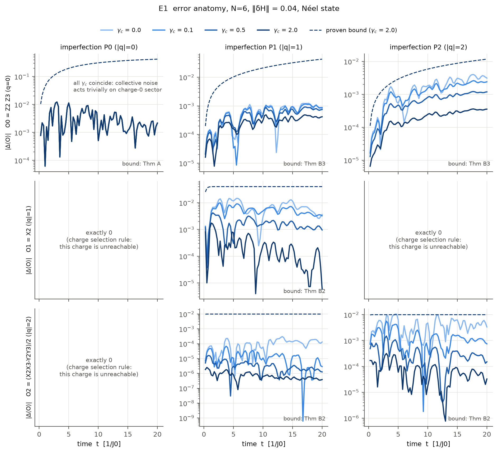
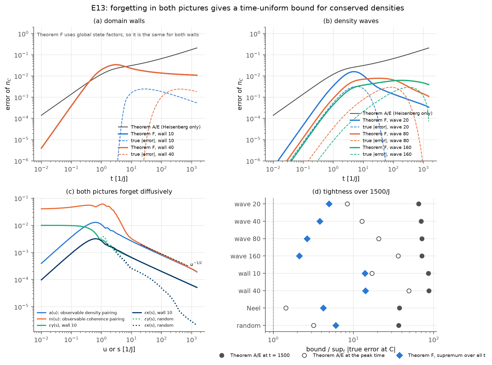
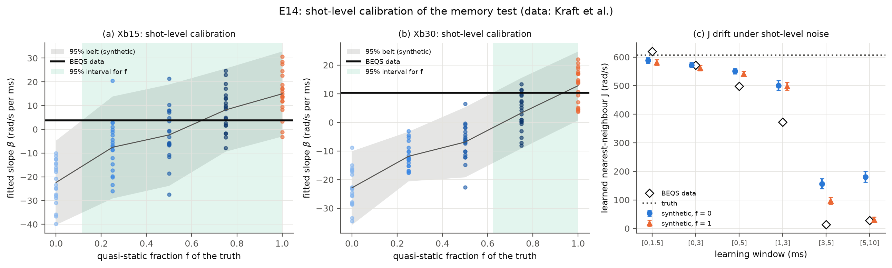
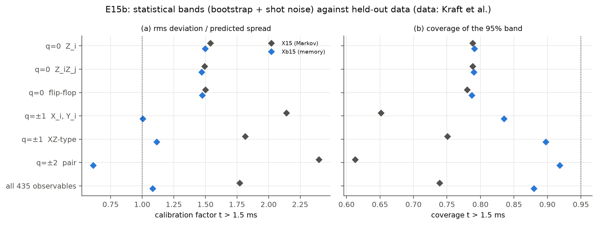
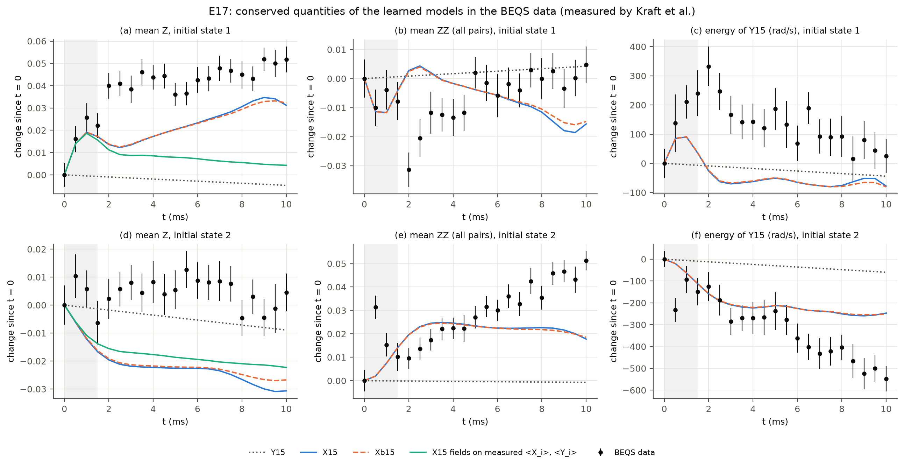
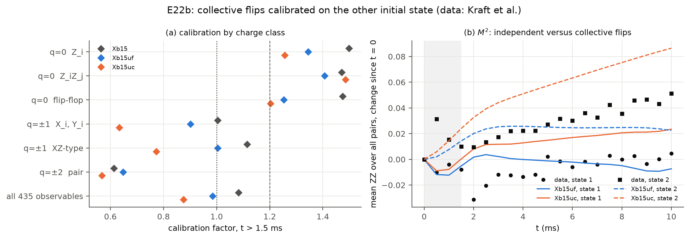
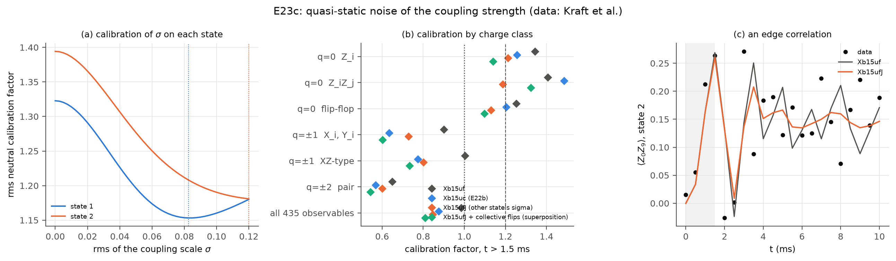

# 연구 한눈에 보기 (2026-11-06 기준)

지금까지의 연구를 처음부터 따라잡기 위한 안내서다. 수식은 줄이고 비유와 그림으로 설명한다. 숫자와 판정의 근거는 §10의 문서에 있다.

---

## 0. 세 줄 요약

**한 문장으로.** 양자 시뮬레이터에는 오차가 있을 수밖에 없다. 장치에 원래 있는 대칭과 dissipation을 이용해, 오차가 넘지 않는 상한을 실제 오차에 더 가깝게, 그리고 시간이 지나도 커지지 않게 증명한다. 또 그 보증이 기대는 noise 모델을 실제 실험 데이터로 검증한다. 실제 오차를 줄이는 기법(오류 정정, 오류 완화)이 아니라, 오차에 대한 보증을 촘촘하게 만드는 연구다.

1. **질문.** 불완전한 양자 시뮬레이터(이온 트랩)의 결과가 최대 얼마나 틀릴 수 있는지를 *증명된 숫자*, 즉 오차 상한으로 주고 싶다. 선행연구 BEQS가 이 상한을 처음 실험과 함께 냈지만, 상한이 시간에 비례해 커져서 짧은 시간에만 쓸모가 있었다.
2. **아이디어.** 장치에 원래 있는 두 가지를 쓴다. 하나는 **대칭**(총 자화 보존)이고, 다른 하나는 **dissipation**(특히 모든 이온에 똑같이 걸리는 집단 dephasing)이다. 그러면 오차의 일부는 장치가 스스로 지우고, 상한을 더 작게, 그리고 시간이 지나도 커지지 않게 만들 수 있다.
3. **현재.** 이론의 뼈대는 증명했고 시뮬레이션으로 확인했다. BEQS 공개 데이터를 다시 분석해, 장치의 집단 noise는 white가 아니라 느린 성분이 크다는 것을 보였다. 데이터에는 아직 모델로 설명되지 않는 신호가 둘 남아 있다(§5.4).

---

## 1. 출발점: BEQS가 한 일과 남긴 문제

### 1.1 양자 시뮬레이터는 완벽하지 않다

- 양자 시뮬레이터는 설계한 Hamiltonian H로 다른 양자계를 흉내 낸다. 실제 장치의 Hamiltonian은 조금 틀린 H + δH이고, 환경에서 오는 noise도 섞인다.
- 시뮬레이터를 쓰는 이유는 고전 컴퓨터로 풀기 어려운 문제를 풀기 위해서다. 그 영역에서는 정답을 따로 계산해 맞춰 볼 수 없다. 그래서 "결과가 최대 얼마나 틀렸는가"를 증명된 숫자로 주는 것이 결과를 믿을 유일한 근거다.

### 1.2 BEQS (Kraft et al., PRX 16, 031037 (2026))

- 칼슘 이온(⁴⁰Ca⁺) 트랩의 10-ion과 51-ion 시뮬레이터에서, 짧은 시간(0–1.5 ms) 데이터로 장치의 운동방정식(Hamiltonian + Lindbladian)을 **학습**했다.
- 이 장치는 **아날로그 방식**이다. 게이트를 차례로 거는 대신, 이온들 사이의 결합을 레이저로 계속 켜 두고 계가 Hamiltonian을 따라 저절로 변하게 둔다. "아날로그 대 게이트"는 구현 방식의 구분이고, "이온 트랩 대 초전도"는 하드웨어의 구분이다(Q23). 이온 트랩은 모든 이온이 같은 레이저와 자기장 속에 있어서 위상 noise가 공통으로 걸린다. 그래서 집단 dephasing이 강하다.
- 학습한 모델의 불확실성을 **오차 상한**으로 바꿨다. 상한은 대략 (Hamiltonian 오차의 크기) × (시간)이다.
- BEQS가 남긴 문제는 셋이고, 우리 연구는 이 셋을 직접 이어받는다.
  1. 상한이 시간에 비례해 커진다. BEQS도 "비교적 짧은 시간에만 정보가 있다"고 쓰고, 긴 시간으로 넓히는 것을 중요한 과제로 남겼다.
  2. 결론에서 "대칭과 decoherence-free subspace를 검증에 어떻게 쓸 수 있는지"를 향후 과제로 남겼다.
  3. 집단 dephasing을 white(기억 없는) noise로 모델링했다. 각주 73에서는 느린 자기장 요동이라면 다르게 기술해야 한다고 적었다.

---

## 2. 핵심 아이디어 네 가지

### 2.1 오차를 "charge"로 나눈다

- 이 장치의 이상적인 Hamiltonian(XY 모델)은 이온끼리 위/아래를 맞바꿀 뿐, 전체 "위" 스핀의 개수(총 자화 M)를 바꾸지 않는다. 이것이 U(1) 대칭이다.
- 모든 오차 δH는 두 부분으로 나뉜다.
  - **대칭을 지키는 부분 (charge 0).** M을 바꾸지 않는다. 예: 결합 세기 J가 조금 틀림, z 방향 자기장 오차.
  - **대칭을 깨는 부분 (charge q ≠ 0).** M을 q만큼 바꾼다. 예: 가로 자기장(q = ±1), 두 스핀을 함께 뒤집는 항(q = ±2).
- **오해하기 쉬운 점.** "대칭을 지킨다"는 상태가 그대로라는 뜻도, 모든 큐비트를 위아래로 뒤집는다는 뜻도 아니다. ↑의 개수만 그대로이고, 어느 이온이 ↑인지나 이온 사이의 상관은 얼마든지 바뀐다.

  | 변화 (스핀 3개) | ↑의 개수 M | 분류 |
  |---|---|---|
  | ↑↓↓ → ↓↑↓ (↑가 옆 이온으로 옮겨 감, XY 결합) | 1 → 1 | 대칭을 지킴 (charge 0) |
  | ↑↓↓ → ↑↑↓ (가로 자기장이 스핀 하나를 뒤집음) | 1 → 2 | 대칭을 깸 (charge +1) |
  | ↓↓↓ → ↑↑↓ (두 스핀을 함께 뒤집음) | 0 → 2 | 대칭을 깸 (charge +2) |
  | ↑↑↓ → ↓↓↑ (모든 스핀을 위아래로 반전) | 2 → 1 | 대칭을 깸 |

  - 예를 들어 결합 J가 5% 틀리면 ↑가 옮겨 다니는 속도가 틀려서 측정값이 달라진다. 대칭을 지키는 오차도 실제로 쌓이는 오차다.
  - 여기서 "대칭"은 모든 큐비트를 z축 둘레로 같은 각도만큼 돌려도 Hamiltonian이 같다는 뜻이다. 이 회전은 위/아래 확률을 바꾸지 않고 중첩의 위상만 돌린다.
  - 위아래 전체 반전(Z₂)은 다른 대칭이다. ↑의 개수를 M에서 N − M으로 바꾸므로, ↑와 ↓가 같은 수일 때를 빼면 M이 바뀐다.
  - 표기: 이 저장소에서는 |0⟩ = ↑ = Z의 +1 고유값이다. 그래서 "+1"과 "0"은 같은 상태를 가리킨다.
- 수학적으로는 U(1)의 표현론(Lie 대수 관점)으로 연산자를 분해하는 것이다. 처음 후보로 둔 "Lie algebra 관점"이 이 형태로 들어갔다.

### 2.2 선택 규칙: 대칭을 깨는 오차는 1차에서 보이지 않는다

- 자화나 ZZ 상관처럼 우리가 재는 charge 0 양은 같은 M끼리의 성분만 본다.
- 대칭을 깨는 오차가 한 번 작용하면 진폭이 다른 M으로 넘어간다. 그래서 1차 기여가 **정확히 0**이고, 두 번 작용해 돌아와야 보인다(2차).
- 확인: 오차 ε를 2배로 하면 관측 오차가 4배가 된다(E1에서 3.97–4.00배).
- **1차, 2차는 시간 순서가 아니라 오차 크기 ε의 차수다.** 대칭을 깨는 오차는 처음부터 계속 작용한다. 관측값의 변화가 ε에 비례하는 항 없이 ε²에 비례하는 항부터 시작한다는 뜻이다.
  - 상태가 M 칸에 있고, 오차가 크기 ε의 진폭을 다른 칸(M + q)으로 새게 한다고 하자: |ψ′⟩ ≈ |ψ⟩ + ε|φ⟩.
  - charge 0 관측량 O의 기댓값은 ⟨ψ|O|ψ⟩ + ε(⟨ψ|O|φ⟩ + 켤레) + ε²⟨φ|O|φ⟩다. O는 M이 다른 성분을 잇지 못하므로 ε 항이 정확히 0이다.
  - 그림으로 보면(큐비트 하나, 블로흐 구): 상태는 길이 1인 화살표이고 처음에 북극(↑)을 가리킨다. 대칭을 깨는 오차(가로 자기장)는 화살표를 작은 각도 θ만큼 기울인다. 측정값은 화살표의 그림자다.
    - 세로 그림자 ⟨Z⟩(charge 0)는 cos θ ≈ 1 − θ²/2라서 2차로만 바뀐다. θ = 0.1이면 0.0050, 0.2이면 0.0199 줄어 4배가 된다.
    - 가로 그림자 ⟨X⟩(charge 1)는 sin θ ≈ θ라서 1차로 바뀐다.
    - 북극은 높이가 가장 높은 꼭대기다. 언덕 꼭대기에서 옆으로 한 발 움직여도 높이는 거리의 제곱만큼만 낮아진다. 여러 큐비트에서는 "높이"가 ↑ 개수가 같은 칸 안의 양이고, "옆 방향"이 다른 칸이다.
  - 크기: ε = 0.01이면 대칭을 지키는 오차는 약 0.01, 대칭을 깨는 오차는 약 0.0001 규모의 측정 오차를 만든다.
  - 새어 나간 진폭이 다른 칸에 머무는 동안 집단 dephasing이 칸마다 다른 무작위 위상을 준다. 그래서 남은 2차 효과도 줄어든다(§2.3).
  - 이 그림은 초기 상태의 M이 정해져 있을 때(예: Néel 상태) 깔끔하다. BEQS 데이터처럼 여러 M이 섞인 초기 상태(x나 y로 누운 스핀)는 화살표가 처음부터 언덕 비탈에 있는 경우라서, 조금만 더 기울여도 높이가 1차로 바뀐다.

### 2.3 Zeno 억제: 집단 dephasing이 대칭을 깨는 오차를 지운다

- 집단 dephasing은 모든 이온에 똑같은 무작위 자기장이 걸리는 noise다. 각 상태는 자기 M에 비례하는 무작위 위상을 받는다.
- **그네 비유.**
  - 대칭을 지키는 오차는 M이 같은 상태끼리 연결한다. 두 상태가 같은 위상을 받으니 noise가 구분하지 못한다. 박자를 맞춰 미는 그네처럼 오차가 그대로 쌓인다.
  - 대칭을 깨는 오차는 M이 다른 상태끼리 연결한다. 밀 때마다 박자가 무작위로 바뀌니 밀기들이 서로 상쇄되어, 오차가 작게 쌓인다. 이것이 양자 Zeno 효과다.
- 억제 정도는 charge의 제곱에 비례한다(γ_c q²). 다만 noise가 느리면(준정적) 억제가 q² 대신 |q| 정도로 약해진다(정리 G).

### 2.4 Forgetting: 관측량도 상태도 과거를 잊는다

- dissipation이 있으면 계는 과거를 잊는다. 그래서 중간에 생긴 오차도 시간이 지나면 잊힌다(정리 A). 비유하면, 마찰이 있는 그릇 속 공은 잘못 밀려도 흔들림이 가라앉는다.
- 그런데 보존량(예: 자리마다의 자화 밀도)이 있으면 잊는 속도가 느리다. 밀도는 확산으로만 퍼지기 때문이다. 이때 관측량 쪽만 보고 상한을 만들면 상한이 √t로 커질 수밖에 없다. 이것을 증명한 것이 정리 E다. "이 방식으로는 안 된다"를 증명한 불가능성 정리라서 no-go라고 부른다.
  - 비유: 방 안의 열이 퍼지는 것을 열전도율을 조금 틀리게 넣고 시뮬레이션한다. 틀린 열전도율은 온도 차이가 있는 곳에서만 문제가 되고, 방 온도가 고르게 되면 아무 일도 하지 않는다.
  - 관측량만 보는 상한은 모든 초기 상태를 보증해야 하므로, 온도가 고르게 된다는 사실을 쓰지 못하고 매 순간 최악의 온도 차이를 가정한다. 그래서 상한이 √t로 자란다. 실제 오차가 자라는 것이 아니라 상한이라는 도구의 한계다.
- **해결.** 관측량뿐 아니라 상태도 확산으로 평평해진다는 것을 함께 쓴다. 두 쪽이 각각 1/√t로 줄어들고, 그 합성곱이 상수로 유계라서 상한이 시간이 지나도 커지지 않는다(정리 F).

*E1 (N = 6 정확 계산). 열은 오차의 charge, 행은 관측량의 charge다. 색이 진할수록 집단 dephasing γ_c가 크다. 왼쪽 위(대칭을 지키는 오차)에서는 모든 γ_c 곡선이 겹친다. 대칭을 깨는 오차(가운데, 오른쪽 열)는 γ_c가 클수록 작다. "exactly 0" 칸은 선택 규칙 때문에 오차가 정확히 0인 경우다. 점선(증명된 상한)은 늘 실제 오차 위에 있다.*

---

## 3. 연구 흐름

| 단계 | 날짜 | 한 일 |
|---|---|---|
| 1 | 11-04 | 기본 정리(선택 규칙, Zeno 억제, forgetting 상한)와 시뮬레이션 E1–E5 |
| 2 | 11-04 | 계 크기와 무관한 국소 상한, BEQS 10-ion 데이터 재학습, 51-ion 데이터 진단 |
| 3 | 11-04 ~ 05 | 불완전함의 charge 분류(정리 B6), 보존량이 있을 때의 no-go(정리 E), 데이터의 대칭 시험 |
| 4 | 11-05 ~ 06 | 기억이 있는 noise(정리 G), 시간 균일 상한(정리 F), 데이터의 모델 선택과 보정(E11–E17) |

2026-11-05부터 원고 작성은 보류하고, 결과는 연구 노트(`docs/`)에 기록하고 있다.

---

## 4. 증명한 것과 시뮬레이션으로 확인한 것

### 4.1 정리

| 결과 | 내용 | 쉬운 의미 | 상태 |
|---|---|---|---|
| 정리 A | 오차 ≤ ∫₀ᵗ ‖[δH, O_u]‖ du (O_u는 dissipation으로 잊혀 가는 관측량) | 관측량이 과거를 잊으면 상한이 포화한다 | 증명 |
| 정리 A2 | 기대 오차의 주항과 3차 나머지 | BEQS의 기대 오차 식보다 1.8–24배 작다 | 증명 |
| 정리 A3 | 학습 불확실성이 Gaussian일 때 예측의 집중 부등식 | dissipation이 있으면 예측 구간 폭이 시간에 따라 자라지 않는다 | 증명(11-06, 보조정리 A3.1) |
| 정리 B1 | charge가 맞지 않는 오차의 1차 기여는 0 | 선택 규칙 | 증명 |
| 정리 B2–B4 | Zeno 인자가 들어간 상한(모든 차수, 상수 명시) | 대칭을 깨는 오차의 상한이 γ_c q²로 줄어든다 | 증명 |
| 정리 B3′, 따름정리 B3-loc | 국소 관측량의 상한이 계 크기 N과 무관 | 큰 장치에도 쓸 수 있다 | 증명 |
| 명제 C | 감쇠율 불확실성을 Gaussian으로 두면 긴 시간에 비물리적 | log-normal을 써야 한다(BEQS의 10 ms 창에는 영향 없음) | 증명 |
| 정리 B6 | 보호 여부는 오차가 coherent인지 dissipative인지가 아니라 초연산자 charge가 정한다 | 위/아래를 같은 비율로 뒤집는 noise(공변 flip)는 집단 dephasing으로 보호되지 않는다 | 증명 |
| 정리 E | 보존 밀도의 "관측량만 보는" 상한은 √t로 자랄 수밖에 없다 | 기존 방식의 한계(no-go) | 증명 |
| 정리 G | 고전 집단 noise 일반에서 보호 인자: white는 1/Q², 준정적은 1/\|Q\| | noise가 느리면 보호가 약해진다 | 증명 |
| 정리 F, 명제 F.1 | 관측량과 상태가 둘 다 잊으면 시간 균일 상한 | 시간이 지나도 커지지 않는 상한 | 상호작용 없는(quasi-free) 사슬에서 가정 없이 증명 완료(11-06). 상호작용 사슬에서는 가정으로 남고, 수치로 지지된다 |
| 명제 F.4 | 강한 dephasing 극한에서 상호작용 사슬의 오차는 시간 척도 변경이고, 시간 균일성은 포물형 추정 하나와 같다 | 상호작용 사슬의 문제를 한 문장으로 줄였다 | SSEP에서 증명. 상호작용(KLS)은 거시판(Lemma F.5)과 평형 근처판을 증명했고, 미시판은 추측(N = 128까지 수치 지지, E16c) |

### 4.2 시뮬레이션

| 실험 | 무엇을 | 결과 |
|---|---|---|
| E1 | N = 6 정확 계산, charge별 오차 해부 | 선택 규칙 확인. \|q\| = 2 오차가 γ_c 0 → 2에서 약 11배 억제 |
| E2 | 정리 A 대 BEQS 상한 | 정리 A는 포화하고 BEQS 상한은 선형으로 증가(t = 40에서 41배 차이) |
| E3, E3b | BEQS 유형의 학습 불확실성 | 대칭 성분만 세면 상한이 √3배 촘촘하고, 기대 오차 상한은 BEQS 식보다 1.8–24배 작다. 다만 긴 시간(비섭동 영역)에서는 이득이 사라진다 |
| E5, E7 | free fermion, N = 20–200 | 국소 상한이 N과 무관하고, 전역 상한보다 700–1300배 촘촘. 짝 생성 오차가 35배 억제 |
| E8 | 불완전함의 세 분류 | 정리 B6 확인 |
| E10, E13 | 보존 밀도의 forgetting, N = 400 사슬 | 관측량만 보는 상한은 √t로 자라고, 정리 F는 모든 초기 상태에서 포화 |
| E12, E12b | 기억이 있는 noise | 정리 G의 스케일링 확인(커널 식과 0.4% 이내) |
| E13b–E13e | 정리 F 다듬기 | 실제 최대 오차의 1.04–2.1배까지 조였다. 명제 F.1의 빈 단계 두 개를 증명하고 수치로 확인 |
| E16 | 상호작용 XXZ 사슬, N = 10 | 정리 F의 그림이 상호작용에서도 유지되고, 정리 A보다 8–85배 촘촘 |

*E13. (a), (b)의 회색 선(정리 A/E, 관측량만 봄)은 시간이 갈수록 커진다. 색 실선(정리 F, 관측량과 상태를 함께 봄)은 포화하거나 줄어든다. 점선은 실제 오차다. (d)는 상한이 실제 최대 오차의 몇 배인지 보여 준다(파란 마름모가 정리 F).*

---

## 5. BEQS 공개 데이터 재분석

데이터는 Kraft et al.이 측정한 것이다. 우리는 공개된 원시 shot(Zenodo)을 독립적으로 다시 분석했다. 측정 기저는 파일에 없어서 t = 0 통계로 복원했다(원저자에게 확인 메일은 보내지 않기로 결정).

### 5.1 장치 모델

- **재학습 (E6).** 최근접 결합 J ≈ 617 rad/s이고 집단 dephasing이 지배적이다(γ_c ≈ 30 rad/s). U(1)을 깨는 결합은 통계적으로 0과 구별되지 않는다. 장치는 대체로 대칭적이다.
- **10-ion 오차 예산.** 2 ms에서 BEQS형 상한은 15다. 관측량의 범위가 2이므로 아무것도 보증하지 못한다. 같은 조건에서 우리 증명서는 0.39–0.58로 유효하다.
- **51-ion 진단.** 평균 자화의 이동은 D5/2 자발 붕괴로 정확히 설명되지만, 자화의 분산은 6배 빨리 커진다. 자발 붕괴 말고도 자화를 바꾸는 과정이 있다는 뜻이고, §5.4의 스핀 뒤집힘과 이어진다.
- **모델 선택 (E11).** 물리 제약을 넣은 단순한 모델이 전체 모델보다 미래 예측이 3배 정확하다(rms 0.040 대 0.118). 이 모델은 파라미터 122개로, 대칭을 지키는 결합, 이온별 자기장, 집단 dephasing, 시간에 따라 커지는 집단 rate만 쓴다. 전체 모델은 파라미터가 275개다.
- **인증.** 구조화 모델 조건부로 집단 dephasing 세기 γ_c ≥ 20.7 rad/s를 인증했다(E9).

### 5.2 집단 noise는 white가 아니다

- 데이터와 똑같은 방식으로 shot을 뽑은 합성 데이터로 검정을 보정했다(simulation-based calibration, E14).
- white 집단 noise는 3 ms 창에서 3.7–5.1σ로 기각된다. 느린(준정적) 성분이 대부분이고(비율 약 0.6–1), BEQS 각주 73의 가능성을 데이터로 지지한다.
- 기억(준정적 성분)을 넣은 모델은 charge가 있는 관측량의 예측만 고치고, charge 0 관측량은 그대로 둔다. "집단 noise는 charge q 블록에만 작용한다"는 Lemma G.0이 예측하는 패턴 그대로다(E15).

*E14. (a), (b)의 가로축은 합성 참의 준정적 비율 f다. 회색 띠는 그 참에서 나올 수 있는 기울기 β의 95% 범위이고, 검은 선이 실제 데이터다. 3 ms 창(b)에서 데이터는 f = 0(white)의 띠 밖에 있다. 1.5 ms 창(a)은 검정력이 부족하다.*

### 5.3 오차 띠는 얼마나 믿을 만한가 (E15)

- **증명된 띠(정리 A, 모든 초기 상태를 보증).** 보존량인 mean Z에서만 10 ms까지 의미가 있다. 나머지 관측량에서는 1–4 ms에 띠가 관측량의 범위보다 커져서 의미를 잃는다.
- **통계적 띠(bootstrap 재학습 + shot noise).** 증명된 띠보다 30–550배 좁고, 10 ms 내내 쓸모가 있다.
- 보정 인자는 실제 편차를 예측한 퍼짐으로 나눈 값이고, 1이면 띠가 잘 맞는다는 뜻이다. 기억 모델에서는 전체 1.08, charge가 있는 클래스 0.6–1.1, charge 0 클래스 약 1.5다.

*E15. 기억 모델(파란색)은 charged 클래스(q = ±1, ±2)를 1 근처로 고치지만, q = 0 클래스는 1.5에 남는다.*

### 5.4 아직 설명되지 않는 두 신호 (가장 최근 작업, 11-06)

**① charge 0 관측량에 남은 1.5배 오차 (E17).**
- 오차는 학습된 모델이 보존하는 세 양, 즉 자화, 자화의 제곱, 대칭 Hamiltonian의 에너지 방향에 몰려 있다. 그 방향의 보정 인자는 2.5–4.2이고, 나머지 방향은 1.3–1.6이다.
- 데이터는 세 보존 법칙을 모두 어긴다. 예를 들어 x 쪽으로 기운 초기 상태의 자화가 +0.044 변한다(z = 17).
- 자화 변화를 맞추려면 두 가지가 함께 필요하다.
  - 처음 약 2 ms 동안 작용하는 결맞은 가로 자기장
  - 계속 작용하는 비결맞은 스핀 뒤집힘(약 5 rad/s, D5/2 자발 붕괴의 약 12배)
- BEQS는 예측 구간 밖의 점을 제어 파라미터 표류나 배경 기체 충돌로 추정했다. 둘 다 주된 원인이 아니다.
  - 대칭 Hamiltonian이 표류해도 자화와 그 제곱은 그대로 보존된다.
  - 충돌형 shot은 0.3% 이하다.

**② charge-2 불균형 (E11e, E11f, E11g).**
- 이온마다 noise를 따로 맞추면 x축 noise와 y축 noise의 차이 S_XX − S_YY(charge ±2 성분)가 −94 rad/s로 나온다.
- 분석 방법이 만드는 편향(약 −20)을 빼도 −74가 남는다. 그러면 noise 행렬이 물리적이지 않은 모양(음의 rate)이 된다.
- 그럴듯한 후보 다섯 가지를 넣어 같은 분석을 시뮬레이션했지만, 어느 것도 이 값을 만들지 못했다(최대 −13). 후보는 기억이 있는 단일 이온 noise, 결합 세기의 느린 요동, 느린 noise 아래의 가로 자기장, 국소 dephasing 등이다. 학습 창의 한 시점을 빼도 남는다.
- 지금 가장 유력한 후보는 처음 수 ms 동안 변하는 대칭 파괴 동역학이다. 아직 시험하지 않았다.

**11-07 갱신 (E22, E22b).**
- **초기 상태.** 두 초기 상태는 Z 고유상태가 아니라 가로로 편극된 곱상태다(상태 1은 x 쪽, 상태 2는 y 쪽).
- **① 중성 오차.**
  - 처음 수 ms의 대칭 파괴 동역학을 여러 꼴로 넣어 보았다. 등방 폭발, 비등방 폭발, 국소 dephasing 폭발, 가로 장 폭발, 이온 간 상관이 있는 가로 noise다. 물리적인 형태로는 어느 것도 데이터를 설명하지 못한다.
  - 대신 늦은 기록에서 새 단서를 찾았다. M²(모든 쌍의 평균 ZZ)가 두 상태 모두에서 커진다. 이것은 여러 이온이 함께 뒤집히는 과정이 있어야만 생긴다.
- **② charge-2 불균형.** 초과분은 y로 편극된 상태 2에서 나온다. 11-09에 원인을 분해했다(§8). 상태 2의 0.5 ms 데이터 한 점과, 두 초기 상태가 서로 다른 조건에서 측정된 것처럼 보이는데도 하나의 모델로 함께 맞춘 것이 대부분을 만든다.

*E17. 학습된 모델이 보존하는 세 양을 t = 0 대비 변화로 그렸다. 점이 데이터다. 점선(Y15)은 완전히 대칭인 모델의 예측으로 거의 0이고, 실선은 가로 자기장이 있는 모델(X15, Xb15)의 예측이다. 데이터가 모델의 보존 법칙을 크게 벗어난다.*

---

## 6. 지금 어디에 서 있나

**잘 된 것**
- 이론의 뼈대(선택 규칙, Zeno 억제, forgetting, 시간 균일 상한)를 증명하고 수치로 확인했다. 명제 F.1은 11-06에 완성됐다.
- 우리 상한은 모든 비교에서 BEQS 상한보다 촘촘하다.
- 데이터 분석으로 장치에 대해 새로 안 것이 셋이다.
  1. 대칭을 강제한 단순한 모델이 3배 정확하다.
  2. 집단 noise는 white가 아니라 느린 성분이 크다.
  3. 학습 방법 자체의 편향을 정량화했다(창에 따른 J 표류의 일부, 음의 flip rate, 이온별 비물리적 noise 행렬).

**한계와 아직 아닌 것**
- BEQS 조건(약한 집단 noise, 짧은 시간)에서는 Zeno 억제가 작다(10 ms에서 15–43%). 이 영역에서 실제 이득은 주로 선택 규칙에서 나온다.
- 모든 초기 상태를 보증하는 상한은 실제 오차보다 10–100배 느슨하다. 데이터에서는 보존량에서만 오래 유효하다.
- 데이터에 모델로 설명되지 않는 것이 남아 있다(§5.4, §8). 11-09 작업까지의 정리는 다음과 같다.
  - 모든 이온에 공통인 U(1) 파괴 과정이 있다(M² 증가). 늦은 구간에서 선형이고 전역적이다.
  - 중성 분류의 남은 1.2–1.4배는 늦은 시간 진동의 박자(진동수) 오차다. 결합 요동, 상태별 생성자, 회차 매개변수 어느 것도 고치지 못했다. 원고에서는 띠의 경험적 보정으로 다룬다.
  - charge-2 불균형 K는 대부분 상태 2의 0.5 ms 한 점과 두 초기 상태의 불일치(회차 간 detuning 약 125 rad/s)에서 나온다. charge-2 소산의 증거가 아니다. 약 −50 rad/s가 남는다.
  - 상태 1의 늦은 charge-2 바닥이 있다.
  - 마지막 둘의 나머지는 공개 데이터로는 원인을 가를 수 없다.
- 상호작용이 있는 사슬에서 정리 F는 강한 dephasing 극한의 포물형 추정 하나로 줄었다. SSEP에서는 증명했다. 상호작용(KLS)에서는 거시판과 평형 근처판을 증명했고, 미시판은 N = 128까지 수치가 지지하는 추측이다. 미시판은 수학 문헌에서도 열린 문제다.

---

## 7. 우리 기여와 논문 계획

**먼저 인정할 것 (우리 것이 아님).**
- dissipation이나 noise가 대칭을 깨는 오차를 Zeno 효과로 억제한다는 메커니즘 자체. gauge 이론 양자 시뮬레이션 분야(Stannigel 2014, Halimeh–Hauke 그룹 등)에서 잘 알려져 있다.
- 집단 dephasing의 q² 감쇠, 정확한 고전 noise master equation, 보존량의 확산 꼬리.

**우리 기여.**

| # | 기여 | 근거 |
|---|---|---|
| 1 | 보존량이 있을 때 시간 균일한 오차 상한. 먼저 관측량만 보는 기존 방식은 √t로 자랄 수밖에 없음을 증명하고(no-go, 정리 E), 상태 쪽 정보를 더해 이 한계를 넘었다(정리 F). 상호작용 없는 사슬에서는 증명 완료, 상호작용 사슬은 수치로 지지 | 정리 E, F / E10, E13, E16 |
| 2 | BEQS 공개 데이터의 독립 재분석: 물리 제약 모델이 3배 정확, white noise 기각, 학습 편향 정량화, 보존량 위반 발견 | E6, E9, E11, E14, E15, E17 |
| 3 | 학습된 열린계 모델을 위한 대칭 분해 인증 상한(선택 규칙, 상수 명시, N 무관 국소판) | 정리 B1–B4, B3′ |
| 4 | 초연산자 charge에 따른 불완전함 분류와 γ_c 진단 | 정리 B6 / E8 |
| 5 | 보호 효과의 noise 스펙트럼 의존성(white 1/Q², 준정적 1/\|Q\|) | 정리 G / E12 |

**논문으로 묶으면.**
- **PRA:** 기여 3 + 4 + 2(모델 선택). "학습된 모델의 오차 인증을 대칭과 dissipation으로 촘촘하게 하고 실데이터에 적용한다." BEQS의 자연스러운 후속작이다.
- **PRX:** 기여 1 + 5 + 2(white noise 기각). "보존량과 기억이 있는 noise 아래의 장시간 인증."
- 원고(`paper/`, 로컬 전용, 공개 저장소에 올리지 않음)는 11-05부터 보류 중이다.

---

## 8. 남은 검증의 결과와 다음 단계

**11-06에 수행한 검증 (자세한 내용은 [research-qa.md](research-qa.md) Q24, [results/summary.md](results/summary.md) §9.9–9.10).**

| # | 검증 | 결과 |
|---|---|---|
| 1 | 측정 기저 민감도 (E18) | 결론은 그대로다. 다만 사전 규칙으로는 18개 비교 중 2개가 경계를 살짝 넘어 "실패"로 기록됐다 |
| 2 | 10-ion / 51-ion 교차 확인 (E19) | 정상 상태 flip rate가 2–3 /s로 일치한다. 학습 창에서만 튄다(첫 1 ms의 과도 과정) |
| 3 | charge-2 불균형의 마지막 후보 (E11h) | 첫 1 ms의 flip 폭발이 일부(최대 4분의 1)를 설명한다. 대부분은 여전히 열려 있다 |
| 4 | 중성 1.5배 고치기 (E20) | 균일 가로 장과 flip을 넣은 모델이 중성 인자를 1.25–1.41로, 전체를 0.99로 낮춘다. 남는 것은 초기 폭발이다 |
| 5 | 정리 A3 증명 | 완성했다(보조정리 A3.1, McShane 확장) |
| 6 | 정리 F의 상호작용 확장 (명제 F.4, E16b) | 강한 dephasing 극한에서 대칭 KLS 과정의 포물형 추정 하나로 줄였다. SSEP에서는 증명했고, KLS는 추측이다(수치가 지지) |
| 7 | 전체 재현 | 원고 재개 시 |

**11-07에 수행한 남은 과제 (자세한 내용은 [research-qa.md](research-qa.md) Q25, [results/summary.md](results/summary.md) §9.11).**

| # | 과제 | 결과 |
|---|---|---|
| 1 | 첫 1 ms의 정체 (E22, E22b) | 큰 등방 flip 폭발은 전체 관측량으로는 지지되지 않는다. 데이터가 원하는 비등방 성분은 어떤 꼴로도 물리적이지 않다. 대신 늦은 기록에서 M²가 커진다는 것을 찾았다. 이것은 이온 사이에 상관된 뒤집힘이 있어야만 생긴다. 집단 flip을 넣으면 전체 예측 인자가 0.88로 가장 좋아지지만, 중성 인자는 1.2 아래로 내려가지 않는다(사전 규칙 실패) |
| 2 | 대칭 KLS 과정의 포물형 추정 (Lemma F.5, E16c) | 필요한 미시적 명제는 수학 문헌에도 없다(Gu–Yang 2025는 평형 분산만 다룬다). 거시 방정식 수준과 평형 근처에서는 증명했다. N = 128까지의 Monte Carlo는 사전 기준 네 개를 모두 충족한다. P는 N과 무관하고 SSEP 상수 아래다 |
| 3 | charge-2 불균형의 나머지 (E22 (C)) | 초과분은 y로 편극된 상태 2에서 나온다(사전 등록 판정). 상태 1의 늦은 charge-2 바닥은 별개 현상이다. 원인을 공개 데이터로 가를 수 없어 한계로 쓴다 |

*E22b. (a) charge 분류별 표본 외 보정 인자. 주황(Xb15uc, 집단 flip)이 charged 분류와 전체에서 가장 좋지만, 중성 Z_iZ_j는 1.2를 넘는다. (b) 모든 쌍의 평균 ZZ(M²에 비례)의 변화. 점이 데이터다. 독립 flip 모델(파랑)은 평평하거나 줄어들고, 집단 flip 모델(주황)은 커진다. 상태 2(점선)에서는 처음부터 너무 빨리 커진다.*

**11-09: 다음 후보와 실패한 부분의 재수행 (자세한 내용은 [research-qa.md](research-qa.md) Q26, [results/summary.md](results/summary.md) §9.12).**

| # | 항목 | 결과 |
|---|---|---|
| 1 | 상관된 뒤집힘의 모양 (E23) | 2 ms 이후 일정한 속도로 작용하고, 사슬 끝에서 끝까지 상관이 줄지 않는다. 모든 이온에 공통인 과정이다. 초반 억제는 없고, 상태 2의 0.5 ms에 한 번 튄다 |
| 2 | 중성 오차가 1.2 아래로 안 내려간 원인 (E23) | 늦은 시간 결맞은 진동의 박자(위상) 오차다. 진동 크기는 맞다. 상태 2의 끝 이온 쌍에 몰려 있어 flip 계열로는 원리적으로 고칠 수 없다. 학습 창을 늘리면 오히려 나빠진다 |
| 3 | 재수행: 결합 세기 요동, 상태별 생성자, 회차 매개변수 (E23c, E23s) | 셋 다 사전 규칙 실패. 결합 요동은 숫자상 거의 통과했지만(Z_i 1.213), 진동을 뭉개 평균만 맞춘 평활화 효과였다(데이터의 진동은 뭉개지지 않았다) |
| 4 | charge-2 불균형 K의 원인 (E23k) | 상태 2의 0.5 ms 한 점과 두 초기 상태의 불일치(회차 간 detuning 약 125 rad/s)가 대부분이다. K는 charge-2 소산의 증거가 아니다. 약 −50 rad/s가 남는다 |
| 5 | A1 재판정 (E18b) | 다중비교를 고려한 규칙으로는 통과한다(사후 판정) |

*E23c. (a) 각 상태의 중성 잔차를 최소로 하는 결합 요동 σ. (b) 분류별 보정 인자. 결합 요동(주황)이 중성 분류를 1.2 근처까지 낮춘다. (c) 끝 이온 상관 ⟨Z₀Z₉⟩. 데이터(점)는 10 ms까지 크게 진동하는데, 결합 요동 모델(주황)은 진동을 뭉갠다. 인자가 좋아진 이유가 이것이다.*

**다음 단계 후보.**

1. 늦은 시간 위상 오차: 학습 창을 늘리지 않고 진동수만 정밀하게 맞추는 적합을 시도하거나, 원고에서는 띠의 경험적 보정(인자 1.2–1.4)으로 다룬다.
2. K의 남은 약 −50 rad/s, 상태 2의 0.5 ms 시점, 상태 1의 charge-2 바닥은 공개 데이터로 더 가를 수 없다. 원고에 한계로 쓴다.
3. KLS의 미시적 추정은 열린 문제로 원고에 명시한다.
4. 확장 후보: 물리 모델로 설명되지 않는 잔차를 신경망 연산자(QNO/QuanONet)로 보완하는 후속 논문, 그리고 게이트 기반 디지털 시뮬레이션(Q22). 게이트 기반에서 가장 새로울 수 있는 것은 보존량이 있는 디지털 열린계 시뮬레이션의 시간 균일 Trotter 상한(정리 F)이다.

---

## 9. 용어 풀이

| 용어 | 뜻 |
|---|---|
| 아날로그 / 게이트(디지털) 시뮬레이션 | Hamiltonian을 계속 켜 두고 저절로 변하게 하는 방식 / 짧은 게이트를 차례로 걸어 시간 변화를 쪼개 흉내 내는 방식. 하드웨어(이온 트랩, 초전도, 중성 원자)와는 별개의 구분이다 |
| Hamiltonian | 계의 에너지와 결맞은 시간 변화를 정하는 연산자 |
| Lindbladian (Lindblad 방정식) | 환경에서 오는 noise까지 넣은 운동방정식. 우리가 학습하는 대상 |
| dissipation | 환경으로 정보가 새어 나가는 효과. 오차도 함께 잊게 하는 좋은 면이 있다 |
| dephasing | 위/아래 확률은 그대로 두고 중첩의 위상만 흐트러뜨리는 noise |
| 집단 dephasing | 모든 이온이 똑같은 위상 흔들림을 받는 경우 |
| U(1) 대칭, 총 자화 M | 위 스핀의 개수가 보존되는 성질 |
| charge q | 연산자가 M을 얼마나 바꾸는지 |
| 선택 규칙 | charge가 맞지 않으면 1차 기여가 정확히 0 |
| 양자 Zeno 효과 | 빠른 무작위화(측정이나 noise)가 특정 전이를 막는 효과 |
| 오차 상한, 인증 | "오차는 이 값을 넘지 않는다"는 증명된 숫자 |
| no-go 정리 | "이 방식으로는 안 된다"를 증명한 불가능성 정리(예: 복제 불가능 정리). 여기서는 정리 E |
| white noise / 준정적 noise | 기억이 없는 빠른 요동 / 한 번의 실행(shot) 동안 거의 고정된 느린 요동 |
| integral method | 운동방정식을 시간에 대해 적분해 선형 최소제곱으로 파라미터를 학습하는 방법. 신경망이 아니다 |
| bootstrap | 측정 설정을 다시 뽑아 학습의 불확실성을 구하는 방법 |
| SBC (simulation-based calibration) | 데이터와 똑같은 방식으로 만든 합성 데이터로, 분석 방법의 편향과 검정력을 재는 것 |
| 보정 인자 | 실제 편차 / 예측한 퍼짐. 1이면 띠가 잘 맞는다 |
| Kossakowski 블록 | 이온 하나의 noise를 x, y, z 축 사이의 행렬로 쓴 것. 물리적이면 음의 고유값이 없다(PSD) |
| CP-가분성 | 시간마다의 rate가 음이 되지 않는 성질. 깨지면 noise에 기억이 있다는 신호 |
| hypocoercivity | 일부 방향에만 감쇠가 있어도 전체가 감쇠함을 보이는 수학 기법. 명제 F.1의 증명에 썼다 |

---

## 10. 더 읽을 곳

- 질문별 쉬운 설명: [research-qa.md](research-qa.md) (Q1–Q16)
- 실험별 수치와 판정: [results/summary.md](results/summary.md)
- 선행연구 대비 새로움: [literature/novelty-check.md](literature/novelty-check.md)
- 정리와 증명: [theory/error-anatomy-theory.md](theory/error-anatomy-theory.md)(1–2단계), [theory/phase3-theory.md](theory/phase3-theory.md), [theory/phase4-theory.md](theory/phase4-theory.md)
- BEQS 데이터 구조와 규약: [data/beqs-data-notes.md](data/beqs-data-notes.md)
- 그림: `results/*.png` (PDF는 원고용)
