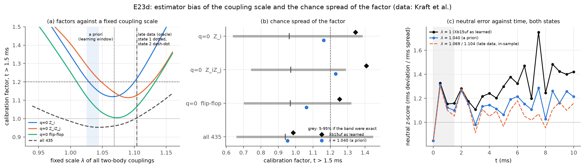
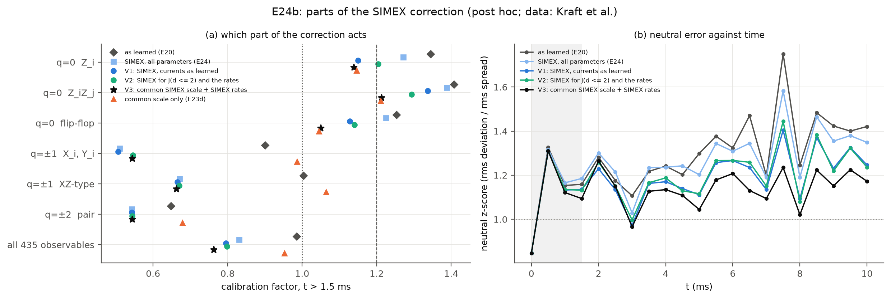
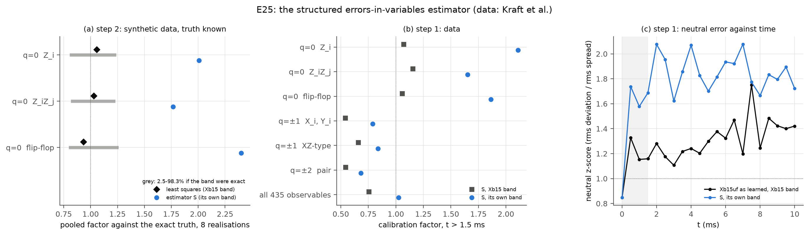
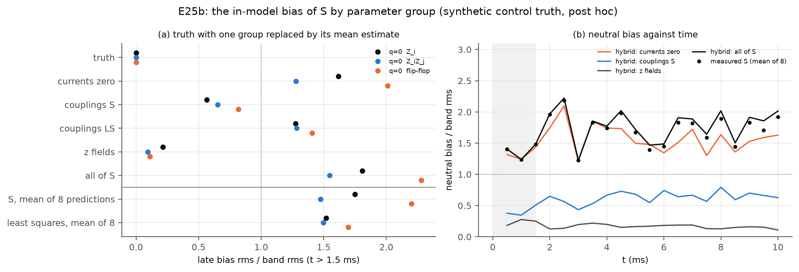
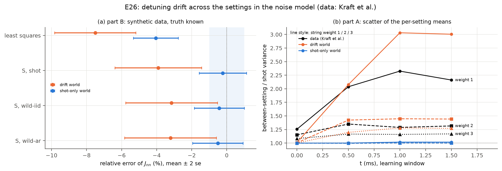
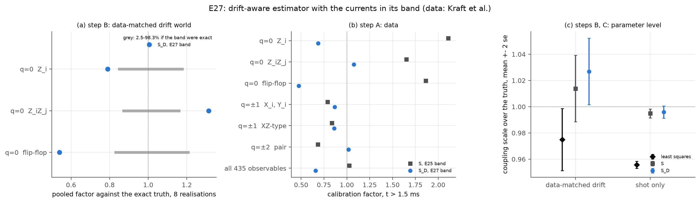
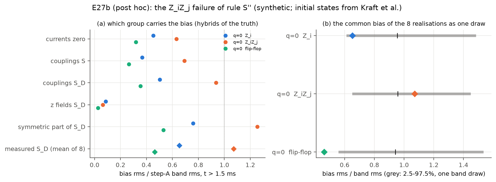
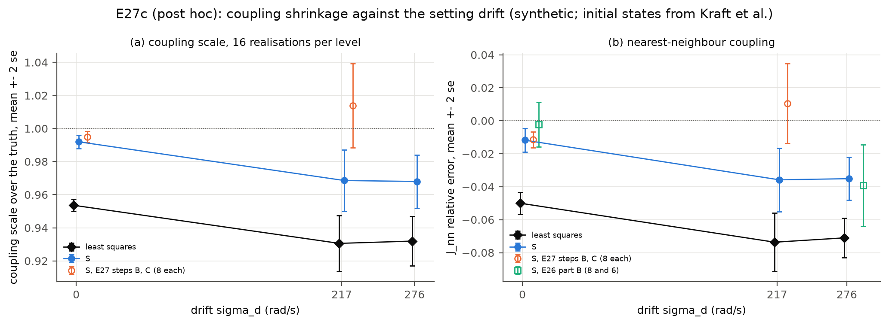
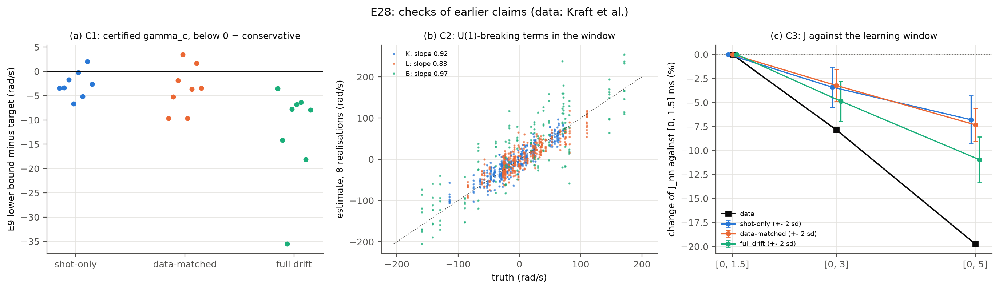
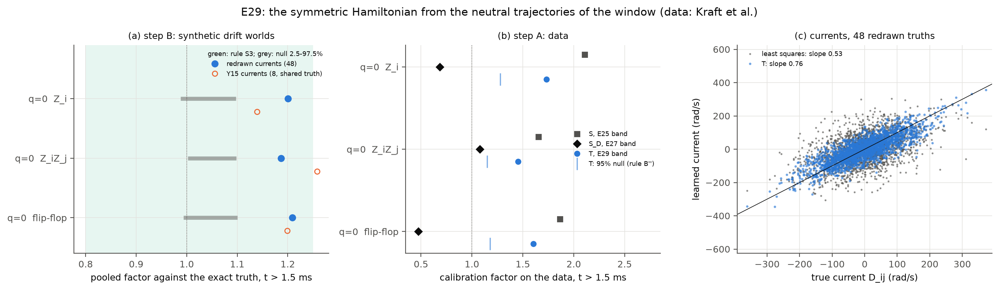

# 연구 설명 Q&A (쉬운 설명)

2026-11-05 기준. 연구 진행 중에 나온 질문과 답을 쉬운 말로 정리했다. 기술적인 세부는 다음 문서에 있다.
- 전체 흐름(처음 읽을 때): `docs/research-overview.md`
- 결과: `docs/results/summary.md`
- 정리와 증명: `docs/theory/`
- 선행연구 점검: `docs/literature/novelty-check.md`

---

## Q1. 무엇을 연구하나?

양자 시뮬레이터(예: trapped ion)는 설계한 Hamiltonian을 완벽하게 구현하지 못한다. 실제 장치의 Hamiltonian은 조금씩 틀려 있고, noise도 섞인다.

연구 질문은 이것이다. **"불완전한 장치로 시뮬레이션한 결과가 최대 얼마나 틀릴 수 있는지, 보증된 상한(bound)을 줄 수 있는가?"**

- **선행연구 BEQS** (Kraft et al., PRX 16, 031037 (2026))
  - 이런 상한을 처음으로 실험 데이터와 함께 제시했다.
  - 하지만 시간이 지날수록 상한이 계속 커져서, 짧은 시간에만 쓸모가 있다.
- **우리 아이디어**
  - 장치에 원래 있는 dissipation(특히 모든 이온에 똑같이 걸리는 집단 dephasing)과 대칭(총 자화 보존)을 이용한다.
  - 그러면 상한을 훨씬 촘촘하고 오래 유지할 수 있다.

## Q2. "상한을 줄인다"는 것은 특별한 실험 기법인가, 수학적 증명인가?

**수학적 증명이다.** 장치나 실험을 바꾸는 기법(오차 보정, 오차 완화)이 아니다. 실제 오차는 그대로 두고, "오차가 절대 이 값을 넘지 않는다"는 보증을 더 작은 숫자로 증명한다.

- **비유.** 다리가 견디는 무게를 계산할 때, 구조를 모르면 안전 여유를 크게 잡아 쓸모없는 보증("1톤까지 안전")이 나온다. 구조를 알면 같은 안전 보증을 정확하게("10톤까지") 줄 수 있다.
- **BEQS의 상한.** 대략 (Hamiltonian 오차의 크기) × (시간)이다. 장치의 구조를 쓰지 않은 최악의 경우라서 시간에 따라 계속 커진다.
- **우리 작업.** 장치가 원래 가진 구조(대칭, dissipation)를 계산에 넣어 같은 보증을 훨씬 작은 숫자로 증명한다.
- **진행 순서.** 정리를 증명하고, 시뮬레이션으로 상한이 항상 실제 오차 위에 있는지 확인하고, BEQS 실험 데이터에 적용한다.

## Q3. dissipation, dephasing, 집단 dephasing, 대칭이란 무엇이고, 왜 이용하나?

- **dissipation (열린계).**
  - 고립된 양자계는 정보를 영원히 기억한다. 그래서 중간에 생긴 실수도 끝까지 남아 쌓인다.
  - 실제 장치는 환경과 조금씩 상호작용하며 정보를 잃는다. 이것이 dissipation이다.
  - 보통은 나쁜 것이지만, **과거의 실수도 함께 잊어버린다**는 좋은 면이 있다.
  - 비유: 그릇 속의 공. 마찰이 없으면 한 번 잘못 밀린 공은 계속 엉뚱하게 굴러다니고, 마찰이 있으면 흔들림이 가라앉는다.
- **dephasing.** dissipation의 한 종류다. 스핀이 위인지 아래인지는 그대로 두고, 중첩 상태의 위상만 무작위로 흐트러뜨린다. 원인은 스핀의 회전 주파수가 흔들리는 것이다(자기장, 레이저 주파수 요동).
- **집단 dephasing.**
  - 모든 이온이 *똑같은* 흔들림을 받는 경우다.
  - 비유: 모든 사람의 시계가 똑같이 빨라지거나 느려진다. 사람들 사이의 상대 시간은 그대로지만, "절대 시각"과의 관계는 엉망이 된다.
  - 그래서 집단 dephasing은 *총 자화가 같은 상태들 사이의 관계는 건드리지 못하고*, 총 자화가 다른 상태들 사이의 중첩만 지운다.
- **대칭 (총 자화 보존).** 이 장치의 이상적인 Hamiltonian(XY 모델)은 이온끼리 위/아래를 맞바꿀 뿐, 전체 "위" 스핀의 개수는 바꾸지 않는다. 그래서 동역학은 "총 자화가 같은 방" 안에서만 일어난다.
- **왜 이용하나.** 둘이 만나면 어떤 오차는 장치가 저절로 지운다는 것을 증명할 수 있다(Q4). 그 몫만큼 상한이 작아진다.

## Q4. 왜 집단 dephasing은 대칭을 깨는 오차만 지우고, 대칭을 지키는 오차는 못 지우나?

한 줄로 말하면 이렇다. **집단 dephasing은 총 자화(M)가 서로 다른 상태들 사이의 위상만 흐트러뜨린다.** 대칭을 깨는 오차는 바로 그런 연결(M이 다른 상태 사이)을 만들고, 대칭을 지키는 오차는 M이 같은 상태끼리만 연결한다.

**스핀 2개 예시.** 집단 dephasing은 모든 스핀에 똑같은 무작위 자기장이 걸리는 것이다. 각 상태는 자신의 M에 비례하는 무작위 위상 e^{−iMφ}를 받는다.

| 상태 | M | 받는 무작위 위상 |
|---|---|---|
| ↑↑ | +1 | e^{−iφ} |
| ↑↓, ↓↑ | 0 | 없음 (둘이 같음) |
| ↓↓ | −1 | e^{+iφ} |

- **대칭을 지키는 오차** (예: 결합 J가 조금 틀림). 이 오차는 ↑↓ ↔ ↓↑를 바꾼다. 둘 다 M=0이라 같은 위상을 받으므로 noise가 구분하지 못한다. 그래서 오차는 noise가 없을 때처럼 쌓인다.
- **대칭을 깨는 오차** (예: 가로 자기장, 쌍 생성 항). 이 오차는 ↓↓ → ↑↑처럼 M을 바꾼다. 원래 성분과 오차 성분이 서로 다른 무작위 위상을 받는다.

**왜 지워지나 (그네 비유).** 오차는 매 순간 조금씩 "잘못된 진폭"을 만든다.
- 박자를 맞춰 밀면 그네가 점점 크게 흔들린다. 대칭을 지키는 오차가 이렇고, 틀릴 확률이 t²로 커진다.
- 박자가 매번 무작위면 밀기들이 상쇄된다. 대칭을 깨는 오차가 이렇다.
  - 짧은 기억 시간(약 1/(2γ_c Q²)) 안에서 만든 진폭끼리만 보강된다.
  - 그래서 확률이 t에만 비례하고, 크기도 작다. 이것이 **양자 Zeno 효과**다.
  - 자화를 많이 바꿀수록(Q가 클수록) 더 강하게 억제된다.

**처음부터 안 보이는 이유 (선택 규칙).**
- 우리가 재는 관측량(Z, ZZ, 자화)은 같은 M끼리의 성분만 본다.
- 대칭을 깨는 오차가 한 번 작용하면 진폭이 다른 M으로 넘어갈 뿐이라, 1차에서는 기여가 **정확히 0**이다.
- 두 번 작용해 원래 M으로 돌아와야 보인다(2차). 이 2차 효과를 집단 dephasing이 다시 억제한다.

## Q5. 그러면 오차는 두 종류뿐이고, 하나는 상쇄되어 작게 쌓이고 하나는 크게 쌓이는 것인가?

큰 그림은 맞다. 정확히 하려면 다음을 보탠다.

1. **"두 종류의 오차"라기보다 "모든 오차를 두 부분으로 나눈다"가 정확하다.** 실제 오차 하나에는 두 부분이 섞여 있다. 대칭을 깨는 부분은 Q = ±1, ±2, …로 다시 등급이 나뉘고, Q가 클수록 더 강하게 억제된다.
2. **상쇄는 한 오차가 서로 다른 시각에 만든 효과끼리 일어난다.** 서로 다른 오차끼리 상쇄되는 것이 아니다. 그 전에 1차 기여가 0이라는 선택 규칙이 먼저 작동한다.
3. **대칭을 지키는 오차는 "크게 쌓인다"기보다 "집단 dephasing의 보호를 못 받는다"가 정확하다.**
   - 다른 dissipation이나, 상태 자체가 정보를 잃는 효과로는 여전히 줄어들 수 있다(정리 A, F).
   - 다만 보호가 없으니 인증에서 핵심이다. 실제로 BEQS 데이터에서 마지막까지 남은 오차도 이쪽이었다.
4. **이 그림이 가장 깔끔한 조건.**
   - 초기 상태와 관측량의 총 자화가 정해져 있을 때다(예: Néel 상태).
   - BEQS처럼 처음부터 여러 자화가 섞인 상태에서는 대칭을 깨는 오차도 1차로 보일 수 있다(E11의 자화 표류).
   - noise가 느리면 억제가 약해진다(정리 G).

## Q6. BEQS는 모델을 만들어 오차를 보증했는데, 우리는 모델 없이 대칭과 dissipation으로 보증하나?

**아니다. 우리도 BEQS와 같은 "학습된 모델"을 쓴다.** 다른 것은 모델의 불확실성을 오차 bound로 바꾸는 방법이다.

| | BEQS | 우리 |
|---|---|---|
| 모델 | 짧은 시간 데이터로 Hamiltonian과 Lindbladian을 학습 (불확실성 포함) | 같은 종류의 학습된 모델 사용 (공개 데이터로 직접 재학습도 함) |
| 오차의 원인 | 모델 파라미터가 실제와 조금 다름 (학습 불확실성, 보정 오차) | 같음 |
| 오차를 bound로 바꾸는 방법 | (파라미터 편차 크기) × (시간). 구조를 무시한 최악의 경우 | 편차를 대칭을 깨는 부분과 지키는 부분으로 나누고, 깨는 부분은 dissipation이 지운다는 점을 이용 |
| 결과 | 짧은 시간만 유효 | 더 촘촘하고 더 오래 유효 (10-ion, 2 ms에서 bound 15 → 0.39) |

추가로 두 가지가 있다.
- **모델이 거의 필요 없는 진단.**
  - 51-ion 데이터의 자화 분포 진단은 z-기저 측정만으로 강한 대칭 위반을 찾는다.
  - 집단 dephasing 세기를 바꿔 보는 진단(따름정리 B6′)으로 오차의 종류를 가린다.
  - 선택 규칙은 기준 모델이 대칭적이라는 사실만 쓴다.
- **모델을 더 잘 만드는 것도 기여다.** 대칭과 물리 제약을 강제한 모델(파라미터 122개)이 원래 모델(275개)보다 미래 예측이 3배 정확했다(E11).

## Q7. 오차 상한을 알면 무엇을 얻나?

한 줄로 말하면 **양자 시뮬레이터의 결과를 "믿을 수 있는 숫자"로 만든다.** 실험값에 오차 막대가 없으면 과학적 근거로 쓸 수 없는 것과 같다.

1. **고전 컴퓨터로 확인할 수 없는 결과도 믿을 수 있다.**
   - 양자 시뮬레이터는 고전 컴퓨터로 못 푸는 문제를 풀려고 만든다. 그 영역에서는 정답을 따로 계산해 확인할 방법이 없다.
   - 그래서 보증된 상한이 유일한 근거다. "양자 이점"을 주장하려면 꼭 필요하다.
2. **더 긴 시간을 인증할 수 있다.**
   - 관측량 범위가 ±1인데 상한이 15이면 아무것도 보증하지 못한다.
   - 우리 상한은 같은 상황에서 0.39–0.58이었다.
   - 정리 F로 시간이 지나도 커지지 않는 상한을 얻었다.
3. **실험자에게 무엇을 고쳐야 할지 알려 준다.**
   - 자화를 바꾸지 않는 오차(결합 J, z 방향 자기장)를 우선 고친다.
   - 자화를 바꾸는 오차는 장치가 저절로 지운다.
   - 전역 위상 noise를 일부러 넣어 위험한 오차를 억제하는 설계도 가능하다.
4. **장치를 더 잘 이해하고 측정 비용을 줄인다.**
   - 학습할 파라미터가 줄었다(275 → 122).
   - noise의 성질도 새로 밝혔다: 국소 dephasing은 거의 없고, white noise가 아니라 느린 성분이 크다.

## Q8. 지금까지 무엇을 했고, 결과는?

| 단계 | 한 일 | 결과 |
|---|---|---|
| 1 | 기본 정리(선택 규칙, Zeno 억제, forgetting bound) | 수치 검증 통과, BEQS bound보다 항상 촘촘함 |
| 2 | 계 크기와 무관한 bound, BEQS 공개 데이터 재학습 | 대칭을 깨는 결합은 데이터에서 0과 구별되지 않음 |
| 3 | 불완전함의 세 분류(Hamiltonian이든 dissipation이든 charge가 결정) | 보존량이 있으면 기존 방식 bound는 √t로 커질 수밖에 없음을 발견 |
| 4 | 느린 noise, 시간 균일 bound, 실데이터 모델 선택 | 아래 참고 |

4단계 결과는 다음과 같다.
- **느린 noise.** 보호는 남지만 약해질 수 있다. 같은 조건에서 |Q|=2 오차 보호가 최대 약 1.8배 약하다.
- **시간 균일 bound.** "관측량도 상태도 정보를 잃는다"는 두 면을 함께 쓰면, 시간이 지나도 커지지 않는 상한이 나온다. 수치에서 모든 초기 상태에 대해 성립했다.
- **실데이터.**
  - 물리적으로 단순한 모델이 3배 정확하다.
  - 집단 noise는 white noise가 아니다(보정된 시험으로 4.9–8.1σ 기각).
  - 학습 창에 따른 결합 변화의 일부는 학습 방법의 편향이다.

## Q9. 관련 연구와 겹치나?

- 우리 작업 전체를 그대로 한 연구는 찾지 못했다.
- **가장 큰 겹침은 핵심 메커니즘이다.** dissipation, noise, 에너지 벌점, 무작위 대칭 변환이 대칭을 깨는 오차를 Zeno 효과로 억제한다는 것은 gauge 이론 양자 시뮬레이션의 중심 주제다. 대표 문헌은 다음과 같다.
  - Stannigel et al. 2014
  - Halimeh–Hauke 그룹
  - Lamm et al. 2020
  - 수학적 일반 이론: Zanardi–Campos Venuti, Burgarth–Facchi
- 그래서 "Zeno 억제" 자체를 새로움으로 내세우면 안 된다.
- 주장별 겹침 정도와 포지셔닝 권고는 `docs/literature/novelty-check.md` §6에 있다.

## Q10. 그러면 우리 연구의 novelty와 기여는?

한 줄로 말하면 이렇다. **BEQS가 시작한 "학습된 모델로 양자 시뮬레이션의 오차를 보증하는 일"을, 장치에 원래 있는 대칭과 dissipation을 이용해 훨씬 촘촘하고 오래 가게 만들었다. 그리고 그 보증이 기대는 전제(noise 모델)를 실험 데이터로 검증했다.**

| # | 기여 | 새로움 | 근거 |
|---|---|---|---|
| 1 | 보존량이 있는 동역학에서 시간이 지나도 커지지 않는 오차 bound. "관측량만 보는 bound는 √t로 자랄 수밖에 없다"는 no-go와 그 해결 | 높음 | 정리 E, F / E10, E13 |
| 2 | BEQS 공개 데이터의 독립 재분석: 물리 제약 모델이 3배 정확, white 집단 noise 기각, 학습 방법의 편향 정량화 | 높음 (데이터 결과) | E6, E9, E11 |
| 3 | 학습된 열린계 모델을 위한 대칭 분해 인증 bound: 선택 규칙으로 오차 예산 축소, 상수가 명시된 모든 차수 bound, 계 크기 무관 국소판 | 중간 (메커니즘은 알려짐, 인증 도구로서 새로움) | 정리 B1–B4, B3′ |
| 4 | 불완전함의 charge 분류: coherent인지 dissipative인지가 아니라 초연산자 charge가 보호 여부를 정함, γ_c 진단 | 중간 | 정리 B6 / E8 |
| 5 | 보호 효과가 noise 스펙트럼에 따라 달라짐 (white 1/Q², 느린 noise 1/\|Q\|) | 중간 (따름정리급) | 정리 G / E12 |

**우리 것이 아닌 것 (먼저 인정할 것).**
- dissipation이나 noise가 대칭을 깨는 오차를 Zeno 효과로 억제한다는 메커니즘 자체
- 집단 dephasing의 q² 감쇠
- 정확한 고전 noise master equation
- 보존량이 있을 때의 확산 꼬리
- 회귀 변수에 noise가 있을 때의 편향 일반론

**논문으로 묶는다면.** 2026-11-10에 사용자가 이 분할로 확정했다(Q34).
- **PRA:** 기여 3 + 4 + 2(모델 선택). 메시지는 "학습된 모델의 오차 인증을 대칭과 dissipation으로 촘촘하게 하고, 실데이터에 적용한다"이다. BEQS의 자연스러운 후속작이다.
- **PRX:** 기여 1 + 5 + 2(white noise 기각). 메시지는 "보존량과 기억이 있는 noise 아래에서의 장시간 인증"이다.
- 처음 제안한 방향과의 관계: 오차를 U(1) charge로 분해하는 방법 자체가 Lie 대수(표현론) 관점이라 그 축은 유지된다. QNO/QuanONet은 후속 논문으로 남겨 두었다.

**초록용 요약 초안.** 학습된 생성자로 열린계 양자 시뮬레이션의 오차를 인증할 때, 장치에 원래 있는 U(1) 대칭과 집단 dephasing을 이용하면 bound를 크게 줄일 수 있다. 보존량이 있으면 기존 방식의 bound가 반드시 시간에 따라 자라지만, 상태의 확산까지 이용하면 시간 균일한 bound를 얻는다. 공개된 trapped-ion 데이터를 재분석해 집단 noise가 white noise가 아님을 보이고, 이것이 인증에 미치는 영향을 정량화한다.

## Q11. 학습된 모델은 QML(양자 머신러닝)을 쓰는 방식인가? 어떤 방식인가?

**QML이나 신경망이 아니다.** 물리 방정식에 파라미터를 맞추는 고전적인 Hamiltonian/Lindbladian 학습이다. 통계로 치면 물리에서 유도한 변수로 하는 선형 회귀에 가깝다. 비유하면, 굴러가는 공의 영상에서 운동방정식의 힘을 알아내는 것과 같다.

1. **모델의 틀(ansatz).** Lindblad 방정식에 들어갈 항의 목록을 정한다. 그 세기가 모르는 파라미터 θ다(원래 모델 275개, 최소 모델 122개).
   - 모든 이온 쌍의 결합 J_ij
   - 이온별 자기장
   - dephasing 행렬 Γ_ij
   - 자발 붕괴(emission) rate
2. **데이터.**
   - 알고 있는 초기 상태를 0–10 ms 동안 0.5 ms 간격으로 측정한다.
   - 측정은 무작위 Pauli 기저로 한다(설정 200개 × 각 200 shot).
   - 그 shot들로 여러 Pauli 기댓값 ⟨P⟩(t)를 추정한다.
3. **맞추기 (integral method).**
   - 운동방정식 d⟨O⟩/dt = Σ_k θ_k ⟨G_k(O)⟩는 파라미터에 대해 선형이다. G_k(O)는 계산으로 알 수 있는 연산자이고, 그 기댓값은 데이터에서 나온다.
   - 시간에 대해 적분해 수천 개의 선형 방정식을 만들고, 최소제곱으로 θ를 구한다. 물리 제약(rate ≥ 0, 대칭 등)이 있으면 제약 최소제곱을 쓴다.
   - defect correction으로 거친 시간 간격에서 생기는 적분 오차를 보정한다.
   - bootstrap으로 파라미터 불확실성을 구한다.
4. **검증.** 학습에 쓰지 않은 나중 시간(5–10 ms)을 예측해 모델을 고른다(E11).

| | 우리가 쓰는 방법 (integral method) | QML / 신경망 |
|---|---|---|
| 모델 | 물리 방정식의 정해진 항 | 신경망, 양자 회로 (블랙박스) |
| 파라미터 의미 | 결합, 자기장, 감쇠율 | 대개 직접적인 의미가 없음 |
| 학습 | 선형 최소제곱 (빠르고 해가 하나) | 비선형 최적화 |
| 오차 보증 | 불확실성을 정리로 전파할 수 있음 | 보증을 붙이기 어려움 |

BEQS도 같은 계열의 방법(Olsacher et al. 2025)을 쓴다. 우리는 원시 데이터로 독립적으로 다시 구현했다.

이 방식의 한계는, 틀에 없는 효과를 표현하지 못한다는 점이다. 실제로 끝까지 설명되지 않는 신호가 남았다(E11c). 이 잔차를 신경망 연산자(QNO/QuanONet)로 보완하는 것이 처음 제안한 방향과 이어지는 후속 연구 후보다.

## Q12. 지금까지 잘 나온 부분과 잘 안 나온 부분은? (2026-11-05)

**잘 나온 부분.**
- 이론: 모든 정리가 수치 검증을 통과했다.
  - 선택 규칙과 Zeno 억제(N=6 정확 계산, N=200 free fermion).
  - 정리 G: 대칭을 지키는 오차는 noise 종류와 무관하고(차이 10⁻¹²), 모든 차수 bound가 모든 경우에 성립한다(E12, E12b).
  - 정리 F: bound가 모든 상태, 모든 시각에서 성립하고 시간이 지나도 커지지 않는다. 국소 짝짓기를 쓰면 최대 오차의 1.04–2.1배까지 조여진다(E13, E13b). 정확한 전파자가 수치와 2×10⁻⁶까지 맞는다(E13c).
  - 정리 F의 두 그림 항등식(Lemma F.0)은 상호작용 사슬(XXZ, N = 10)에서도 성립한다. 적분 함수의 부호가 일정해서, 절댓값을 취한 bound가 실제 오차와 10⁻⁴까지 같다. 관측량 쪽 forgetting 지수는 상호작용 유무에 따라 0.06밖에 달라지지 않는다(E16).
- 실데이터:
  - 대칭을 강제한 단순한 모델이 예측을 가장 잘한다(표본 외 오차 0.118 → 0.040).
  - white 집단 noise를 기각했다(3 ms 창에서 3.7–5.1σ). 느린 준정적 noise가 대부분이다(f ≈ 0.6–1).
  - 표본 외 예측에서 기억 모델은 charged 클래스만 고친다. 보정 인자가 1.8–2.4에서 0.6–1.1로 내려가고, 중성 클래스는 1.5로 그대로다. 정리 G(Lemma G.0)가 예측한 패턴이다(E15). 학습 계수의 불확실성까지 넣으면 435개 관측량 전체의 보정 인자는 1.08이다.
  - 보존량 mean Z에서는 모든 초기 상태를 보증하는 정리 A의 띠가 10 ms까지 의미를 유지한다(E15). 대칭을 깨는 계수만 들어가기 때문이다(Remark A.3).
  - E9부터 이어진 "비물리적 noise" 가운데 음의 총 flip rate와 이온별 non-PSD 블록은 추정기가 만든 것임을 확인했다(E11e).
  - J 표류 중 방법의 편향과 실제 변화를 분리했다.

**잘 안 나온 부분.**
- BEQS 실험 조건에서는 Zeno 억제가 15–43%로 작다.
- 미리 정한 기준 중 일부를 못 맞췄다(E13의 전역 짝짓기 조임, E14의 1.5 ms 창, E13b의 수치 반올림 수준 위반, E16의 가장 낮은 모드).
- charged 섹터 신호는 설명하지 못했다. 여섯 charged 조합 모두 보정 범위 밖이다(E11e). 가장 큰 charge-2 불균형(S_XX − S_YY, 편향 보정 후 −74 rad/s) 때문에, 보정한 site 평균 블록이 PSD가 아니다(S_XX = −31 rad/s, z ≈ −3.4). 마르코프 단일 이온 noise로는 만들 수 없는 성분인데, 원인은 모른다. E11d의 다섯 가지 설명과 charge-2 결합으로도 풀리지 않았다.
- 중성 클래스에는 예측 퍼짐의 1.5배인 구조 오차가 남는다(E15). 예를 들어 mean Z의 데이터가 예측보다 0.010–0.035 높다. (처음에 "최고 모델도 shot noise의 3–8배"로 보였던 차이는 대부분 학습 계수의 불확실성이었다.)
- 모든 초기 상태를 보증하는 정리 A의 띠는 mean Z를 뺀 관측량에서 1–4 ms에 의미를 잃는다(E15). 확률적 띠는 30–550배 좁지만, 95%에 맞추려면 경험적 보정이 필요하다.
- 정리 F를 quasi-free 사슬에서 가정 없이 증명하는 명제 F.1은 거의 완성됐지만 한 단계가 남았다. 가장 어려웠던 k-균일 감쇠는 hypocoercivity로 상수까지 명시해 증명했고, 수치로도 확인했다(E13d). 남은 것은 m(u)에서 coherence 지표 r에 대한 ℓ¹ 합이다.

## Q13. 잘 안 나온 부분의 이유는? (2026-11-05)

이론이 틀린 경우는 없었다. 원인은 네 가지로 묶인다.

1. **장치 조건.** 보호의 크기는 x = 2γ_cQ²t 하나로 정해진다(Zeno 인수 2(x − 1 + e^{−x})/x²). BEQS 10 ms에서는 x = 0.4–2라서 인수가 0.57–0.88이다. 인수 0.1–0.2에는 x ≈ 10–20, 즉 γ_c ≈ 500–1000 rad/s가 필요하다. 이 장치의 집단 결맞음 시간(약 20 ms)이 실험 길이보다 길다. 한 charge 섹터 안의 시뮬레이션이라면 전역 noise를 일부러 넣어 보호를 키울 수 있다(정리 G 2항: 대칭 관측량은 바뀌지 않는다).
2. **추정의 noise와 편향.**
   - noise를 현실적으로 모델링할수록 귀무 분포가 넓어졌다: β의 표준편차가 Gaussian 보정 4.7 → shot 수준 9.1 → 실데이터 bootstrap 12.9(Xb15). 같은 설정에서 읽은 문자열들이 shot을 공유하기 때문이다.
   - 1.5 ms 창은 시점이 4개뿐이라, 순수 준정적 noise라도 기대 z가 4.1이다. 3σ 기준을 넘을 확률이 반반이었다.
   - 회귀 변수에 noise가 있으면 추정이 0 쪽으로 끌린다(errors-in-variables). J 표류의 일부와 β의 음의 편향이 이것이다.
   - 단일 이온 noise 블록(이온당 8개, 모두 80개 계수)도 편향된다. 참의 rate가 0이어도 총 flip rate가 약 −50 rad/s로 나오고, 거의 모든 이온에서 non-PSD 블록이 생긴다(E11e).
   - 비교 기준에서도 noise 하나가 빠져 있었다. "SEM의 3–8배"는 학습 계수의 불확실성을 뺀 비교였다(E15).
3. **최악의 경우를 가정한 bound 설계.**
   - 정리 A는 모든 초기 상태를 보증하므로 연산자 노름을 쓴다. 학습 계수 210개의 불확실성(계수당 약 29 rad/s)이 같은 방향으로 겹치는 경우까지 덮어서 ‖δH‖ ≈ 1490 rad/s가 된다(ℓ² 합은 517). 실제 오차는 부호가 무작위인 오차들이 상쇄돼서 훨씬 작다. 이것은 BEQS의 bound에도 같은 규모로 적용된다.
   - E15에서 직접 쟀다. 정리 A의 띠는 같은 관측량의 통계적 띠보다 30–550배 넓다. 보존량 mean Z는 적분 함수가 다른 관측량의 1/5–1/26이라 10 ms까지 의미를 유지한다.
   - E13의 느슨함은 주로 상태 쪽 인자를 전역 최대값과 짝지은 탓이었다. 국소 짝짓기로 domain wall이 14배에서 2.1배로 줄었다(E13b).
4. **기준 설계.** 몇몇 사전 기준은 검정력 계산 없이 정해졌다(E14 1.5 ms 창). E16 예비 점검에서는 느린 모드의 오차가 늦게 정점에 이르기 때문에, "[2, 10]에서 덜 자란다"는 기준이 시간 균일성과 무관하게 실패할 수 있었다. 본 실행에서도 가장 낮은 모드에서 그대로 실패했다(F_abs 4.1배, A 2.0배). 앞으로는 검정력과 정점 시각을 먼저 계산한 뒤 기준을 정한다.

charged 섹터 신호는 E11e로 갈랐다. 단일 이온 noise가 없는 합성 데이터에 같은 fit을 해 보니, 둘이 섞여 있었다.
- 음의 총 flip rate와 이온별 non-PSD 블록은 방법의 인공물이다. 참에 단일 이온 noise가 전혀 없어도 9–10개 이온에서 나온다.
- charged 성분은 데이터에 있다. 미리 정한 규칙의 판정이 "데이터에 있음"이다(측정 rms가 모든 합성 분포의 95번째 백분위수의 1.6–1.8배).
- 조합별로 보면(2차 실행), 추정기의 편향을 빼도 charge-2 불균형(S_XX − S_YY ≈ −74 rad/s)이 남는다. 그래서 site 평균 블록이 PSD가 아니다(S_XX = −31 rad/s, z ≈ −3.4). "비마르코프 단일 이온 noise"는 후보로 남지만, 근거가 음의 총 rate에서 charge-2 불균형 하나로 좁혀졌다. 이 열로 투영되는 모델 밖 효과도 같은 자격의 후보다.

## Q14. 잘 안 나온 부분은 해소됐나? (2026-11-06)

11월 5일 원인 분석에서 다룬 여덟 가지 가운데 셋은 풀렸거나 거의 풀렸고, 둘은 절반만 풀렸다. 나머지 셋은 그대로인데, 장치 조건이거나 미리 정한 기준의 실패라서 분석으로 바꿀 대상이 아니다.

- **풀렸거나 거의 풀림.**
  - E13의 조임 미달: 국소 짝짓기로 domain wall이 14배에서 2.1배로 줄어, 못 맞춘 두 사전 기준을 충족한다(E13b).
  - "최고 모델도 shot noise의 3–8배": 학습 계수의 불확실성을 넣으면 보정 인자가 1.08이다(E15). 이 값은 charged(0.6–1.1)와 중성(1.5)의 평균이다.
  - 명제 F.1의 k-균일 감쇠: hypocoercivity로 증명했다(E13d). r에 대한 ℓ¹ 합만 남았다.
- **절반만 풀림.**
  - charged 섹터 신호: 이온별 non-PSD와 음의 총 flip rate는 추정기의 인공물이다. charge-2 불균형(−74 rad/s)은 데이터에 있다(E11e).
  - 정리 A의 vacuity: 정리 A는 그대로다. 통계 띠는 30–550배 좁지만, 중성 관측량에서는 95% 대신 약 79%만 덮는다(E15).
- **그대로.**
  - BEQS 조건의 작은 Zeno 억제: 장치 조건이다.
  - E14의 1.5 ms 창: 사전 기준 실패다. white 기각은 3 ms 창의 3.7–5.1σ로만 주장한다. 대신 E15에서 다른 종류의 증거가 생겼다. 기억 모델이 charged 클래스만 고친다.
  - E16의 가장 낮은 모드: 예상한 실패다.

열린 문제는 셋으로 모였다. charge-2 불균형의 원인, 중성 클래스의 1.5배 구조 오차, 명제 F.1의 ℓ¹ 합이다(아래 남은 과제 1–3). 중성 클래스의 오차는 통계 띠를 정리 A 대신 쓰는 데 걸리는 문제이기도 하다.

## Q15. 그대로인 부분은 BEQS에서도 다룬 것인가? (2026-11-06)

셋 다 BEQS가 시험한 것은 아니다. 다만 셋 모두 BEQS가 언급하거나 향후 과제로 남긴 지점과 닿아 있다(PRX 판 본문으로 확인).

- **작은 Zeno 억제.**
  - BEQS가 한 것: 집단 dephasing이 주된 decoherence이고, 총 자화가 보존되며, decoherence-free subspace(DFS)가 있음을 학습으로 확인했다(III.A). 짧은 시간 bound와 51-ion bound에서는 DFS를 이용해 Hamiltonian 부분만 다뤘다.
  - 하지 않은 것: dissipation이 대칭을 깨는 오차를 지운다는 관점은 없다. 결론에서 "대칭과 DFS를 아날로그 시뮬레이터 검증에 어떻게 쓸 수 있는지"를 향후 과제로 남겼다. 우리 연구가 이 방향이다.
  - 따라서 "이득이 작다"는 BEQS가 잰 장치 조건에 우리 bound를 적용해서 처음 나온 결과다.
- **E14의 1.5 ms 창.**
  - 이 창은 BEQS의 학습 창(t = 0, 0.5, 1, 1.5 ms의 4 시점) 그대로다. 검정력이 낮은 것은 이 데이터 설계에서 온다.
  - BEQS 본문은 집단 dephasing의 원인을 빠른 레이저 주파수 요동으로 보고 마르코프 master equation으로 모델링했다. 각주 73은 느린 전역 자기장 요동이라면 정적 B에 대한 평균으로 기술해야 한다고 적었다. 결론은 느린 표류와 유색 noise 학습을 향후 과제로 남겼다. 어느 쪽인지 시험하지는 않았다.
  - E14는 이 질문을 시험했고(같은 데이터로 시험한 연구는 찾지 못했다), 결과(준정적 성분이 대부분)는 각주 73의 가능성을 지지한다. 1.5 ms 창의 실패는 우리 검정 설계의 문제다.
- **E16의 가장 낮은 모드.**
  - 정리 F는 우리 결과라서 BEQS에 대응하는 시험이 없다.
  - BEQS의 bound는 시간에 비례해 자란다(Duhamel). BEQS도 결론에서 이 bound가 "예상대로 비교적 짧은 시간에만 정보가 있다"고 했고, 더 긴 시간으로 확장하는 것을 "중요한 과제"로 남겼다. 긴 시간은 학습된 ensemble의 표본 50개로 만든 95% 예측 구간으로 검증했다(Fig. 3(c)).
  - 정리 F는 이 과제에 대한 답이고, E16의 실패는 그 답을 시험하는 우리 기준의 문제다.

절반만 풀린 항목은 BEQS와 더 직접 겹친다.
- 정리 A가 짧은 시간에만 의미가 있는 것은 BEQS bound도 같다(위 결론).
- E15의 통계 띠는 BEQS의 예측 구간과 같은 계열이다. 띠 자체는 새롭지 않고, 새로운 것은 대칭 클래스별 보정이다. BEQS는 데이터가 "대부분 겹치고 일부 outlier가 남는다"고 보고, outlier를 제어 파라미터 표류나 배경 기체와의 충돌로 추정했다.
- BEQS는 dephasing 행렬에 Γ ≽ 0을 제약으로 걸었고, 단일 이온 noise로는 σᶻ형 dephasing과 emission만 두었다. 그래서 E11e의 charge-2 불균형(S_XX ≠ S_YY)은 BEQS의 모델 틀에서는 표현되지 않는다.

## Q16. 남은 과제 세 가지를 진행한 결과 (2026-11-06)

질문은 "남은 과제는 뭐지? 남은 과제들을 진행해줘"였다. 남은 과제는 셋이었다. 원고 보류(4번)는 그대로 둔다.

**3. 명제 F.1의 ℓ¹ 합: 풀렸다 (E13e).**
- r에 지수 가중치 e^{θ|r|}를 넣어도 hypocoercive 에너지가 k에 균일하게 감쇠한다(Lemma F.3). 감쇠율은 E13d의 약 절반이다.
- 그러면 r마다 Carlson형 부등식을 쓰고 r에 대해 가중 Cauchy–Schwarz를 쓰면 m(u) ≤ Cε(1 + Du)^{−1/2}가 된다. 명제 F.1은 이제 가정 없이 증명됐다.
- 수치 점검: 가중 부등식 여덟 개가 모두 성립한다. N = 400 사슬에서 실제 m(u)는 증명의 상한 아래에 있고, 상한은 점근적으로 u^{−1/2}로 줄어든다. 손실은 대부분 hypocoercive 상수에서 생기고, Carlson 단계는 거의 손실이 없다(실제값의 1.4배 안팎).

**2. 중성 클래스의 1.5배 오차: 원인을 좁혔다 (E17).**
- 학습된 모델은 세 중성량(자화, 자화의 제곱, 대칭 Hamiltonian의 에너지)을 보존한다. 오차는 이 보존 방향에 몰려 있다. 보존 방향의 보정 인자는 2.5–4.2이고, 나머지 방향은 1.34–1.55다.
- 데이터는 세 보존 법칙을 모두 어긴다. 상태 1의 mean Z가 +0.044(z = 17), 상태 2의 mean ZZ가 +0.031(z = 13), 상태 2의 에너지가 −352 rad/s(z = −15) 변한다.
- BEQS가 든 두 후보에 대한 판정:
  - 제어 파라미터 표류(대칭 Hamiltonian의 표류)는 자화와 그 제곱을 바꾸지 못하므로 주된 원인이 될 수 없다.
  - 측정 순서에 따른 표류와 시간점 흔들림은 있지만 작다. 위반은 측정의 네 구간 모두에 있다.
  - 배경 기체 충돌은 모델 확률과 비교해 배제했다(E11f). 열 스핀이 모두 같은 shot은 늦은 시간에 모델과 4–9% 이내로 맞는다. 충돌형 shot은 많아야 0.2–0.3%이고, mean Z에 주는 영향은 0.004 이하다.
- mean Z 변화는 두 과정을 함께 넣어야 맞는다(χ²가 291–895에서 63/36으로 준다). 처음 약 2 ms 동안 작용하는 결맞은 y 장(약 −21 rad/s)과, 계속 작용하는 비결맞은 flip(S ≈ 5 rad/s, D5/2 붕괴의 약 12배)이다.
  - 이 flip rate는 E11e에서 편향을 보정한 값(+9–13 rad/s)과 같은 자릿수다.
  - X15의 이온별 횡방향 장은 타협값이다. 측정된 편극에 넣으면 상태 2의 mean Z가 내려가야 하는데, 데이터는 평평하다.
- 정리: 중성 오차는 U(1)을 깨거나 에너지를 보존하지 않는 과정이 모델에 없어서 생긴다. 집단 noise는 중성 블록을 건드리지 않으므로(Lemma G.0) 기억 모델로는 고칠 수 없다.

**1. charge-2 불균형: 후보는 지웠지만 원인은 아직 모른다 (E11f, E11g).**
- 사전 등록한 대로, 비마르코프 과정을 하나씩 넣은 참으로 E11e와 같은 SBC를 돌렸다.
  - 국소 준정적 z noise(50, 150 rad/s)
  - 결합 전체의 준정적 요동(J 10%)
  - X15 횡방향 장 + 준정적 집단 detuning
  - 국소 white dephasing(5 rad/s)
- 어느 것도 재현하지 못했다. 대조군 대비 K의 이동은 최대 −13 rad/s이고, 필요한 초과분은 −74 rad/s다. 다른 charged 조합도 맞지 않는다.
- 잡음 없는 fit에서 오설정이 만드는 K는 −8 이하다. 합성 데이터의 −20은 거의 다 shot noise에서 오는 추정기 편향이다.
- 학습 창의 한 시점(0.5 또는 1.0 ms)을 빼도 초과분이 −49 ~ −105 rad/s로 남는다(E11g). 한 시점의 이상값도 아니다.
- 그래서 E11e의 두 해석 가운데 "단일 이온 noise의 기억(CP-가분성 위반)"은 약해졌다. 남는 것은 모델 틀 밖의 효과다. E17이 같은 데이터에서 U(1)을 깨는 과정을 직접 봤으므로, 처음 수 ms 동안 변하는 U(1) 파괴 동역학이 가장 유력한 후보다. 시간 국소 ansatz는 이것을 표현하지 못한다.

## Q17. "대칭을 지키는 오차"는 큐비트들이 상하로 뒤집혀 전체적으로는 달라진 것이 없다는 뜻인가? (2026-11-06)

질문은 이랬다. "대칭을 지키는 부분은 여러 큐비트의 위상이 좌우나 상하로 정확히 반전돼서, 전체로 보면 달라진 점이 없는 것인가? 그런데 +1이 더 많은 상태를 그대로 반전하면 0이 더 많아지지 않나?"

둘 다 아니다. "대칭을 지킨다"는 **↑의 개수(총 자화 M)만 그대로이고 나머지는 얼마든지 바뀐다**는 뜻이다.

- **우리가 쓰는 대칭(U(1)).** 모든 큐비트를 z축 둘레로 같은 각도만큼 돌려도 Hamiltonian이 같다는 성질이다. 이 회전은 위/아래 확률을 바꾸지 않고 중첩의 위상만 돌린다. 같은 내용을 "↑의 개수가 보존된다"로 말할 수 있다.
- **위아래 전체 반전은 다른 대칭(Z₂)이다.** 질문의 지적대로 ↑가 많던 상태를 ↓가 많은 상태로 바꾸므로(M → N − M), 우리 분류에서는 M을 바꾸는 쪽이다.
- **대칭을 지키는 오차도 상태를 바꾼다.** 스핀 3개에서 ↑↓↓ → ↓↑↓(↑가 옆으로 이동)는 M = 1을 유지하므로 대칭을 지킨다. ↑↓↓ → ↑↑↓(가로 자기장)는 M을 1에서 2로 바꾸므로 대칭을 깬다. 결합 J가 틀리면 ↑가 옮겨 다니는 속도가 틀려서 측정값이 달라진다. 그대로인 것은 개수뿐이다.
- **그래서 집단 dephasing이 못 지운다.** 집단 dephasing의 무작위 위상은 M에만 달려 있다. M이 같은 두 상태(↑↓↓, ↓↑↓)는 같은 위상을 받아 noise가 구분하지 못한다. 따라서 정확한 표현은 "변한 것이 없다"가 아니라 "noise 입장에서 구분이 안 된다"다.
- **표기.** 이 저장소에서는 |0⟩ = ↑ = Z의 +1 고유값이다. "+1"과 "0"은 같은 상태를 가리키므로 ↑/↓로 쓰는 것이 안전하다.

`docs/research-overview.md` §2.1에도 같은 예시를 넣었다.

## Q18. "1차 기여가 0"은 처음에 대칭을 지키다가 나중에 깨져서 2차에서 보인다는 뜻인가? (2026-11-06)

아니다. 1차, 2차는 시간 순서가 아니라 **오차 크기 ε의 차수**다. 대칭을 깨는 오차는 처음부터 계속 작용한다. 다만 측정값의 변화가 ε에 비례하는 항(1차) 없이 ε²에 비례하는 항(2차)부터 시작한다.

- **진폭으로 보면.** 상태가 ↑ 개수 M인 칸에 있고, 오차가 크기 ε의 진폭을 다른 칸(M + q)으로 새게 한다: |ψ′⟩ ≈ |ψ⟩ + ε|φ⟩. charge 0 관측량 O의 기댓값은 ⟨ψ|O|ψ⟩ + ε(⟨ψ|O|φ⟩ + 켤레) + ε²⟨φ|O|φ⟩다. O는 ↑ 개수가 같은 성분끼리만 이으므로 ε 항이 정확히 0이다.
- **그림으로 보면.** 블로흐 구에서 북극을 가리키던 화살표가 θ만큼 기울면, 세로 그림자 ⟨Z⟩는 cos θ ≈ 1 − θ²/2로 2차로만 바뀐다. 자세한 설명은 Q19에 있다.
- **"두 번 작용해 돌아온다".** 밀도행렬로 보면 오차가 한 번 작용한 성분은 M과 M + q 칸 "사이"에만 있고, charge 0 관측량은 칸 "안"만 본다. 칸 안으로 돌아오려면 오차가 ket과 bra에 한 번씩, 또는 한쪽에 두 번 작용해야 한다. 어느 쪽이든 ε²이다.
- **크기와 확인.** ε = 0.01이면 대칭을 지키는 오차는 약 0.01, 대칭을 깨는 오차는 약 0.0001 규모다. E1에서 ε를 2배로 하면 대칭을 깨는 오차는 3.97–4.00배(ε²), 대칭을 지키는 오차는 2.035배(ε)가 됐다.
- **Zeno 억제와의 관계.** 새어 나간 진폭이 다른 칸에 머무는 동안 집단 dephasing이 칸마다 다른 무작위 위상을 준다. 선택 규칙이 1차를 없애고, Zeno 억제가 남은 2차를 더 줄인다.
- **주의.** 초기 상태의 M이 정해져 있을 때(예: Néel 상태) 깔끔한 그림이다. BEQS 데이터처럼 처음부터 여러 M이 섞인 상태에서는 1차 항이 남을 수 있다(Q5의 4번).

`docs/research-overview.md` §2.2에도 같은 설명을 넣었다.

## Q19. Q18의 피타고라스 비유는 막대가 기울어진 것을 projection한 이야기인가? (2026-11-06)

그렇다. 처음 쓴 "길이 1인 막대에 수직으로 ε를 덧댄다"는 표현은 오해를 부른다. 양자 상태의 길이는 확률의 합이라 늘 1이고, 늘어나지 않는다. 일어나는 일은 화살표가 기울어지는 것이고, 측정값은 그 그림자(projection)다.

- **큐비트 하나.** 블로흐 구에서 화살표가 처음에 북극(↑)을 가리킨다. 대칭을 깨는 오차(가로 자기장)가 화살표를 θ만큼 기울인다.
  - 세로 그림자 ⟨Z⟩(charge 0 측정)는 cos θ ≈ 1 − θ²/2라서 2차로만 바뀐다.
  - 가로 그림자 ⟨X⟩(charge 1 측정)는 sin θ ≈ θ라서 1차로 바뀐다.

  | 기울기 θ | ⟨Z⟩의 변화 | ⟨X⟩ |
  |---|---|---|
  | 0.1 | 0.0050 | 0.0998 |
  | 0.2 | 0.0199 (4배) | 0.1987 (2배) |

  θ를 2배로 하면 ⟨Z⟩의 변화가 3.99배가 된다. E1의 "3.97–4.00배"가 이것이다.
- **언덕 꼭대기.** 북극은 높이(⟨Z⟩)가 가장 높은 점이다. 꼭대기에서 옆으로 한 발 움직여도 높이는 움직인 거리의 제곱만큼만 낮아진다. 이것이 "1차 기여가 0"의 뜻이다.
- **여러 큐비트.** "높이"는 ↑ 개수가 같은 칸 안의 양(자화, ZZ)이고, "옆 방향"은 ↑ 개수가 다른 칸이다. 대칭을 깨는 오차는 화살표를 다른 칸 쪽으로 기울이므로 charge 0 측정값이 ε²부터 바뀐다.
- **언덕 비탈.** 화살표가 처음부터 기울어 있으면(여러 M이 섞인 상태, 예를 들어 BEQS의 x나 y로 누운 초기 상태) 비탈 위라서 조금만 기울여도 높이가 1차로 바뀐다: cos(θ₀ + θ) ≈ cos θ₀ − θ sin θ₀. Q18의 주의 사항이 이 경우다.

`docs/research-overview.md` §2.2의 비유도 이 그림으로 바꿨다.

## Q20. 기여 1의 "no-go와 그 해결"은 무슨 뜻인가? 아직 해결이 안 됐다는 뜻인가? (2026-11-06)

아니다. no-go는 "이 방식으로는 안 된다"를 증명한 불가능성 정리다(복제 불가능 정리처럼 물리에서 흔히 쓰는 말). 기여 1은 두 단계가 모두 우리 결과라는 뜻이다.

1. **no-go (정리 E).** 관측량 쪽만 보는 오차 상한은 보존량이 있으면 √t로 자랄 수밖에 없다. 상한을 다듬어도 이 방식으로는 피할 수 없다.
2. **해결 (정리 F).** 상태 쪽 정보를 함께 쓰면 시간이 지나도 커지지 않는 상한이 나온다. 상호작용 없는 사슬에서는 명제 F.1로 가정 없이 증명됐다(11-06). 상호작용 사슬에서는 가정이 수치(E16)로만 지지되고, 이것이 남은 이론 과제다.

- **왜 관측량만 보면 자라나 (방의 온도 비유).** 열전도율을 조금 틀리게 넣고 방 안의 열 확산을 시뮬레이션한다고 하자.
  - 틀린 열전도율은 온도 차이가 있는 곳에서만 문제가 된다. 방 온도가 고르게 되면 아무 일도 하지 않는다.
  - 관측량만 보는 상한은 모든 초기 상태를 보증해야 하므로, 온도가 고르게 된다는 사실을 쓰지 못한다. 매 순간 최악의 온도 차이를 가정한다.
  - 게다가 보존량은 사라지지 않고 확산으로만 퍼지므로 관측량이 1/√t로 느리게 잊는다. 이를 시간에 대해 쌓으면 √t가 된다.
  - 실제 오차가 자라는 것이 아니라 상한이라는 도구의 한계다.
- **해결 아이디어.** 관측량도 퍼지고 상태도 고르게 된다. 두 쪽이 각각 1/√t로 줄어드는 것을 함께 쓰면 쌓이는 양이 상수로 묶인다. E13 그림에서 회색 선(관측량만)은 계속 오르고 색 실선(양쪽)은 평평해진다.

`docs/research-overview.md` §2.4, §7, §9에도 같은 설명을 넣었다.

## Q21. 우리 기여는 "양자 컴퓨터의 고유한 특성을 이용해 error bound를 더 정확히 재면서 낮추는 연구"인가? (2026-11-06)

큰 방향은 맞다. 세 가지를 다듬는다.

1. **대상은 양자 시뮬레이터다.** 게이트로 계산하는 양자 컴퓨터가 아니라, 이온 트랩처럼 Hamiltonian을 직접 구현해 시간에 따라 흘려보내는 아날로그 장치다.
2. **실제 오차를 줄이지 않는다.** 오류 정정이나 오류 완화가 아니라, "오차가 이 값을 넘지 않는다"는 증명된 상한을 촘촘하게 만든다. 상한이 작아지는 것과 실제 오차에 가까워지는 것은 같은 일이다. 상한은 측정하는 것이 아니라 학습된 모델에서 증명한다.
3. **빠진 두 가지가 핵심이다.**
   - 시간이 지나도 커지지 않는 상한(정리 F). BEQS의 상한은 시간에 비례해 자랐다.
   - 보증이 기대는 noise 모델을 실데이터로 검증한 것. 집단 noise가 white가 아니라는 것과, 모델로 설명되지 않는 신호를 찾았다.

**한 문장으로.** 양자 시뮬레이터에는 오차가 있을 수밖에 없다. 장치에 원래 있는 대칭과 dissipation을 이용해, 오차가 넘지 않는 상한을 실제 오차에 더 가깝게, 그리고 시간이 지나도 커지지 않게 증명한다. 또 그 보증이 기대는 noise 모델을 실제 실험 데이터로 검증한다.

`docs/research-overview.md` §0 맨 앞에 이 문장을 넣었다.

## Q22. 이 연구를 gate 기반 양자 시뮬레이터로도 할 수 있나? (2026-11-06)

할 수 있다. 뼈대는 대부분 옮겨 간다. 다만 "장치에 원래 있는 집단 dephasing"이 공짜로 주어지지 않고, 선행연구가 더 많아 새로움이 줄어든다.

- **그대로 옮겨 가는 것.**
  - charge 분해와 선택 규칙: 목표 Hamiltonian이 U(1) 대칭이면(XY, Heisenberg, Fermi-Hubbard 등) 성립한다. 시간 적분이 Trotter 단계의 합으로 바뀔 뿐이다.
  - 초연산자 charge 분류(정리 B6): 게이트 noise 채널에도 적용된다.
  - 국소 상한(B3′): 회로는 광원뿔이 정확해서 더 쉽다.
  - 학습된 모델로 인증하는 틀: 한 단계 채널을 학습하고(cycle benchmarking, Pauli noise learning 등) 그 불확실성을 상한으로 바꾼다.
- **달라지는 것.**
  - Trotter 오차의 charge는 구현에 달렸다. iSWAP나 fSim처럼 입자 수를 보존하는 게이트로 구현하면 오차도 charge 0이라 선택 규칙의 보호가 없다. XX와 YY를 나눠 구현하면 공통 큐비트를 가진 항들 사이의 오차에 charge ±2 성분이 섞이고, 그 성분은 보호된다.
  - 집단 dephasing: 초전도 큐비트의 noise는 대부분 큐비트마다 따로라서 저절로 주어지는 보호가 거의 없다. 이온 트랩 게이트 장치는 공통 위상 noise가 있는 편이다. 단계 사이에 모든 큐비트에 같은 무작위 z 회전을 넣으면 평균적으로 집단 dephasing과 같아서, 보호를 일부러 만들 수 있다.
  - 이 무작위화는 알려진 방법이다(Tran et al., PRX Quantum 2, 010323 (2021); Lamm et al. 2020). 우리가 더할 수 있는 것은 상수가 명시된 인증 상한과, 무작위 위상을 독립으로 뽑을지 상관되게 뽑을지에 따른 보호 차이(정리 G: 독립이면 1/Q², 상관되면 약해짐)다.
  - 시간 균일 상한(정리 A, F)은 목표 동역학에 dissipation이 있어야 한다. 닫힌계 Trotter 시뮬레이션에는 없고, 열린계를 회로로 시뮬레이션할 때는 쓸 수 있다. Angrisani et al.(2609.40174)은 dissipation이 Trotter 오차를 억제함을 보였지만 보존량이 있는 계를 다루지 못했다. 정리 F가 그 빈칸을 채울 수 있다.
- **제안.** PRA 논문은 지금처럼 아날로그 장치로 하고, 게이트 기반은 Discussion에서 확장으로 언급한다. 후속 논문 후보로는 "보존량이 있는 디지털 열린계 시뮬레이션의 시간 균일 Trotter 상한"이 가장 유망하다. 필요한 작업은 정리들의 이산 시간판(적분을 합으로)과 게이트 장치의 데이터나 시뮬레이션이다.

`docs/research-overview.md` §8에 확장 후보로 넣었다.

## Q23. 현재 우리 방식은 초전도 큐비트 방식이고, 일반적인 gate 방식은 이온 트랩인가? (2026-11-06)

아니다. 두 가지 구분이 섞였다. "아날로그 대 게이트"는 동역학을 구현하는 방식의 구분이고, "이온 트랩 대 초전도"는 큐비트를 만드는 하드웨어의 구분이다. 두 축은 서로 독립이다.

현재 연구는 **이온 트랩 하드웨어의 아날로그 실험**이다. BEQS 데이터는 칼슘 이온 10개, 51개로 XY 모델을 구현한 것이고, 초전도 큐비트는 쓰지 않았다.

| 하드웨어 \ 방식 | 아날로그 (Hamiltonian을 계속 켜 둠) | 게이트 (게이트를 차례로 걺) |
|---|---|---|
| 이온 트랩 | 우리 연구 (BEQS 데이터) | Quantinuum, IonQ 등의 이온 트랩 양자 컴퓨터 |
| 초전도 큐비트 | 결합을 켜 둔 채 흘려보내는 실험도 일부 있다 | Google, IBM 등 대부분 |
| 중성 원자 | Rydberg 원자 배열 시뮬레이터 | 게이트 방식도 개발 중 |

- Q22에서 초전도와 이온 트랩을 비교한 것은, 집단 dephasing이 장치에 원래 있느냐가 하드웨어의 성질이기 때문이다.
- 이온 트랩은 모든 이온이 같은 레이저와 자기장 속에 있어서 위상 noise가 공통으로 걸린다. 그래서 아날로그든 게이트든 집단 dephasing이 강하다. 우리 방식이 BEQS 데이터에서 잘 맞는 이유다.
- 초전도 큐비트는 noise가 큐비트마다 따로라서 보호가 저절로 생기지 않는다. 그래서 단계 사이에 무작위 전역 회전을 일부러 넣어야 한다.

`docs/research-overview.md` §1.2와 §9에 이 구분을 넣었다.

## Q24. 남은 검증 A, B를 수행한 결과 (2026-11-06)

요청은 "A, B 검증들을 쭉 수행해줘"였다. 데이터 검증 넷(A1–A4)과 이론 둘(B5–B6)을 모두 했다. 판정은 실행 전에 정한 규칙을 그대로 따랐다.

| 항목 | 실험 | 결과 | 사전 규칙 판정 |
|---|---|---|---|
| A1 측정 기저 민감도 | E18 | 저여유 설정(13개, 77개)을 빼도 결론은 그대로다. 18개 비교 중 2개가 무작위 제거 범위를 살짝 벗어났다(\|z\| ≤ 2). 우연만으로도 약 0.9개가 벗어나는 수준이고, 기대 오배정은 0.004개다 | 실패 (다중비교 보정이 없던 규칙) |
| A2 10-ion·51-ion flip rate | E19 | 정상 상태 flip rate가 3.3 ± 1.1 /s와 2.10 ± 0.22 /s로 일치한다(z = 1.1). 학습 창에서만 19 ± 8 /s로 튄다 | 충족 |
| A3 charge-2 불균형의 마지막 후보 | E11h | 첫 1 ms의 flip 폭발(τ = 0.42 ms)이 mean Z를 가장 잘 설명한다. SBC에서는 K를 −10 ~ −19만큼 움직이고 flip rate 초과를 재현하지만, K 전체는 재현하지 못한다 | 재현 실패 |
| A4 중성 1.5배 고치기 | E20 | 균일 가로 장과 51-ion flip rate를 넣으면 중성 인자가 1.47–1.50에서 1.25–1.41로, 전체가 1.08에서 0.99로 내려간다. 상태 2의 에너지 이완은 정확히 맞는다(−357 대 −352) | 부분 (1.2 이하 미달) |
| B5 정리 A3 증명 | 이론 + E21 | 보조정리 A3.1(작은 Hamiltonian 섭동 아래 균일 forgetting)과 McShane 확장으로 증명을 완성했다. 상수도 2배 조였다. N = 4 수치에서 보조정리 비율은 최대 0.34이고, 4,000개 표본 중 상한을 넘은 것이 없다 | 충족 |
| B6 정리 F의 상호작용 확장 | 명제 F.4 + E16b | 강한 dephasing 극한에서 대칭 KLS 과정의 포물형 추정 하나로 줄였다. SSEP에서는 증명했고(P ≤ 0.264·osc), KLS는 추측이다. 축소는 N = 10 양자 오차를 1.01–1.36배로 재현한다 | (a) 충족, (b) 실패 (기준 설계 결함, 사후 비교는 지지) |

**새로 드러난 그림.**
- 데이터에서 모델 밖에 있던 효과는 대부분 두 가지로 정리된다.
  - 첫 1 ms의 과도 과정(초기 폭발): 점유를 바꾸지만, 등방 flip처럼 결맞음까지 지우지는 않는 것으로 보인다(E20의 적합성 점검).
  - 이온당 2–3 /s의 정상 flip: 10-ion과 51-ion에서 같고, D5/2 붕괴의 5–8배다.
- 이온별 가로 장(20개)보다 균일 가로 장(2개)이 표본 외 예측이 좋다. 지금까지의 최선 모델은 전체 보정 인자 0.99인 Xb15uf다.
- charge-2 불균형은 일부(최대 4분의 1)만 초기 폭발로 설명되고, 대부분은 여전히 열려 있다.
- 사전 규칙 두 개(A1, B6b)는 설계 결함 때문에 실패로 기록됐다. 다중비교 보정이 없었고, 크기마다 다른 무작위 프로파일을 비교했다. 다음 규칙부터는 이것을 고친다.

## Q25. 남은 과제 세 가지를 수행한 결과 (2026-11-07)

요청은 "남은 과제를 수행해줘"였다. 세 과제를 모두 했다. 데이터는 Kraft et al.이 측정한 것이고, 여기서는 공개 원시 shot을 분석했다. 사전 규칙은 이번에 다중비교가 생기지 않도록 실험마다 판정 하나씩만 정했다.

| 과제 | 한 일 | 결과 | 판정 |
|---|---|---|---|
| 1. 첫 1 ms의 정체 | E22: 학습 창에서 후보 생성자 6개를 비교하고 늦은 기록을 진단했다. E22b: 집단 flip을 표본 밖에서 시험했다 | 큰 등방 flip 폭발은 435개 관측량 전체로는 지지되지 않는다. 데이터가 원하는 비등방 성분은 어떤 꼴로 넣어도 물리적이지 않다. 대신 늦은 기록에서 M²가 커진다는 것을 새로 찾았다 | E22는 진단. E22b는 실패: 전체 인자는 0.88로 가장 좋지만 중성 Z_iZ_j가 1.49로 남는다 |
| 2. KLS 포물형 추정 | 문헌 확인, Lemma F.5, 평형 근처 추정, E16c | 필요한 미시적 명제는 문헌에 없다. 거시판과 평형 근처판은 증명했다. N = 128까지의 수치는 추측을 지지한다 | E16c: 네 기준 모두 충족 |
| 3. charge-2 불균형 | E22 (C): 상태별 분해, 판독 사상 보정, 이온 간 상관 블록 | 초과분은 Y로 편극된 상태 2에서 나온다. 상태 1의 늦은 charge-2 바닥은 별개 현상이다 | 상태별 판정(사전 등록): 상태 2만 이상. 한계로 기록 |

**쉬운 말로.**
- **먼저 바로잡을 것.** 두 초기 상태는 위아래(Z)로 정렬된 상태가 아니라, 모든 이온이 가로 방향(상태 1은 x 쪽, 상태 2는 y 쪽)을 향한 상태다. 가로 방향의 정렬은 약 3 ms 안에 흩어진다.
- **"첫 1 ms의 폭발"은 하나의 과정이 아니었다.**
  - 자화(Z) 쪽에는 처음 2 ms에 빠른 변화가 있다.
  - 하지만 435개 관측량을 함께 보면, 이것을 "모든 이온이 무작위로 뒤집히는 짧은 폭발"로 설명할 수 없다. 그런 폭발의 세기는 자화만 맞출 때 필요한 값의 5분의 1밖에 나오지 않는다.
  - 데이터는 x축과 y축에 서로 다른 잡음을 원한다. 하지만 그 잡음 행렬에는 음의 rate가 생긴다. 실제 잡음으로는 일어날 수 없는 형태다.
- **오래 보면 다른 단서가 있다.**
  - 10개 이온의 총 자화 M은 실험마다 다른 값이 나온다. 그 분포가 시간이 지날수록 넓어진다.
  - 이온마다 따로 일어나는 뒤집힘은 이렇게 만들 수 없다. 오히려 분포를 기본 폭으로 되돌린다.
  - 여러 이온이 함께 뒤집히는 과정이 있어야 한다. 예를 들어 모든 이온에 공통으로 걸리는 가로 방향 잡음이다. 51-ion 데이터에서 Var M이 유난히 빨리 커지던 것과 같은 모양이다.
- **집단 flip을 넣어 보았다.**
  - 한 상태에서 정한 세기(1.5–2.2 rad/s)로 다른 상태를 예측했다. 전체 예측은 지금까지 가장 좋아졌다(0.99 → 0.88).
  - 하지만 처음 2 ms에 너무 세게 작용해서 ZZ 분류는 나빠졌다.
  - 다음 후보는 세기가 시간에 따라 변하는 형태, 또는 일부 이온끼리만 상관된 형태다.
- **charge-2 불균형.**
  - 상태 하나씩 맞추면 분석 방법 자체의 편향이 커진다. 그래서 같은 방식으로 만든 가상 데이터와 비교했다.
  - 그 기준에서 이상한 것은 y로 편극된 상태 2뿐이다.
  - 상태 1에서 따로 발견한 바닥(XX와 YY 상관의 일정한 차이)을 지워도 불균형은 줄지 않는다. 그러니 둘은 다른 현상이다.
  - 공개 데이터에는 측정 펄스 정보가 없어서 이 이상 가를 수 없다. 한계로 쓴다.
- **KLS.**
  - 우리에게 필요한 명제, 즉 평형에서 먼 상태에서 계 크기와 무관한 미시적 추정은 수학 문헌에도 없는 열린 문제다. 가장 가까운 Gu–Yang(2025)은 평형 상태의 분산만 다룬다.
  - 대신 거시 방정식 수준에서는 성립함을 증명했고, 평형 근처 상태에서도 증명했다.
  - 미시 수준에서는 N = 128까지 계산했다. 크기를 키워도 값이 그대로이고, 상호작용이 없을 때의 상수 아래에 있다.

**새로 드러난 그림.**
- 데이터에서 모델 밖에 남은 것은 이제 세 가지로 정리된다.
  1. 이온 사이에 상관된 U(1) 파괴 과정. M²가 커지는 것으로 보인다. 지금까지 어떤 모델에도 없던 종류이고, 넣으면 전체 예측이 가장 좋아진다.
  2. 상태 2의 charge-2 동역학(K). 원인을 모른다.
  3. 상태 1의 늦은 charge-2 바닥. 판독 쪽 효과처럼 보이지만, 대비 차이만으로는 설명되지 않는다.
- 첫 1 ms의 "등방 flip 폭발"(E11h)은 자화 하나만 맞춘 이름이었다. 전체 관측량으로는 지지되지 않으므로 이 이름을 더는 쓰지 않는다.
- 이론 쪽에서는 상호작용 사슬의 시간 균일 상한(정리 F)이 "SSEP는 정리, KLS는 거시판 정리와 수치로 뒷받침되는 추측"까지 왔다.

## Q26. 다음 후보를 수행하고, 실패한 부분의 원인을 분석해 다시 수행한 결과 (2026-11-09)

요청은 "다음 후보를 수행해주고, 실패하거나 결과가 잘 안 나온 부분들도 원인을 분석해서 재수행해줘"였다. 데이터는 Kraft et al.이 측정한 것이고, 여기서는 공개 원시 shot을 분석했다.

| 항목 | 한 일 | 결과 | 판정 |
|---|---|---|---|
| 다음 후보: 상관된 과정의 모양 | E23 (A): M² 증가의 시간·공간 모양 | 늦은 구간에서 선형이고, 거리에 따라 줄지 않는 전역 과정이다. 초반 억제는 없고, 상태 2의 0.5 ms에 한 번 튄다 | 진단 |
| E20·E22b 중성 실패의 원인 | E23 (B)–(D): 오차 분해, 창 의존성, 선별 | 오차는 보존 방향이 아니라 상태 2의 쌍 패턴(끝 이온)에 있다. flip 계열로는 원리적으로 1.2에 닿을 수 없다. 긴 창일수록 더 나쁘다 | 진단 |
| 재수행 1 | E23c: 결합 세기의 준정적 요동 | Z_i만 1.213으로 근소하게 실패했다(Z_iZ_j 1.19, flip-flop 1.13, 전체 0.85). 진동 크기 점검에서 물리적으로 기각됐다 | 실패 (사전 등록) |
| 재수행 2 | E23s: 상태별 생성자 / 회차 매개변수 | 중성 분류가 1.6–1.75로 나빠졌다 | 둘 다 실패 (사전 등록) |
| K의 출처 | E23k: 시간점 제거, 상태별 생성자, 회차 detuning 진실 모형 | 상태 2의 t = 0.5 ms 한 점과 두 상태의 불일치가 대부분을 만든다. 약 −50 rad/s가 남는다 | 진실 모형 시험은 실패 (모양은 재현, 크기 절반) |
| A1의 실패 | E18b: 패밀리 단위 규칙 | 최대 \|z\| p = 0.68, Holm 기각 없음 | 통과 (사후) |
| B6b의 실패 | E16c (11-07) | 네 기준 모두 충족 | 이미 재수행 |

**쉬운 말로.**
- **상관된 뒤집힘의 모양.** 2 ms 이후에는 일정한 속도로 작용하고, 사슬 끝에서 끝까지 상관이 줄지 않는다. 모든 이온에 공통인 과정이다. "처음에는 약하다가 나중에 켜지는" 모양은 데이터에 없다. 대신 상태 2에서 0.5 ms에 한 번 크게 튄다.
- **왜 중성 오차가 1.2 아래로 안 내려갔나.**
  - 데이터의 진동과 모델의 진동은 크기는 같은데, 늦은 시간에 박자가 조금씩 어긋난다.
  - 이 어긋남은 사슬 끝 이온들, 특히 상태 2에서 크다.
  - flip이나 집단 잡음은 이 박자 어긋남을 고칠 수 없다. 처음부터 1.2 기준에 닿을 수 없는 후보였다.
- **재수행에서 얻은 교훈.**
  - "결합 세기가 shot마다 10% 흔들린다"는 모델은 숫자상 거의 통과했다. 그러나 그 모델은 진동을 뭉개 평균만 맞춘다. 실제 데이터의 진동은 뭉개지지 않았다. 박자가 틀린 진동보다 평균이 rms 오차가 작아서 점수만 좋아진 것이다.
  - 앞으로 모델을 비교할 때는 늦은 진동의 크기도 함께 본다.
  - 상태마다 따로 학습하거나 회차 매개변수를 더하면 학습 구간에는 더 잘 맞지만, 예측은 더 나빠졌다.
  - 지금까지 시험한 모델 중 중성 예측이 가장 좋은 것은 여전히 단순한 공동 모델(Xb15uf)이다.
- **charge-2 불균형 K.**
  - 오랫동안 원인을 모르던 이 값은 대부분 두 가지에서 나온다. 하나는 상태 2의 0.5 ms 데이터 한 점이다. 다른 하나는 두 초기 상태가 서로 다른 조건(전역 detuning 약 125 rad/s 차이)에서 측정된 것처럼 보이는데도 하나의 모델로 함께 맞춘 것이다.
  - 그러니 K를 "x축과 y축 잡음이 다르다"는 물리적 증거로 읽으면 안 된다. 남는 약 −50 rad/s만 아직 설명되지 않는다.

**새로 드러난 그림.**
- 이번에 드러난 데이터의 구조는 세 가지다.
  - 모든 이온에 공통인 U(1) 파괴 과정(M² 증가)이 있다.
  - 상태 2의 0.5 ms에 특이한 시점이 있다.
  - 두 초기 상태 사이에 회차 간 차이가 있다(detuning 약 125 rad/s).
- 중성 분류의 남은 1.2–1.4배는 이 모델 계열의 진동수 정확도 한계다. 원고에서는 띠를 그만큼 넓히는 경험적 보정으로 다룬다.
- 사전 규칙 판정 다섯 개 중 넷이 실패했다(E23c, E23s 두 변형, E23k (C)). 모두 그대로 기록했다. 다만 E23c와 E23s-r은 같은 데이터로 선별하거나 앞선 실패를 본 뒤 고른 후보였다.
- (Q27에서 고쳐 읽음) 중성 분류의 남은 오차 가운데 절반쯤은 모델 계열의 한계가 아니라 학습 추정량의 편향이다.

## Q27. 실패한 부분을 더 잘 나오게 하려면? 이론이나 수식에서 바꿔야 할 것이 있나? (2026-11-09)

**답.** 있다. 다만 물리 정리(선택 규칙, Zeno 억제, forgetting, 시간 균일 상한)가 아니라 데이터 분석의 수학 세 곳이다. 저장된 결과만으로 진단했다(E23d, 새 학습 없음). 데이터는 Kraft et al.이 측정한 것이고, 여기서는 공개 원시 shot을 분석했다.

| # | 바꿀 곳 | 지금 | 문제 | 바꿀 수식 |
|---|---|---|---|---|
| 1 | 학습 추정량 | 적분법의 최소제곱 | 회귀 행렬이 잡음 섞인 측정값이라 결합을 3–4% 작게 잡는다 | 잡음을 고려한 추정(보정 최소제곱, SIMEX, 모델 궤적 회귀) |
| 2 | 판정 규칙 | 인자 ≤ 1.2 | 인자 자체의 우연한 흔들림을 고려하지 않았다 | 귀무분포의 분위수로 문턱을 정하고 패밀리 단위로 판정 |
| 3 | 오차 띠 | bootstrap 퍼짐 + shot 잡음 | 추정량의 편향이 빠져 있다 | √(분산 + 편향²), 또는 1번으로 편향을 없앤다 |

**1. 학습 추정량이 결합 세기를 작게 잡는다 (가장 큰 원인).**
- **진단.** Xb15uf의 2체 결합 전체에 고정 배율 λ를 곱해 보았다(E23c의 λ 격자, 평균 없이). 늦은 데이터가 원하는 값은 상태 1에서 1.069, 상태 2에서 1.104다. 학습된 결합이 7–10% 약하다는 뜻이다.
  - 고정 배율은 진동을 뭉개지 않는다. λ = 1.04에서 늦은 진동의 분산은 3–6%만 바뀐다(E23c의 결합 요동 모델은 3–12배 줄였다). 위상만 고쳐진다.
- **원인.** 적분법은 Aθ = y를 최소제곱으로 푼다. 그런데 회귀 행렬 A가 측정된 상관값으로 만들어져 shot 잡음을 품는다. 통계학에서 errors-in-variables(설명변수에 잡음이 있는 회귀)라고 부르는 상황이다. 최소제곱 계수는 0 쪽으로 줄어든다. 참 행렬을 A₀, 잡음을 E라 하면 1차 근사로 E[θ̂] ≈ (A₀ᵀA₀ + Σ_AA)⁻¹(A₀ᵀA₀ θ + Σ_Ay)다. 여기서 Σ_AA = E[EᵀE]이고, Σ_Ay는 A의 잡음과 y의 잡음의 공분산이다.
- **크기는 늦은 데이터 없이 잴 수 있다.** 세 가지 독립 추정이 일치한다.

  | 방법 | J의 축소 | 보정 배율 |
  |---|---|---|
  | bootstrap (Xb15, 100회) | 3.4% | 1.035 |
  | E11b 합성 데이터 (독립 Gaussian 잡음) | 2.5–4.0% | 1.025–1.042 |
  | E14 합성 데이터 (shot 수준 잡음) | 3.1–4.3% | 1.032–1.044 |

  - errors-in-variables의 지문도 있다. 잡음 크기를 4분의 1로 줄이면(분산 16분의 1) 축소가 2.48%에서 0.20%로 준다(E11b). 편향이 잡음 분산에 비례한다. 모형 오지정이 원인이라면 잡음과 무관해야 한다.
  - 이 편향은 E11b에서 이미 재 두었다. 그러나 예측을 만들 때 고치지 않았다.
- **효과.** 사전 보정(λ = 1.040, E14 평균)만으로 중성 인자가 Z_i 1.34 → 1.16, Z_iZ_j 1.41 → 1.23, flip-flop 1.25 → 1.06으로 내려간다. 1을 넘는 초과분의 43–75%가 없어진다. 435개 전체는 0.99 → 0.95이고, charged 분류는 0.97, 1.06, 0.68로 괜찮다. 단 모든 결합에 같은 배율을 곱한 근사다.
- **남는 것.** 늦은 데이터가 원하는 배율(1.07–1.10)의 약 절반만 설명된다. 나머지 절반의 원인은 아직 모른다. 상태마다 원하는 값이 다른 것(1.069, 1.104)도 단서다.
- **"긴 창일수록 나쁘다"(E23 (C))의 일부도 이것이다.** shot 수준 합성 데이터에서 축소는 창 [0, 1.5]에서 3–4%, [0, 3]에서 6–7%, [0, 5]에서 9–11%로 커진다. 1.5 ms 창 대비 데이터의 J 감소(−8%, −20%) 가운데 3분의 1 남짓(−3%, −7%)이 이 편향이다. "긴 창 = 모형 오지정"이라는 E23의 해석은 이만큼 고쳐 읽는다.
- **다른 매개변수도 같은 편향을 받는다(bootstrap 기준).** γ_c는 과대 추정되고(중심 30, bootstrap 평균 40 rad/s), β는 과소 추정된다(중심 7.6, bootstrap 평균 −8.5 rad/s/ms). 매개변수 수준에서 보정하면 γ_c ≈ 20 rad/s, β ≈ 24 rad/s/ms다. β 보정값은 E11b가 합성 데이터로 추정한 실제 준정적 기울기 22–31 rad/s/ms와 맞는다. 집단 noise 매개변수라서 중성 관측량에는 영향이 없고(Lemma G.0), charged 관측량에 영향이 있다.
- **바꿀 수식 (셋 모두 학습 창만 쓴다).**
  - (a) 보정 최소제곱: 정규방정식에서 잡음 공분산을 뺀다. (AᵀA − Σ_AA)θ = Aᵀy − Σ_Ay. Σ는 원시 shot에서 계산할 수 있고, 같은 측정 설정에서 나온 문자열 사이의 상관도 넣을 수 있다.
  - (b) SIMEX: 잡음을 일부러 더 넣어(분산 ×1.5, ×2, ×3) 추정값이 어떻게 변하는지 보고, 잡음이 0인 쪽으로 외삽한다.
  - (c) 회귀 행렬을 데이터 대신 모델 궤적으로 만들고 반복한다(도구변수 또는 출력 오차 방식). 회귀 행렬에 잡음이 들어가지 않으므로 이 편향이 원리적으로 없다. 대신 반복마다 1.5 ms 진화를 두 번 계산해야 한다.
  - 주의: 예측값 수준의 bootstrap 편향 보정(2 × 중심 − 반복 평균)은 오히려 나빠진다(Xb15의 중성 인자 1.47–1.50 → 1.70–1.82). 진동수가 조금씩 다른 예측을 평균하면 진동이 줄어든 곡선이 되고, 그 차이를 더하면 진동이 과장되기 때문이다. 보정은 매개변수 수준에서 해야 한다.

**2. 판정 규칙 "≤ 1.2"에는 귀무분포가 없었다.**
- 보정 인자도 우연에 따라 흔들리는 통계량이다. 예측 오차가 시간과 관측량 사이에 강하게 상관돼 있어서 독립 표본이 적고, 그만큼 크게 흔들린다.
- 띠가 정확히 맞는 경우를 4000번 모의했다. 참값은 중심 예측에 bootstrap 공분산에서 뽑은 오차와 shot 잡음을 더해 만들었다.

  | 분류 | 중앙값 | 90% | 95% | Xb15uf (p) | λ = 1.040 (p) |
  |---|---|---|---|---|---|
  | q=0 Z_i | 0.96 | 1.28 | 1.39 | 1.34 (0.067) | 1.16 (0.20) |
  | q=0 Z_iZ_j | 0.97 | 1.21 | 1.29 | 1.41 (0.017) | 1.23 (0.088) |
  | q=0 flip-flop | 0.97 | 1.24 | 1.32 | 1.25 (0.088) | 1.06 (0.31) |

- 띠가 완벽해도 세 중성 분류가 모두 1.2 이하일 확률은 0.81이다. 435개 ≤ 1.15까지 요구하는 E20 규칙 전체를 통과할 확률은 0.71이다. 즉 E20 규칙은 맞는 모델도 열 번에 세 번꼴로 떨어뜨린다. E23c의 1.213 같은 "근소한 실패"는 통계적으로 의미가 없다.
- 이 기준으로 보면 Xb15uf에서 분명히 어긋난 것은 Z_iZ_j 하나다(p = 0.017). Z_i와 flip-flop은 경계다(p = 0.07–0.09). 사전 보정 후에는 셋 다 우연의 범위 안이다(p = 0.09–0.31).
- 인자를 만드는 bootstrap이 12회뿐이라, 인자 자체의 jackknife 오차도 0.05–0.07이다.
- **바꿀 것.** 문턱을 귀무분포의 분위수로 정하고, 여러 분류를 함께 판정하는 패밀리 단위 규칙을 쓴다(E18b와 같은 방식). 이번 숫자는 데이터를 본 뒤 계산했으므로 지난 판정을 뒤집는 데 쓰지 않는다. 다음 시험부터 사전 등록한다.

**3. 오차 띠에는 분산만 있고 편향이 없다.**
- 지금의 띠는 bootstrap 퍼짐과 shot 잡음이다. 추정량의 편향은 들어 있지 않다. 예측 오차의 크기는 √(분산 + 편향²)이 맞다. 1번으로 편향을 없애거나, 없애지 못한 몫을 띠에 넣어야 한다. 그러면 "경험적 인자 1.2–1.4"를 근거 있는 항으로 바꿀 수 있다.
- 시간에 따른 모양도 이것과 맞는다. 학습된 그대로의 모델은 표준화 오차가 1.5 ms의 1.16에서 10 ms의 1.42까지 커진다. 진동수가 조금 틀리면 위상 오차가 시간에 비례해 쌓이기 때문이다. 사전 보정 후에는 1.0–1.3 사이로 평평해진다.

**4. 물리 모델에서 바꿀 만한 것 (남은 절반).**
- **처음 구간의 과도 과정.** 빠른 자유도(예: 이온의 진동 모드)를 소거해 얻는 유효 모델은 정확히는 ρ(t) = e^{tL}(S ρ₀) 꼴이다. S는 처음에 한 번 작용하는 단위원 근처의 사상(initial slip)이다. 순수한 e^{tL}로 맞추면 S의 효과를 L이 흡수해 편향된다. 상태 2의 0.5 ms 튐, E22 (A)에서 물리적 생성자로 맞지 않던 처음 1 ms, 상태마다 다른 λ가 같은 뿌리일 수 있다. 시험 방법은 S에 매개변수 몇 개를 주거나, 0.5 ms를 기준점으로 학습하는 것이다.
- **회차 매개변수는 사전분포와 함께.** E23s-r은 β가 5에서 66으로 튀는 조건수 문제로 실패했다. 1번의 편향 보정과 β에 대한 사전 정보(E11b: 22–31 rad/s/ms)를 함께 쓰면 다시 시험할 만하다.
- **확인했지만 지지가 약한 것.** 전류 항(XY − YX)이 사이트별 위상 하나로 설명되는 순수 게이지 꼴(레이저 위상 기울기)인지 보았다. χ² 24.6, 자유도 15로 약해서, 매개변수를 줄이는 데 쓰기 어렵다.

**5. 정리는 바꿀 필요가 있나?**
- 선택 규칙, Zeno 억제, forgetting, 시간 균일 상한은 그대로다. 실패는 장치 모델을 배우는 통계 층에서 났다.
- 데이터 부분에는 두 가지를 더하면 좋다.
  - 적분법 학습의 errors-in-variables 편향을 1차 공식으로 적고, 그것이 외삽에서 시간에 비례하는 위상 오차가 된다는 보조정리. 통계학의 고전 결과(측정오차 모형)를 우리 학습법에 적용하는 것이다.
  - initial slip을 넣는다면 CPTP 반군과 채널 S에 대해 ‖e^{tL}S − e^{tL̂}‖⋄ ≤ ‖S − id‖⋄ + t‖L − L̂‖⋄다. slip의 몫은 시간에 따라 자라지 않는 상수 항으로 들어간다.

**6. 이번 진단으로 바뀌지 않는 것.** K의 남은 약 −50 rad/s, 상태 2의 0.5 ms 시점, 상태 1의 charge-2 바닥이다. K의 대조군은 이미 같은 추정량과 같은 shot 수준 잡음으로 만들었으므로, 추정량 편향을 상쇄하고도 남은 값이다.

**쉬운 말로.**
- 학습 방법에는 결합 세기를 실제보다 4%쯤 작게 재는 버릇이 있었다. 기울기를 재는 재료(측정값)에 잡음이 섞여 있으면 기울기가 작게 나오는, 통계학에서 잘 알려진 현상이다. 이 버릇은 E11b에서 이미 쟀지만, 예측을 만들 때 고치지 않았다.
- 결합이 4% 약하면 진동이 4% 느리다. 1.5 ms까지는 거의 티가 나지 않지만, 10 ms쯤에는 박자가 눈에 띄게 어긋난다. 중성 오차가 "진폭은 맞고 박자만 틀린" 모양이었던 이유다.
- 이 버릇만 고쳐도 남은 오차의 절반쯤이 사라진다. 고칠 값은 늦은 데이터를 보지 않고 정할 수 있다.
- 또 "1.2 이하면 통과" 규칙 자체가 너무 빡빡했다. 완벽한 모델도 열 번에 세 번은 떨어진다. 다음부터는 우연의 범위를 먼저 계산하고 판정한다.

*E23d. (a) 2체 결합 전체에 고정 배율 λ를 곱했을 때의 표본 외 인자. 파란 띠는 학습 창만으로 정한 보정(1.025–1.044)이고, 세로선은 늦은 데이터가 원하는 값(상태 1 점선, 상태 2 일점쇄선)이다. (b) 띠가 정확히 맞을 때 인자의 5–95% 범위(회색), 학습된 그대로의 값(마름모), 사전 보정 후의 값(원). (c) 중성 분류의 표준화 오차를 시간에 따라 그렸다. 학습된 그대로는 시간이 갈수록 커지고(위상 누적), 사전 보정이 그 증가를 대부분 없앤다.*

## Q28. 다음 수행: 학습 추정량의 errors-in-variables 보정 (E24, E24b, 2026-11-09)

요청은 "다음 수행을 진행해줘"였다. Q27에서 제안한 E24를 사전 등록한 뒤 수행했다(사전 등록 커밋 94a2516). 데이터는 Kraft et al.이 측정한 것이고, 여기서는 공개 원시 shot을 분석했다.

**방법: shot 재표본 SIMEX.**
- SIMEX는 잡음을 일부러 더 넣어 추정값이 어떻게 변하는지 보고, 잡음이 없는 쪽으로 외삽해 편향을 지우는 방법이다.
- 잡음을 더하는 방법을 바꾸었다. 측정 설정 200개를 재표본하는 기존 bootstrap은 일부 문자열을 빠뜨려 회귀 행이 2514개에서 1704개로 줄었다. 그래서 각 (설정, 시간)의 200 shot만 재표본했다. 설계는 그대로 두고 shot 잡음만 같은 크기로 더해진다(qerr.shots.resample_shots).
- 보정값은 2 × (원래 추정) − (잡음을 한 번 더한 추정의 평균)이다(선형 외삽, qerr.learning.simex_extrapolate).

**1단계: 참값을 아는 합성 데이터 (사전 등록 판정: 통과).** E11f의 대조 참값(J_nn = 607.1 rad/s, 준정적 집단 noise)을 데이터와 같은 방식으로 12번 표본 추출했다.

| 추정량 | J_nn 오차 | 결합 배율 (45쌍) | γ_c (참 0) | β (참 38.2) |
|---|---|---|---|---|
| 최소제곱 | −3.3% (±0.5) | 0.961 | 12.3 | 16.0 |
| SIMEX 선형 | +0.9% (±0.5) | 1.000 | −0.4 | 36.3 |
| SIMEX 2차 | +1.1% (±0.5) | 1.002 | −1.7 | 38.8 |

- 선형이 기준(1% 이내)을 통과해 2단계의 주 추정량이 되었다. 2차는 1.1%로 기준을 살짝 넘었다.

**2단계: 실제 데이터 (사전 등록 판정: 통과, 다만 아슬아슬).**
- 보정된 매개변수: 결합 +4.5%(J_nn 599 → 627 rad/s), γ_c 30 → 15 rad/s, β 5 → 31 rad/s/ms, h_y −20 → −15 rad/s.
  - β 31은 E11b가 합성 데이터로 보정해 추정한 실제 준정적 기울기(22–31)와 맞는다. 편향 없는 추정량이 같은 답을 직접 준다.

| 분류 | 학습된 그대로 | SIMEX 보정 |
|---|---|---|
| q=0 Z_i | 1.34 | 1.27 |
| q=0 Z_iZ_j | 1.41 | 1.39 |
| q=0 flip-flop | 1.25 | 1.23 |
| q=±1 X_i, Y_i | 0.90 | 0.51 |
| q=±1 XZ형 | 1.00 | 0.67 |
| q=±2 | 0.65 | 0.54 |
| 435개 전체 | 0.99 | 0.83 |

- 규칙 A(E20 규칙)는 실패다. 규칙 B(Holm, E23d 귀무분포)는 통과다(p = 0.10, 0.021, 0.11; 문턱 0.0167). 평활화 방지 조건도 1.04로 충족했다. 그래서 사전 등록한 결론은 "errors-in-variables 보정이 중성 초과분을 설명한다"이다.
- **그러나 정직하게 읽으면 약한 통과다.** Z_iZ_j의 p는 0.0165에서 0.021로 문턱을 겨우 넘었고, 중성 인자 자체는 조금만 내려갔다. 크게 좋아진 것은 charged 분류와 전체였다.

**E24b (사후 진단): 왜 중성 분류가 덜 좋아졌나.**
- SIMEX는 공통 배율로 작용하지 않았다. 거리 1–2 결합은 4–5% 올렸지만, 전류 항(XY − YX)은 46% 부풀렸다.
- 합성 데이터를 보면 전류 항은 학습 창에서 거의 식별되지 않는다. 보정 전에도 참값과의 기울기가 0.26이다. SIMEX는 신호보다 잡음을 더 키운다(오차 rms 101 → 122 rad/s).
- 변형별 결과는 다음과 같다. E24의 매개변수로 만들었고 새 학습은 없다. 같은 늦은 데이터를 다시 썼으므로 확증은 아니다.

| 변형 | 바꾼 것 | Z_i | Z_iZ_j | flip-flop | charged (X/Y, XZ, q=±2) | 전체 | 규칙 B의 p |
|---|---|---|---|---|---|---|---|
| 학습된 그대로 | — | 1.34 | 1.41 | 1.25 | 0.90, 1.00, 0.65 | 0.99 | 0.067, 0.017, 0.088 (탈락) |
| SIMEX 전체 (E24) | 모든 매개변수 | 1.27 | 1.39 | 1.23 | 0.51, 0.67, 0.54 | 0.83 | 0.10, 0.021, 0.11 |
| V1 | 전류 항만 학습값 그대로 | 1.15 | 1.34 | 1.13 | 0.51, 0.67, 0.54 | 0.80 | 0.22, 0.034, 0.22 |
| V2 | 거리 ≤ 2 결합, γ_c, β만 SIMEX | 1.20 | 1.29 | 1.14 | 0.55, 0.67, 0.54 | 0.80 | 0.16, 0.047, 0.20 |
| V3 | 모든 결합에 공통 SIMEX 배율 1.045, γ_c와 β는 SIMEX | **1.14** | **1.21** | **1.05** | 0.54, 0.66, 0.54 | **0.76** | 0.23, 0.10, 0.33 |
| 공통 배율만 (E23d) | 결합만 ×1.045 | 1.15 | 1.21 | 1.05 | 0.99, 1.06, 0.68 | 0.95 | — |

- 합성 데이터에서도 V3 방식이 가장 좋다.
  - 결합 오차 rms는 34.5 rad/s다(최소제곱 35.6, 매개변수별 SIMEX 35.7).
  - 배율은 0.9998로 편향이 없다.
  - 전류 항 오차는 102.9로 부풀지 않는다(최소제곱 101.1, 매개변수별 122.2).
  - γ_c 오차는 3.4로 줄어든다(최소제곱 12.8).
  - 공통 배율 자체도 실현마다 1.040 ± 0.002로 매우 안정적이다.
- 늦은 시간(t ≥ 5 ms) 중성 표준화 오차의 평균은 학습된 그대로 1.40에서 E24 1.34, V1 1.24, V2 1.25를 거쳐 V3 1.15로 내려간다.

**의미.**
- 두 보정은 서로 다른 곳을 고친다. 결합의 공통 배율은 중성 분류(진동의 박자)를 고치고, 집단 rate(γ_c, β)의 보정은 charged 분류(감쇠)를 고친다. V3는 둘을 합쳐 지금까지 가장 좋은 모델이다(전체 0.76, 중성 1.14/1.21/1.05).
- 매개변수별 보정은 거의 식별되지 않는 방향(전류 항, 먼 결합)의 잡음을 키운다. 이때 측정오차 모형의 표준 처방은 공통 신뢰도 비율을 한 번 추정해 모두에 적용하는 구조화 보정이다. 합성 데이터가 이를 지지한다.
- 따라서 Q27의 진단("중성 실패의 절반쯤은 추정량 편향")은 확인되었다. 구조화 보정까지 하면 중성 초과분은 우연의 범위 안(p ≥ 0.10)에 들어온다.
- **단서.**
  - V1–V3는 E24 결과를 본 뒤 만든 사후 변형이고, 같은 늦은 데이터로 평가했다. V3의 구성은 합성 데이터의 결과로 정당화되지만, 실제 데이터에서 V3를 고른 것은 결과를 본 뒤다. 확정하려면 새 데이터나 독립 검증이 필요하다.
  - 지금의 띠(Xb15 bootstrap)는 보정 전 추정량의 퍼짐이다. charged 인자가 0.5–0.7로 1보다 작다는 것은 이제 띠가 너무 넓다는 뜻이다. 보정된 추정량에 맞는 띠를 다시 만들어야 한다.

**쉬운 말로.**
- 학습 방법에는 결합을 4% 작게 재는 버릇이 있었다. 참값을 아는 가짜 데이터에서 SIMEX가 이 버릇을 정확히 지웠다.
- 그런데 매개변수마다 따로 고치면, 원래 거의 알 수 없는 매개변수(전류 항)의 잡음까지 커진다. 그래서 E24에서는 중성 분류가 기대만큼 좋아지지 않았다.
- 결합 전체에 같은 비율로 보정하는 방식이 가짜 데이터에서도, 실제 데이터에서도 가장 좋았다. 다만 실제 데이터에서는 이 방식을 결과를 본 뒤에 골랐으므로 확정된 결론은 아니다.
- 덤으로 얻은 것도 있다. 편향 없는 추정량이 집단 noise의 "기억" 크기(β ≈ 31)를 직접 맞혔고, charged 관측량의 예측이 크게 좋아졌다.

*E24b. (a) 분류별 표본 외 인자. 회색 마름모가 학습된 그대로, 검은 별이 V3(공통 SIMEX 배율 + SIMEX rate), 주황 삼각형이 공통 배율만 쓴 경우다. 중성 분류는 공통 배율이, charged 분류는 rate 보정이 고친다. (b) 중성 표준화 오차의 시간 변화. V3(검은 선)가 늦은 시간의 위상 누적을 가장 많이 줄인다.*

## Q29. 다음 수행들: 구조화 보정을 학습 방법으로 (E25), 설정 간 detuning 표류 (E26), 편향 분해 (E25b) (2026-11-09)

요청은 "다음 수행들을 진행해줘"였다. Q28 남은 과제 1번의 네 항목을 수행했다. E25와 E26은 실행 전에 규칙을 커밋했다(11a42c9, e2a7f9e). E25b는 E25가 실패한 뒤 원인을 찾으려고 만든 사후 진단이다. 데이터는 Kraft et al.이 측정한 것이고, 여기서는 공개 원시 shot을 분석했다.

**한 줄 요약.** 사전 등록한 두 실험은 모두 실패했고, 실패의 원인은 분명해졌다.
1. 학습 창이 식별하지 못하는 전류 항을 0으로 고정했다. 이것이 늦은 시간 중성 예측에 띠 폭의 1.3–2.0배 편향을 만든다. shot bootstrap 띠는 이 편향을 보지 못한다.
2. 측정 설정 사이에 느린 detuning 표류가 있고, 이것이 결합을 더 작게 잡게 만든다. 재표본 방식의 SIMEX로는 이 몫을 지울 수 없다.

**무엇을 했나.**

| Q28의 항목 | 실험 | 결과 |
|---|---|---|
| 구조화 보정(S)을 학습 방법으로 정하고 띠를 다시 만든다 | E25 1단계 | 데이터 규칙 B′ 실패 |
| 절차 전체를 합성 데이터에서 사전 등록 검증 | E25 2단계 | 규칙 S 실패 |
| 식별되지 않는 전류 항을 빼거나 구조화 (합성 먼저) | E25 0단계 | 0으로 두기를 골랐다(매개변수 오차 87.5 < 102.9 rad/s). E25b에서 이것이 편향의 주원인으로 드러났다 |
| initial slip과 회차 매개변수 | E25 3단계 | 보류(이유는 아래) |
| (새로 발견) 설정 간 detuning 표류 | E26 | 어떤 잡음 모형도 기준을 통과하지 못해 파트 C를 실행하지 않았다 |

**E25: 추정량 S와 그 띠 (사전 등록).**
- 추정량 S는 다음과 같다.
  - 결합: 공통 SIMEX 배율 λ를 곱한다.
  - 전류 항: 0으로 둔다(0단계 결정).
  - γ_c와 β: SIMEX로 보정한다.
  - 장: 학습값을 그대로 쓴다.
- 띠는 학습 창의 shot bootstrap 12번으로 만든다. 복제마다 S 절차 전체(연쇄 20개)를 다시 하고 두 상태를 예측한다.

*1단계, 데이터.* S는 λ = 1.045, β = 31.4 rad/s/ms다. 새 띠는 이전 Xb15 띠보다 좁다. 중성은 0.45/0.53/0.38배, charged는 0.67/0.69/0.77배다.

| 분류 | S, 새 띠 | S, Xb15 띠 | 귀무분포 95% (새 띠) |
|---|---|---|---|
| q=0 Z_i | 2.11 | 1.07 | 1.35 |
| q=0 Z_iZ_j | 1.65 | 1.15 | 1.20 |
| q=0 flip-flop | 1.86 | 1.06 | 1.22 |
| q=±1 X_i, Y_i | 0.79 | 0.54 | — |
| q=±1 XZ형 | 0.84 | 0.66 | — |
| q=±2 | 0.68 | 0.54 | — |
| 435개 전체 | 1.03 | 0.76 | — |

- 규칙 B′는 실패다. 중성 세 분류가 모두 기각되었다(p ≤ 0.00025). 평활화 방지 조건은 1.08로 충족했고, 규칙 A는 실패다.
- bootstrap 복제의 β 평균은 7.8로, 중심값 31.4보다 훨씬 낮다. bootstrap 세계에서는 데이터 자체가 참값 역할을 하므로, 복제 안의 SIMEX는 보정 전 데이터 추정값(5.1) 쪽을 겨냥한다. 띠의 폭에는 영향이 작지만 알고 있어야 할 성질이다.

*2단계, 합성 데이터 (확증 단계).* E11f 대조 참값을 8번 실현했다(연쇄 40개).
- S는 실현마다 λ = 1.041 ± 0.001로 안정적이다. β는 35.2로 참값 38.2에 가깝다(최소제곱은 15.6).
- 그러나 새 띠로 잰 합동 인자는 2.01/1.77/2.40이다. 귀무분포 98.3% 분위수(1.24/1.23/1.26)를 넘으므로 규칙 S는 실패다.
- 오차를 나누어 보면 원인이 보인다.
  - 실현 사이의 흩어짐은 띠의 1.05/1.04/1.02배다. 띠는 분산을 정확히 잰다.
  - 평균 편향이 띠의 1.75/1.47/2.20배다. 인자는 √(1 + 편향²)이 되어 약 2가 된다. 띠가 분산만 담을 때 생기는 일이다(E23d의 결론 (ii)).
- 데이터의 인자(1.65–2.11)는 합성 세계에서 추정량의 편향만으로 나오는 인자(1.77–2.40)와 크기가 같다.

**E25b: 편향은 어디서 오나 (사후 진단).** 합성 참값의 매개변수에서 한 묶음씩 8번 적합의 평균 추정값으로 바꿔 넣고 예측했다. 수치는 늦은 시간 중성 편향을 E25 띠의 rms로 나눈 값이다.

| 바꾼 묶음 | Z_i | Z_iZ_j | flip-flop |
|---|---|---|---|
| 없음 (참값 그대로, 경로 점검) | 0.00 | 0.00 | 0.00 |
| 전류 항을 0으로 | **1.62** | **1.28** | **2.01** |
| S의 결합 (공통 배율) | 0.56 | 0.65 | 0.82 |
| 최소제곱의 결합 (참고) | 1.27 | 1.28 | 1.41 |
| z 장 | 0.21 | 0.09 | 0.11 |
| S 전체 | 1.81 | 1.55 | 2.28 |
| 실측: S 예측 8개의 평균 | 1.75 | 1.47 | 2.20 |

- 편향의 대부분은 0으로 둔 전류 항에서 온다. 묶음별 편향은 거의 그대로 더해진다(합산 대 전체 0.99–1.01). "S 전체"는 실측 편향을 잘 재현한다.
- S의 공통 배율은 결합의 축소 편향을 1.27–1.41에서 0.56–0.82로 줄였다. 남은 몫은 45개 결합 사이의 축소 모양 차이다. 그런데 전류 항을 0으로 두면서 그보다 큰 새 편향이 생겼다.
- 0단계는 전류 처리를 매개변수 오차로 골랐다. 하지만 늦은 중성 예측은 학습 창이 잘 보지 못하는 전류 항에 민감하다. 매개변수 오차가 작은 선택이 예측 오차도 작게 만들지는 않는다.
- 이전 Xb15 띠가 중성 분류에서 대략 맞았던 이유도 보인다.
  - 최소제곱은 복제마다 전류 항을 잡음과 함께 다시 학습하므로, 전류의 불확실성이 띠 폭에 들어갔다. 게다가 설정 bootstrap은 shot 잡음보다 넓게 퍼진다.
  - 합성 데이터에서 최소제곱의 흩어짐은 Xb15 띠의 0.71–0.86배, 편향은 0.65–0.79배다. 둘이 합쳐져 인자가 0.93–1.06이 되었다. 두 오류가 상쇄된 결과였다.

**E26: 설정 간 detuning 표류 (사전 등록).**

*파트 A, 데이터 (학습 창만 사용).* 설정별 평균의 흩어짐(설정 간 분산 / 이항 shot 분산)은 다음과 같다.

| 문자열 무게 | t = 0 | 0.5 ms | 1.0 ms | 1.5 ms |
|---|---|---|---|---|
| 1 (데이터) | 1.26 | 2.04 | 2.33 | 2.16 |
| 2 (데이터) | 1.15 | 1.35 | 1.29 | 1.32 |
| 3 (데이터) | 1.08 | 1.17 | 1.16 | 1.17 |
| 1 (합성 표류 세계) | 1.01 | 2.08 | 3.03 | 3.00 |
| 1 (합성 shot 세계) | 1.00 | 1.00 | 1.02 | 1.02 |

- 설정마다 하나의 전역 회전각을 맞추면, 각도의 퍼짐이 시간에 비례해 자란다. 상태 1에서 0.06, 0.14, 0.29 rad(0, 0.5, 1.0 ms)다. 0.5 ms와 1.0 ms의 각도는 설정마다 일치한다(Spearman 0.87, 0.76). 이웃 설정끼리 상관이 있다(lag-1 Spearman 0.80, 0.58).
- 즉 측정 순서를 따라 천천히 변하는 전역 detuning이 있다. 크기는 rms 약 220–270 rad/s로, E11b/E14가 추정한 준정적 집단 noise(276 rad/s)와 같은 크기다.
- t = 0에도 초과 분산이 있다(무게 1에서 1.26). 표류로는 생기지 않으므로, 설정마다 준비나 판독이 흔들리는 성분이 따로 있다.

*파트 B, 합성 데이터 (참값을 앎).* 표류 세계는 대조 참값에 설정별 detuning(AR(1), lag-1 상관 0.8, rms 276 rad/s)을 넣은 것이다. 실현은 8번이고, shot 세계는 6번이다.

| 세계 | 최소제곱 | S, shot SIMEX | S, wild-iid | S, wild-ar |
|---|---|---|---|---|
| 표류 | −7.5 ± 1.2% | −3.9 ± 1.2% | −3.2 ± 1.3% | −3.2 ± 1.3% |
| shot만 | −4.0 ± 0.6% | −0.2 ± 0.7% | −0.4 ± 0.7% | −0.5 ± 0.7% |

- 수치는 J_nn의 상대 오차(평균 ± SE)다. 기준은 "두 세계 모두 1% 이내"인데, 통과한 잡음 모형이 없다. 사전 등록대로 파트 C(데이터)는 실행하지 않았다.
- 표류는 결합 축소를 −4.0%에서 −7.5%로 키운다. shot SIMEX는 shot 몫만 지운다. 설정 단위 wild bootstrap(i.i.d. 또는 AR(1) 가중치)도 거의 나아지지 않는다(λ 1.047 대 필요한 1.081).
- 왜 그런가. 표류는 설정마다 모든 문자열과 시간에 걸친 결맞은 회전이다. wild bootstrap은 이미 있는 편차에 가중치를 곱할 뿐 새 회전을 더하지 못한다. 측정값에 회전을 직접 더하려면 같은 이온의 X 값과 Y 값이 같은 설정에 있어야 하는데, 한 설정은 이온마다 한 기저만 잰다. 그래서 표류 몫을 지우려면 모형 기반(parametric) 시뮬레이션이 필요하다.
- 데이터의 표류는 합성 표류 세계보다 약하다. 초과 분산으로 보면 분산이 0.45–0.66배다. 축소가 잡음 분산에 비례한다는 1차 근사를 쓰면, 데이터에서 최소제곱의 축소는 약 6%다. 그러면 필요한 결합 배율은 약 1.06–1.07이다. 늦은 데이터가 원하는 배율(E23d: 1.069, 1.104)의 아래쪽 값과 맞는다. 다만 이것은 가정에 기댄 추정이다.

**3단계(initial slip, 회차 매개변수)를 보류한 이유.**
- 사전 등록은 "규칙 B′가 중성 분류를 기각할 때만 실행한다"였고, B′는 기각했다.
- 그러나 같은 크기의 실패가 slip도 회차 효과도 없는 합성 세계에서 이미 나온다(규칙 S 실패). E25b는 그 원인이 전류 항을 0으로 둔 것임을 보였다.
- 이 상태에서 slip이나 회차 매개변수를 넣으면, 그것들이 추정량의 편향을 흡수해 통과할 수 있다. 잘못된 이유로 통과하는 시험이 된다. 그래서 추정량의 모형 내 편향을 먼저 고친 뒤에 3단계를 한다. 이 판단이 틀렸다면 slip 가설의 시험이 늦어지는 비용이 있다.

**의미.**
1. bootstrap 띠는 분산만 담는다. 띠가 보지 못하는 편향은 두 갈래다. 하나는 식별되지 않는 방향을 상수로 고정한 데서 오는 편향(전류 항)이고, 다른 하나는 재표본으로 재현할 수 없는 잡음(표류)이 만드는 편향이다.
2. 추정량을 고르는 기준은 매개변수 오차가 아니라 예측 오차여야 한다. 특히 늦은 중성 관측량처럼 학습 창이 잘 보지 못하는 방향에 민감한 예측에서 그렇다.
3. 이전 Xb15 띠의 대략적인 보정은 넓은 설정 bootstrap과 띠 밖의 편향이 상쇄된 결과였다.
4. 대칭 오차 상한(정리 A, B, E, F, G)은 영향받지 않는다. 바뀌는 것은 학습 추정량과 띠의 구성이다.

**쉬운 말로.**
- 새 학습 방법(S)은 결합의 세기를 바로잡았다. 그러나 잘 보이지 않는 작은 항(전류)을 0으로 둔 것이 늦은 시간 예측을 한쪽으로 밀었다.
- 오차 띠는 "같은 실험을 다시 하면 얼마나 흔들리나"만 잰다. 그래서 매번 같은 방향으로 틀리는 오차는 보지 못한다. 이번 실패가 바로 그것이었다.
- 또 측정 설정마다 스핀이 조금씩 다른 각도로 돌아가 있었고, 그 각도가 측정 순서를 따라 천천히 바뀌었다. 이것이 결합을 더 작게 보이게 한다. 데이터를 재표본하는 것만으로는 이 효과를 흉내낼 수 없다.

*E25. (a) 합성 데이터(참값을 앎)의 합동 인자. 회색 막대는 띠가 정확할 때의 2.5–98.3% 범위다. S(파랑)는 자기 띠로 재면 범위를 크게 넘는다. (b) 데이터의 분류별 인자. 새 띠(파랑)는 중성 분류에서 이전 띠의 절반 폭이라 인자가 약 2가 된다. (c) 데이터의 중성 표준화 오차의 시간 변화.*

*E25b. (a) 참값에서 한 묶음만 평균 추정값으로 바꾼 예측의 늦은 중성 편향. 전류 항을 0으로 둔 것(두 번째 줄)이 S 전체의 편향 대부분을 만든다. (b) 시간에 따른 중성 편향. 주황(전류 0)이 검은 선(S 전체)과 점(실측)을 거의 따라간다.*

*E26. (a) 합성 데이터의 J_nn 상대 오차. 표류 세계(주황)에서는 어떤 SIMEX 잡음 모형도 1% 띠(옅은 파랑)에 들지 못한다. (b) 설정별 평균의 흩어짐. 데이터(검정)는 표류 세계(주황)와 같은 모양이지만 더 약하고, t = 0에도 초과가 있다.*

## Q30. 그럼 지금까지의 주장에는 오류가 없고, 실험은 우리가 다루지 못하는 부분에서 실패한 것이니 주장에 큰 문제는 없나? (2026-11-09)

**답.** 절반은 맞다.
- 정리와 증명, 수치 검증에서 오류가 나온 것은 없다. E25와 E26은 이 부분을 건드리지 않는다. 모형에 기대지 않는 데이터 결과도 그대로다.
- 그러나 "다루지 못하는 부분에서 실패했다"는 정확하지 않다. E25는 표류도 initial slip도 없는, 우리 모형 그대로의 합성 세계에서 같은 크기로 실패했다(합동 인자 2.01/1.77/2.40, 데이터 2.11/1.65/1.86). 실패한 것은 우리 학습 추정량과 오차 띠다. 모형 밖 현상인 설정 간 표류는 E26의 몫이고, 결합 축소를 더 키운다.
- 지금까지 찾은 숫자 오류는 없다. 그러나 해석 하나(이전 띠가 맞는다)는 철회해야 하고, 데이터에 관한 문장 넷은 근거를 바꾸거나 범위를 좁혀야 한다. 확인하지 않은 것이 셋 있다.

이번 답에는 새 실험이 없다. 점검 하나(아래)만 저장된 E25b 예측으로 계산했다. 데이터는 Kraft et al.이 측정한 것이고, 여기서는 공개 원시 shot을 분석했다.

| 주장 | 상태 | 이유 |
|---|---|---|
| 정리 A, A2, A3, B1–B4, B3′, B6, C, E, F, G (증명) | 그대로 | 장치 모형의 오차 δH를 입력으로 받는 조건부 명제다. 이번 실험은 그 입력을 데이터에서 어떻게 추정하느냐의 문제다 |
| 수치 검증 E1–E16 | 그대로 | 참값을 아는 시뮬레이션이다 |
| 보존 법칙 위반(E17), M² 증가(E22, E23), 51-ion 분산 증가(E6b) | 그대로 | t = 0 대비 변화만 본다. 표류는 z축 회전이라 M, M², 대칭 에너지를 바꾸지 못한다 |
| 대칭 모델의 예측 우위(E6a, E11) | 그대로 | 같은 추정량끼리의 상대 비교다 |
| white 집단 noise 기각(E14, 3.7–5.1σ) | 그대로, 더 강해짐 | 귀무분포를 같은 추정량으로 만들었고, 3.7σ는 설정 bootstrap 폭(설정 간 흔들림 포함)으로 계산했다. E26 파트 A가 같은 크기의 느린 detuning을 따로 찾았다(rms 220–270 대 √(2β_s) = 276 rad/s) |
| mean Z의 인증 띠(E15, 10 ms까지 유효) | 그대로 | 보존량에는 대칭을 깨는 계수만 들어간다(Remark A.3). 아래 점검으로 확인했다 |
| U(1)을 깨는 결합이 0과 양립(E6a, 최대 \|z\| 2.7) | 그대로, 검정력은 미확인 | 축소가 결합과 같은 정도(최대 7%)라면 2.9다. 그러나 전류 항처럼 잘 식별되지 않는 방향이면 축소가 훨씬 클 수 있다(전류 항의 기울기 0.26). 이 방향의 식별은 재 보지 않았다 |
| 통계적 띠가 맞는다(E15 전체 1.08, E20 전체 0.99, E22b 0.88, E24 규칙 B 통과, E24b "가장 좋다") | 해석 철회 | 인자 숫자는 맞다. 그러나 중성 분류의 근사 보정은 넓은 설정 bootstrap과 띠 밖 편향이 상쇄된 결과였다(E25b, 최소제곱: 흩어짐 0.71–0.86, 편향 0.65–0.79 띠 폭). 전체 인자는 너무 좁은 분류(중성)와 너무 넓은 분류(q = ±2)의 평균이다. charged 분류(E15 1.00–1.12)는 분해하지 않았다 |
| 정리 A2, A3과 B1′ 예산을 데이터에 쓰는 문장 | 조건 명시 | 학습 오차가 평균 0인 Gaussian이라고 가정한다. E25는 우리 추정량이 이 가정을 어긴다는 것을 보였다 |
| 원고 초록: charge-0 오차는 "정적 마르코프 모형으로는 모든 시간을 못 맞춘다" | 근거 교체 | 원고가 든 근거인 창에 따른 J 감소(617 → 573 → 504 rad/s)는 3분의 1 남짓이 모형 안 추정량 편향이고(창 1.5/3/5 ms에서 축소 3–4/6–7/9–11%), 표류가 있으면 더 크다. 결론은 E14, E26 파트 A(느린 noise), E17(보존 법칙 위반)로 받친다 |
| 원고 초록: γ_c ≥ 20.7 rad/s 인증(E9) | 범위 축소, 확인 필요 | white 모형의 실효 rate다. 혼합 모형의 white 부분은 SIMEX 보정 후 15 rad/s, 준정적 기울기는 31 rad/s/ms다(E24). 또 bootstrap으로 편향을 보정한 하한이라, 재표본이 재현하지 못하는 표류 몫이 있으면 보수적이지 않을 수 있다 |
| errors-in-variables 편향 "3–4%" | 하한으로 | shot 잡음 몫이다. 설정 간 표류가 더해지면 커진다(데이터 약 6%, 가정에 기댄 추정, E26) |

**점검: 보존량 mean Z는 이번 편향을 보지 않는다 (저장된 E25b 예측, 새 시뮬레이션 없음).**
- 합성 대조 참값은 U(1) 대칭이다(가로 장, flip, emission이 없다). 대칭 묶음 하나(전류 항 0, S의 결합, 최소제곱의 결합, z 장)를 평균 추정값으로 바꾼 예측에서, mean Z의 편향은 모든 시각에서 2×10⁻¹⁶ 이하다(기계 정밀도). 같은 예측에서 Z_i의 편향 rms는 0.002–0.024다(t > 1.5 ms).
- 즉 Z_i 분류의 편향(전류 항 0에서 띠 폭의 1.62배)은 이온 사이의 자화 재분배이고, 합은 정확히 그대로다.
- S 전체(평균 θ)에서만 mean Z가 움직인다(최대 0.0041, 상태 1; 0.00023, 상태 2). 평균 θ에 참값에는 없는 가로 장이 rms 2.5 rad/s 남아 있기 때문이다. 대칭을 깨는 항만 보존량을 움직인다는 Remark A.3 그대로다.
- 데이터의 기준 모형에는 작은 가로 장이 있으므로, 거기서는 대칭 편향이 이것과 섞여 2차로만 들어간다.
- 스크립트: `q30_meanz_check.py`(scratchpad, 저장소에 넣지 않음).

**왜 정리는 영향을 받지 않나.**
- 정리 A, B, E, F, G는 "모형 오차가 δH이면 관측 오차는 이 이하다"라는 형태다. δH를 어떻게 아느냐는 정리 밖의 문제다.
- 정리 A2와 A3는 δH가 평균 0인 Gaussian에서 뽑힌다고 가정한다. BEQS 식 (12)와의 비교(1.8–24배)도 같은 가정 아래에서 했으므로 그대로다.
- 데이터에 쓸 때 학습 오차의 평균이 0이 아니면, 그 평균(편향)이 만드는 항을 따로 더해야 한다. 정리 A를 그 편향에 적용하면 크기를 잴 수 있고, 관측량이 잊으면 포화한다. 보존량에서는 편향의 대칭 부분이 거의 들어가지 않는다(위 점검).

**원고를 다시 쓸 때 고칠 문장.**
1. 통계적 띠: "재표본 띠는 학습 오차의 퍼짐만 담고 평균(편향)은 놓친다. 이전 띠의 근사 보정은 상쇄였다(E25, E25b)." E15, E20, E22b, E24, E24b의 인자는 그대로 싣되, 이 사실과 함께 쓴다.
2. "정적 마르코프 모형으로 모든 시간을 못 맞춘다": 창에 따른 J 감소를 근거에서 빼거나, 추정량 편향 몫을 뺀 값으로 바꾼다. 결론은 white 기각, 설정 간 느린 detuning, 보존 법칙 위반으로 받친다.
3. γ_c 문장: "white 모형에서의 실효 rate"로 범위를 좁힌다. Zeno 인수는 이미 혼합 모형의 최악값(0.85, 0.57)으로 다시 인증했다(§9.1).
4. 정리 A2, A3, B1′을 데이터에 쓰는 곳: "학습 오차의 평균이 0"이라는 가정을 명시하고, 편향 항을 따로 적는다. B1′의 "0.82배"는 bootstrap 분산 기준이다. 빠진 편향이 대칭 방향이므로 실제 이득은 이보다 작다.
5. EIV 크기: "shot 잡음만으로 3–4%, 설정 간 표류가 더해지면 더 크다."

**확인이 필요한 것 (모두 합성 데이터만 쓰는 계산이다. 아직 돌리지 않았다).**
1. E26의 표류 세계에서 E9의 basic bootstrap 하한이 참 실효 rate를 덮는지.
2. U(1)을 깨는 결합(가로 장, XX − YY, XY + YX)이 학습 창에서 얼마나 식별되는지. 합성 참값에 작은 값을 넣고 학습값의 기울기를 본다. E6b 증명서(0.39)의 입력도 이 크기에 기댄다.
3. 창에 따른 J 감소 가운데 표류 세계가 설명하는 몫. 표류 세계를 3 ms와 5 ms 창으로 다시 맞춘다.

**쉬운 말로.**
- 정리는 "모형이 이만큼 틀렸다면 예측은 이만큼까지만 틀린다"는 약속이다. 이번 실험들은 모형이 얼마나 틀렸는지를 재는 자(학습 방법과 띠)를 시험한 것이다. 자에 눈금 오차가 있다는 것이 드러났지만, 약속 자체는 그대로다.
- 다만 그 자로 잰 값을 넣어 "데이터에서도 띠가 맞는다"고 말한 곳은 고쳐야 한다. 이전 띠가 맞아 보인 것은, 띠를 너무 넓게 재는 오류와 한쪽으로 치우친 오류가 우연히 상쇄된 결과였다.
- 반대로 전체 자화(보존량)에 대한 인증은 이번 눈금 오차의 영향을 받지 않는다. 대칭을 지키는 오차는 전체 자화를 바꾸지 못하고, 저장된 예측으로 확인했다(차이 10⁻¹⁶).
- 실패가 모형 밖 현상 때문만은 아니다. 표류도 slip도 없는 가짜 데이터에서도 같은 크기로 실패했으니, 고칠 곳은 우리 학습 방법이다. 다음 실험(전류 항의 사전분포, 표류를 넣은 시뮬레이션)이 그곳을 겨냥한다.

## Q31. 다음 수행: 표류를 고려한 추정량과 전류 항을 넣은 띠 (E27), Q30의 확인 과제 셋 (E28) (2026-11-10)

요청은 "그렇게 진행해줘"였다. Q30에서 제안한 두 실험과 확인 과제 셋을 사전 등록하고 실행했다. 규칙은 실행 전에 커밋했다(9679fa0). E27b와 E27c는 E27의 결과를 본 뒤 원인을 찾으려고 만든 사후 진단이다. 데이터는 Kraft et al.이 측정한 것이고, 여기서는 공개 원시 shot을 분석했다. 스크립트는 `experiments/e27_marginal_band.py`, `e27b_coverage_diagnostic.py`, `e27c_drift_shrinkage.py`, `e28_claim_checks.py`다.

**한 줄 요약.**
1. **E27.** 데이터 판정은 통과했지만, 정답을 아는 합성 데이터로 한 절차 검증(규칙 S″)이 Z_iZ_j 분류에서 실패했다. 전류 항을 넣은 새 띠는 Z_i와 flip-flop에서는 너무 넓고 Z_iZ_j에서는 좁다. 띠의 폭은 거의 전부 전류 항의 사전분포에서 오는데, 그 사전분포의 모양이 맞지 않는다(E27b).
2. **E28.**
   - γ_c 인증 하한은 데이터와 맞춘 표류 세계에서 8번 중 6번만 보수적이었다(C1 실패).
   - U(1)을 깨는 항은 학습 창에서 식별된다(C2 통과).
   - 창에 따른 J 감소의 37–41%만 추정량 편향과 표류로 설명된다(C3: 나머지는 설명되지 않음).
3. **E27c.** 표류는 결합을 평균 약 2% 줄인다(데이터 크기 217 rad/s에서 S −2.3 ± 0.9%, 실현 16개). 그보다 큰 효과는 데이터 한 벌마다 결합을 3.7%(sd)씩 흔드는 것이다(표류가 없으면 0.8%). E27 2단계의 실현 8개는 이례적으로 높은 표본이었다(p ≈ 0.01).

| 할 일 (Q30) | 실험 | 판정 |
|---|---|---|
| 전류 항을 띠에 넣고, 표류를 모형 기반 시뮬레이션으로 보정 | E27 | 절차 검증 실패(규칙 S″), 데이터는 양립(규칙 B′, 평활화 방지 조건) |
| E9의 γ_c 하한이 표류 아래에서도 보수적인지 | E28 C1 | 데이터와 맞춘 표류 세계에서 실패 |
| U(1)을 깨는 결합이 학습 창에서 식별되는지 | E28 C2 | 세 묶음 모두 식별 |
| 창에 따른 J 감소 가운데 표류 세계가 설명하는 몫 | E28 C3 | 37–41%, 나머지는 설명되지 않음 |
| (사후) S″ 실패의 원인 | E27b | 전류 사전분포의 모양, 표류 보정의 결합 과대 |
| (사후) 표류가 결합을 얼마나 줄이나 | E27c | S의 결합을 평균 −2.3 ± 0.9% 줄이고, 실현 간 흩어짐을 0.8%에서 3.7%로 키운다. E27 2단계 표본은 이례적(p ≈ 0.01) |

**사전 등록 전에 바꾼 설계 두 가지 (합성 데이터만 사용).**
1. **표류 크기 추정.** 처음 계획은 초과 분산에서 t = 0 몫을 빼고 E26 세계로 환산하는 것이었다.
   - 합성 시험(표류 0, 194, 250, 276 rad/s, 각 3회)에서 이 방법과 설정별 회전각의 퍼짐을 쓰는 방법은 둘 다 5–9% 낮게 읽고 10%쯤 흔들린다. 데이터에서는 194 rad/s와 246 rad/s로 갈린다.
   - 계수 축소를 만드는 것은 회귀 변수의 초과 분산이므로, 1.0–1.5 ms의 초과 분산 전체를 재현하는 값(217 rad/s)을 쓰기로 했다. 194와 246은 민감도로 보고한다.
2. **보정 세계에 전류 항을 넣는다.** 시험 중 보정 세계(S의 추정값 + 표류)에서 S의 결합이 줄지 않는 것을 보고 2×2 진단을 했다(합성, 조건마다 3회, 사슬 10개).

| S의 결합 배율 / 참값 | 표류 없음 | 표류 276 rad/s |
|---|---|---|
| 참값에 전류 항 있음 | 1.010 ± 0.004 | 0.967 ± 0.018 |
| 참값에 전류 항 없음 | 0.990 ± 0.007 | 1.001 ± 0.007 |

   - 표류로 인한 결합 축소는 식별되지 않는 전류 항이 있을 때만 생겼다. 전류 항이 없는 보정 세계는 표류의 몫을 보지 못한다.
   - 그래서 보정 세계마다 전류 항을 사전분포에서 뽑아 넣고, 띠도 같은 표본을 쓴다.

**E27: 표류를 고려한 추정량 S_D와 전류 항을 넣은 띠 (사전 등록).**
- **추정량 S_D.** E25의 S에 parametric bootstrap 보정을 한 번 더한다.
  - 보정 세계 W_k는 S의 대칭 Hamiltonian에 전류 항 D_k(사전분포에서 뽑음)를 넣고, β 가운데 σ_d²/2를 설정 간 표류로 둔 세계다.
  - W_k마다 데이터처럼 shot을 뽑아 S를 다시 적합한다. 결합은 비율 c_k의 평균으로 λ를 나누고, γ_c와 β는 평균 편향을 뺀다.
- **전류 사전분포.** 쌍마다 독립 N(0, τ_g²)이다. τ_g는 같은 거리 묶음(d = 1, 2, ≥ 3)에서 최소제곱 전류의 rms다.
- **띠.** 복제 24개다. 복제 k는 S_D에 k번째 보정 적합의 편차와 전류 D_k를 더한 것이다.

*1단계(A), 데이터.*
- 표류 σ_d = 217 rad/s로, β_S의 75%에 해당한다. τ_g = 105/105/71 rad/s다.
- 보정 결과는 다음과 같다.
  - c = 0.991 ± 0.006(평균 ± SE, 적합 24개).
  - λ: S 1.045 → S_D 1.054. 늦은 데이터가 원하는 값은 1.069, 1.104다(E23d).
  - γ_c: 14.6 → 13.3 rad/s. β: 31.4 → 34.9 rad/s/ms.
- 민감도(적합 12개씩): σ_d = 194 rad/s면 λ_D 1.058, β 42.9이고, 246 rad/s면 1.055, 38.5다. λ_D는 표류 크기에 둔감하고, β는 복제 sd(18)에 비해 차이가 작다.
- 새 띠의 폭(rms, t > 1.5 ms, 중성 Z_i/Z_iZ_j/flip-flop)은 E25 띠의 3.6/2.0/6.3배, Xb15 띠의 1.60/1.07/2.43배다. charged와 q = ±2 분류에서는 Xb15 띠의 0.45–0.63배다.

| 분류 | S_D, 새 띠 | S, E25 띠 | 귀무분포 95% (새 띠) |
|---|---|---|---|
| q=0 Z_i | 0.69 | 2.11 | 1.37 |
| q=0 Z_iZ_j | 1.08 | 1.65 | 1.27 |
| q=0 flip-flop | 0.47 | 1.86 | 1.42 |
| q=±1 X_i, Y_i | 0.87 | 0.79 | — |
| q=±1 XZ형 | 0.86 | 0.84 | — |
| q=±2 | 1.02 | 0.68 | — |
| 435개 전체 | 0.66 | 1.03 | — |

- 규칙 B′는 통과다(p = 0.93, 0.24, 0.998, 기각 없음). 평활화 방지 조건은 1.08로 충족했다.
- 중성 표준화 오차는 t ≥ 0.5 ms의 모든 시각에서 0.46–0.79다. E25 띠로는 1.6–2.1이었다. 띠가 넓어진 덕이다.

*2단계(B), 합성 데이터 (확증 단계).*
- 대조 참값에 데이터와 같은 크기의 표류(217 rad/s)를 넣고 8번 실현했다.
- 실현마다 S(사슬 30개)를 적합하고, 그 실현의 표류 추정과 전류 사전분포로 보정 세계 8개를 만들어 S_D를 얻었다. 판정에는 1단계의 띠를 썼다.

| | Z_i | Z_iZ_j | flip-flop | 435개 전체 |
|---|---|---|---|---|
| S_D, 합동 인자 (1단계 띠) | 0.79 | **1.31** | 0.54 | 0.62 |
| 귀무분포 2.5% / 98.3% | 0.84 / 1.18 | 0.87 / 1.17 | 0.82 / 1.21 | — |
| 편향 / 띠 | 0.65 | 1.07 | 0.46 | 0.51 |
| 실현 간 흩어짐 / 띠 | 0.48 | 0.81 | 0.30 | 0.39 |

- 규칙 S″는 실패다. Z_iZ_j가 98.3% 분위수를 넘는다.
- Z_i와 flip-flop은 2.5% 분위수보다도 작다. 띠가 너무 넓다는 뜻이다. 규칙은 한쪽만 보므로 이 둘은 통과로 센다.
- 사전 등록대로 판정은 "절차는 검증되지 않았고, 데이터는 S_D와 양립한다"이다.
- E25 3단계(initial slip)는 실행 조건(S″ 통과, B′ 기각)이 맞지 않아 실행하지 않는다.
- 표류 추정은 잘 맞았다. 실현마다 187–236 rad/s이고 평균은 217.5 rad/s다(설정값 217).

*3단계(C)와 매개변수 수준 (보고만 함).*

| 결합 배율 / 참값 (평균 ± SE, 실현 8개) | 최소제곱 | S | S_D |
|---|---|---|---|
| 표류 217 rad/s 세계 (B) | 0.975 ± 0.012 | 1.014 ± 0.013 | 1.027 ± 0.013 |
| shot 잡음만 (C) | 0.956 ± 0.001 | 0.995 ± 0.002 | 0.996 ± 0.002 |

- β(참값 38.2 rad/s/ms)는 B에서 최소제곱 10.4, S 30.0, S_D 35.1이다. C에서는 14.6, 34.7, 36.0이다. 두 세계 모두 S_D가 참값에 가장 가깝다.
- 표류 세계에서 S의 결합은 줄지 않았다(shot 세계 대비 +1.9 ± 1.3%). 보정 세계는 1.3%의 축소를 예측했으므로(c = 0.987 ± 0.004, shot 세계에서는 0.999 ± 0.001), S_D는 결합을 2.7% 크게 잡았다.
- 이 결과는 E26(276 rad/s에서 S의 J_nn −3.7 ± 1.4%)과 사전 등록 전 2×2 진단(−4.3 ± 1.8%)과 어긋난다. σ_d²에 비례한다고 보면 217 rad/s에서 약 −2.4%가 나와야 한다. 그래서 E27c로 따로 쟀다.

**E27b: 왜 Z_iZ_j에서 실패했나 (사후 진단, 합성).**
- **방법.** 중성 분류는 집단 noise를 보지 않으므로, 대칭 Hamiltonian만 자화 섹터에서 정확히 전파하면 된다(경로 점검 5×10⁻¹⁶). 참값에서 한 묶음만 8개 실현의 평균 추정값으로 바꿔 예측했다.
- 아래 수치는 늦은 중성 편향 rms를 1단계 띠 rms로 나눈 값이다.

| 바꾼 묶음 | Z_i | Z_iZ_j | flip-flop |
|---|---|---|---|
| 전류 항 0 | 0.45 | 0.63 | 0.32 |
| S의 결합 | 0.37 | 0.69 | 0.26 |
| S_D의 결합 | 0.50 | **0.94** | 0.35 |
| S_D의 z 장 | 0.09 | 0.06 | 0.03 |
| 셋 모두 (S_D의 대칭 부분) | 0.76 | 1.25 | 0.53 |
| 실측 S_D (예측 8개 평균) | 0.65 | 1.07 | 0.46 |

- **편향의 출처.**
  - 대칭 부분이 실측 편향을 대체로 재현한다(남는 rms는 실측의 25–32%).
  - Z_iZ_j 편향의 가장 큰 몫은 S_D의 결합이다. 표류 보정이 결합을 키우면서 편향이 0.69에서 0.94로 커졌다. 2단계 표본의 S가 이례적으로 높았던 탓도 있다(아래 E27c).
- **띠의 출처.** 띠의 폭은 거의 전부 전류 사전분포에서 온다. 참값의 결합과 z 장은 그대로 두고 전류만 사전분포에서 뽑아 넣은 예측 200개의 퍼짐이 1단계 띠의 1.13/1.01/1.19배다.
- **참값의 전류는 전형적이지 않다.** 참값의 실제 전류는 사전분포에서 뽑은 전류보다 영향이 훨씬 작다.
  - "전류 0"이 만드는 편향을 전류만의 퍼짐으로 나누면 참값은 0.40/0.63/0.27이다.
  - 사전분포에서 뽑은 전류 200개는 중앙값 0.96–1.02, 2.5% 분위수 0.59–0.71이다. 참값은 세 분류 모두 200개 전부보다 작다.
  - 가능한 이유(가설, 따로 시험하지 않았다): 참값의 전류(Y15)는 데이터에서 학습한 값이다. 학습값은 데이터가 잘 보지 못하는 방향, 곧 관측량에 영향이 작은 방향에서 크게 흔들리고, 그 흔들림이 rms를 키운다. rms로 맞춘 독립 사전분포는 영향이 큰 방향에 너무 많은 무게를 준다.
- **규칙 S″의 설계 약점 (실행 후에 알아챘고, 판정은 바꾸지 않는다).**
  - 규칙 S″의 귀무분포는 실현 8개를 띠에서 독립으로 뽑은 것처럼 다룬다. 그러나 8개 실현은 참값의 전류를 공유한다. 띠가 전류 사전분포로 채워져 있으면 편향은 실현 사이에 평균되지 않는다.
  - 한 번 뽑은 것으로 보면 Z_iZ_j의 편향(1.07)은 단일 표본 귀무분포의 71% 분위수로 특별하지 않다. Z_i(5%)와 flip-flop(0.4%)은 아래쪽 끝이다.
  - 주변화한 띠를 시험하려면 참값의 전류를 실현마다 사전분포에서 새로 뽑아야 한다.

**E27c: 표류가 결합을 얼마나 줄이나 (사후 측정, 합성).**
- 같은 코드로 표류 0, 217, 276 rad/s에서 16번씩 실현했다. 최소제곱과 S(사슬 20개)만 적합했고, S_D 단계는 뺐다.

| 결합 배율 / 참값 | 표류 0 | 217 rad/s | 276 rad/s |
|---|---|---|---|
| 최소제곱 (평균 ± SE) | 0.954 ± 0.002 | 0.931 ± 0.008 | 0.932 ± 0.007 |
| S (평균 ± SE) | 0.992 ± 0.002 | 0.969 ± 0.009 | 0.968 ± 0.008 |
| S, 실현 간 sd | 0.008 | 0.037 | 0.032 |
| σ_d 추정 (평균 ± sd, rad/s) | 16 ± 14 | 221 ± 20 | 277 ± 27 |

- **평균 축소.**
  - 표류는 S의 결합을 217 rad/s에서 −2.3 ± 0.9%, 276 rad/s에서 −2.4 ± 0.8% 줄인다. σ_d²에 비례한다고 놓고 맞추면 217 rad/s에서 −1.7 ± 0.4%다.
  - 최소제곱도 같은 만큼 줄어, 데이터 크기의 표류에서 최소제곱의 축소는 약 7%(shot 몫 4.6%)다. E26의 "데이터에서 약 6%" 추정과 맞는다.
- **E27 2단계는 이례적 표본이었다.**
  - E26(276 rad/s, −3.7 ± 1.4%)과는 맞는다. 그러나 E27 2단계(217 rad/s, +1.9%)는 같은 코드로 다시 잰 16개와 다르다. S의 평균은 1.014 대 0.969다(Welch p = 0.012, Mann–Whitney p = 0.009). 최소제곱도 p = 0.009로 다르다.
  - 코드 경로가 같고(최소제곱은 사슬과 무관하다) 시드만 다르므로, 2단계의 실현 8개가 우연히 높게 나온 표본으로 본다.
- **그래서 E27의 해석 둘이 바뀐다.**
  - 보정 세계의 축소 예측(2단계 c 0.987, 데이터 c 0.991)은 방향이 맞고, 크기는 직접 잰 값(−2.3 ± 0.9%)보다 작은 편이다. 2단계에서 S_D가 결합을 크게 잡은 것은 보정이 틀려서가 아니라 그 표본의 S가 높았기 때문이다.
  - E27b가 찾은 Z_iZ_j 편향의 가장 큰 몫(S_D의 결합)도 일부는 이 표본의 성질이다.
- **데이터 한 벌에서는 평균 축소보다 흩어짐이 크다.**
  - 표류가 있으면 S의 결합 배율이 실현마다 sd 3.7%로 흔들린다. 표류가 없으면 0.8%다.
  - shot bootstrap 띠(E25)는 이 흩어짐을 보지 못한다. E27의 parametric 띠는 담는다(데이터 복제의 결합 배율 sd 3.1%).
- **참고.** 데이터의 표류가 이 세계와 같다면 S에 더 필요한 배율은 1/0.969 ≈ 1.03이고, λ로는 약 1.08이다. 늦은 데이터가 원하는 값(1.069, 1.104)과 맞는다. 다만 흩어짐(3.7%)을 생각하면 약한 근거다.

**E28: Q30의 확인 과제 셋 (사전 등록).** 세 세계는 모두 대조 참값의 설정 평균을 공유하고, 세계마다 8번 실현했다.
- shot 잡음만 있는 세계
- 데이터와 맞춘 표류 세계(217 rad/s)
- 전체 표류 세계(276 rad/s, E26의 세계)

*C1. E9의 γ_c 인증 하한은 표류가 있어도 보수적인가.* 목표값은 같은 구조화 적합을 정확한 설정 평균에 한 값(15.3 rad/s)이다.

| 세계 | 추정값 평균 ± sd (rad/s) | bootstrap 평균 − 추정값 | 하한이 목표 아래 | 규칙 C1 |
|---|---|---|---|---|
| shot 잡음만 | 18.8 ± 2.3 | +2.1 | 8번 중 7번 | 통과 |
| 데이터와 맞춘 표류 | 18.9 ± 3.8 | +2.5 | 8번 중 6번 | **실패** |
| 전체 표류 | 11.0 ± 10.1 | +2.7 | 8번 중 8번 | 통과 |

- 추정값은 목표보다 약 3.5 rad/s 높다(유한 shot의 편향). bootstrap은 그중 2.1–2.5만 재현한다.
- 데이터와 맞춘 세계에서 하한이 목표를 넘은 두 번은 +3.5, +1.7 rad/s만큼 넘었다. 정확한 95% 하한이라면 8번 중 2번 이상 넘을 확률은 0.057이다.
- 전체 표류에서는 추정값이 크게 흩어지고(sd 10) 아래로 치우친다. 하한은 모두 목표 아래지만 쓸모가 적다.
- 데이터(E9)는 추정값 29.9, bootstrap 평균 32.0, sd 4.1, 인증 하한 20.7 rad/s다.
- **결론.** "γ_c ≥ 20.7 rad/s를 인증한다"는 문장은 데이터와 맞춘 표류 아래에서 보장되지 않으므로 거둔다.
  - 남는 말은 이것이다: white 모형의 실효 rate는 30 ± 4 rad/s이고, 같은 크기의 합성 세계에서 추정값은 약 3.5 rad/s 높게 나온다.
  - 합성 세계에서 본 가장 큰 초과(3.5 rad/s)만큼 여유를 두면 약 17 rad/s다. 다만 사후에 정한 숫자다.

*C2. U(1)을 깨는 항은 학습 창에서 식별되나.*
- 대조 참값에 U(1)을 깨는 항 세 묶음을 E6a bootstrap sd의 2배 크기로 넣었다.
  - K = (XX − YY)/2, 45쌍
  - L = (XY + YX)/2, 45쌍
  - 가로 장 Bx, By, 10개 이온
- shot 잡음만 넣어 8번 실현하고, E6a ansatz로 최소제곱 적합했다.

| 묶음 | E6a sd s_g (rad/s) | 넣은 rms (rad/s) | 기울기 | 잔차 sd / s_g | 판정 |
|---|---|---|---|---|---|
| K | 21.7 | 41.3 | 0.92 | 0.73 | 식별 |
| L | 25.3 | 42.9 | 0.83 | 0.73 | 식별 |
| B | 43.3 | 88.2 | 0.97 | 1.20 | 식별 |

- 실현마다 |추정값| > 3 sd인 항은 110개 중 13–19개다(참값에서는 19개).
- **결론.** E6a의 "U(1)을 깨는 결합은 0과 양립(최대 |z| 2.7)"에는 검정력이 있다. 이 크기의 항이 있었다면 대부분 보였을 것이다. 다만 이 시험은 shot 잡음만 있는 세계에서 했다.

*C3. 창에 따른 J 감소 가운데 추정량 편향의 몫.* 세계별 수치는 J_nn의 상대 변화(평균 ± 실현 간 sd)다.

| 창 | 데이터 J_nn (rad/s) | 데이터 | shot 잡음만 | 데이터와 맞춘 표류 | 전체 표류 |
|---|---|---|---|---|---|
| [0, 1.5] ms | 620.6 | 0 | 0 | 0 | 0 |
| [0, 3] ms | 571.8 | −7.9% | −3.4 ± 1.1% | −3.2 ± 0.8% | −4.9 ± 1.0% |
| [0, 5] ms | 498.1 | −19.7% | −6.8 ± 1.2% | −7.3 ± 0.8% | −11.0 ± 1.2% |

- 데이터와 맞춘 세계가 설명하는 몫은 41%(3 ms), 37%(5 ms)다.
- 데이터의 −19.7%는 그 세계의 평균 ± 2 sd(−7.3 ± 1.7%) 밖이다. 규칙 C3의 결론은 "추정량으로 설명되지 않는다"다.
- 데이터 크기의 표류(217 rad/s)는 shot 잡음만 있을 때에 거의 더하지 않는다. 표류 전체(276 rad/s)를 넣어도 −11%다.
- **결론.** 창에 따른 J 감소의 약 60%(5 ms 창에서 약 −12%p)는 추정량 편향과 표류로 설명되지 않는다. 원고의 "정적 마르코프 모형으로 모든 시간을 맞출 수 없다"는 문장의 근거로, 편향 몫을 뺀 값과 함께 다시 쓸 수 있다.

**Q30 표에서 바뀌는 칸.**

| 주장 | Q30의 상태 | 지금 상태 | 근거 |
|---|---|---|---|
| U(1)을 깨는 결합이 0과 양립 (E6a) | 그대로, 검정력 미확인 | 그대로, 검정력 확인 | C2: 기울기 0.83–0.97 |
| γ_c ≥ 20.7 rad/s 인증 (E9) | 범위 축소, 확인 필요 | 인증 문장 철회 | C1: 맞춘 표류 세계에서 8번 중 6번 |
| 창에 따른 J 감소가 모형의 한계를 보인다 | 근거 교체 | 편향 몫을 빼면 근거로 쓸 수 있다 | C3: 37–41%만 설명 |
| errors-in-variables 편향 "3–4%" | 하한으로 (데이터 약 6%) | 확인됨. 최소제곱은 shot 몫 4.6%에 표류 몫 약 2%가 더해져 약 7%다. 데이터 한 벌마다 3.7%(sd)의 흔들림이 더 있다 | E27 B/C, E27c |
| 통계적 띠가 맞는다 | 해석 철회 | 그대로 철회. 전류를 넣은 띠도 검증되지 않았다 | E27, E27b |

**의미.**
1. **늦은 중성 예측.** 불확실성은 학습 창이 식별하지 못하는 전류 항이 지배한다.
   - 그 불확실성을 띠에 넣으면 띠가 넓어지고(Xb15 띠의 1.1–2.4배), 데이터는 그 안에 들어온다.
   - 그러나 독립 사전분포는 모양이 틀려서 Z_i와 flip-flop에서는 너무 넓다. Z_iZ_j에서 좁았던 데에는 2단계 표본의 성질도 섞여 있다(E27c).
   - 지금으로서는 중성 분류에 대해 검증된 띠가 없다.
2. **표류 보정.** 표류는 결합을 평균 약 2% 줄이고(E27c), 데이터 한 벌마다 3.7%(sd)씩 흔든다. 보정 세계의 평균 보정(S_D)은 방향이 맞지만, 그 크기는 흩어짐보다 훨씬 작다. 띠에는 흩어짐을 반드시 넣어야 한다. E27의 parametric 띠는 넣었다.
3. **γ_c 인증.** 인증은 거둔다. Zeno 인수는 이미 혼합 모형의 최악값으로 다시 인증했으므로(§9.1) 이론 쪽 결론은 바뀌지 않는다.
4. **단단해진 주장.** U(1)을 깨는 결합의 부재(E6a)와 창에 따른 J 감소(편향 몫을 뺀 약 −12%p)가 그렇다.
5. **정리와 증명.** 영향받지 않는다.

**원고를 다시 쓸 때 고칠 문장 (Q30 목록에 더함).**
- **γ_c.** 초록의 "collective dephasing rate above 20 rad/s"는 뺀다. 대신 둘 중 하나로 쓴다.
  - "white 모형의 실효 rate 30 ± 4 rad/s(같은 크기의 합성 세계에서 약 3.5 rad/s 높게 나온다)"
  - 혼합 모형의 결과(white 부분 15 rad/s, 준정적 기울기 31 rad/s/ms)
- **J 감소.** "1.5 → 5 ms 창에서 −20%, 그 가운데 약 37%는 같은 추정량이 모형 안 합성 세계에서 만드는 감소다. 나머지는 데이터 크기의 설정 간 표류로도 설명되지 않는다."
- **U(1)을 깨는 결합.** "같은 크기의 항을 넣은 합성 데이터에서 기울기 0.83–0.97로 복원된다."
- **EIV 크기.** "shot 잡음만으로 최소제곱의 결합 축소는 약 4–5%다. 데이터 크기의 설정 간 표류가 약 2%를 더하고, 데이터 한 벌마다 결합 배율을 약 3.7%(sd)씩 흔든다."

**쉬운 말로.**
- **전류 항과 오차 띠.** 전류 항은 짧은 시간에는 잘 보이지 않지만 늦은 시간 예측을 흔드는 작은 항이다. 이번에는 그 흔들림을 오차 띠에 넣어 보았다.
  - 띠가 넓어져서 실제 데이터는 그 안에 들어왔다.
  - 그러나 정답을 아는 가짜 데이터로 시험해 보니, 어떤 관측량에서는 띠가 너무 넓고 어떤 관측량에서는 좁았다.
  - 전류가 "아무 방향으로나 같은 크기로 있다"고 가정한 것이 틀렸기 때문이다. 실제 전류는 관측에 잘 드러나지 않는 방향에 몰려 있는 것으로 보인다.
- **표류 보정.** 설정마다 스핀이 조금씩 다르게 돌아가는 표류가 결합을 작게 보이게 한다고 생각해 보정했다. 16번씩 다시 재 보니, 표류는 실제로 결합을 평균 2%쯤 작게 보이게 했다. 처음 8번이 우연히 반대로 나온 것이었다. 더 중요한 것은, 표류가 있으면 데이터 한 벌마다 결합이 4%쯤 들쭉날쭉해진다는 점이다. 같은 실험을 다시 해도 얻는 결합이 그만큼 달라질 수 있다.
- **확인 과제 셋.**
  - 집단 noise의 세기를 "적어도 20 rad/s"라고 보증했던 것은, 표류가 있으면 지켜지지 않을 수 있어서 거둔다.
  - 대칭을 깨는 항이 없다는 결론은, 일부러 넣어 본 항을 잘 찾아냈으므로 믿을 만하다.
  - 학습 구간을 늘릴수록 결합이 작아지는 현상은 학습 방법의 버릇으로는 3분의 1 남짓만 설명된다. 나머지는 장치 모형이 놓친 무언가다.

*E27. (a) 합성 표류 세계(217 rad/s)의 합동 인자. 회색 막대는 띠가 정확할 때의 2.5–98.3% 범위다. Z_iZ_j는 위로 넘고, Z_i와 flip-flop은 아래로 벗어난다(띠가 너무 넓다). (b) 데이터의 분류별 인자. 새 띠(파랑)로는 중성 인자가 0.47–1.08로 내려간다. 회색 네모는 E25 띠의 S다. (c) 결합 배율. 이 실현 8개에서는 S가 줄지 않았고, 보정한 S_D는 오히려 커졌다. 16번씩 다시 잰 E27c에서는 S가 약 2% 줄어든다(이 표본이 이례적이었다).*

*E27b. (a) 참값에서 한 묶음만 평균 추정값으로 바꾼 예측의 늦은 중성 편향(1단계 띠 rms 단위). Z_iZ_j(주황)에서는 S_D의 결합이 가장 큰 몫이다. (b) 실현 8개의 공통 편향을 띠에서 한 번 뽑은 값과 비교한 것. Z_iZ_j는 범위 안이고, Z_i와 flip-flop은 아래쪽 끝이다.*

*E27c. (a) 결합 배율, (b) J_nn 오차. 채운 점은 이번 측정(수준마다 실현 16개, 평균 ± 2 SE)이다. 표류가 있으면 S(파랑)와 최소제곱(검정)이 함께 약 2%p 내려간다. 빈 주황 원은 E27 2·3단계(실현 8개)이고, 217 rad/s에서 혼자 위에 있다. 빈 초록 네모는 E26이다.*

*E28. (a) C1: γ_c 하한에서 목표값을 뺀 값. 0보다 위면 보수적이지 않다. 데이터와 맞춘 표류 세계(주황)에서 두 번 위로 나왔다. (b) C2: U(1)을 깨는 항의 학습값과 참값. 세 묶음 모두 대각선 근처다. (c) C3: 창에 따른 J_nn 변화. 데이터(검정)는 세 합성 세계보다 훨씬 빨리 줄어든다.*

## Q32. 연구는 몇 % 남았나? 실험의 양과 주장에 맞는 실험은 충분한가? 그리고 다음 단계 (E29, E29b) (2026-11-10)

질문은 셋이었다. 남은 분량, 실험의 양과 적합성, 다음 단계의 수행이다. 앞의 둘은 노트를 점검해 답했다(새 계산 없음). 다음 단계는 E29로 수행했고, 규칙은 실행 전에 커밋했다(54e014e). E29b는 E29의 데이터 결과를 본 뒤 원인을 찾으려고 만든 사후 진단이다. 데이터는 Kraft et al.이 측정한 것이고, 여기서는 공개 원시 shot을 분석했다. 스크립트는 `experiments/e29_neutral_trajectory.py`, `experiments/e29b_window_diagnostic.py`다.

**한 줄 요약.**
1. **남은 분량.** 연구(증명, 수치, 데이터 분석)는 약 85–90%, 원고까지 넣으면 약 70–75%다. 남은 25–30%의 대부분은 원고와 전체 재현이다. 측정값이 아니라 판단이다.
2. **실험.** PRA 한 편의 주장에는 양과 종류 모두 충분하다. 열려 있던 것은 늦은 중성 예측의 띠 하나였고, E29로 그 원인이 갈렸다.
3. **E29.** 대칭 Hamiltonian을 중성 관측량의 궤적에서 직접 배우는 추정량 T를 만들었다.
   - 합성 데이터(참값의 전류를 실현마다 새로 뽑은 48개 세계)에서는 결합의 편향이 사라지고(참값의 0.998배, 최소제곱 0.948배), 띠가 사전 규칙을 통과했다(1.19–1.21, 기준 [0.80, 1.25]). 다만 띠는 약 20% 좁다(명목 95% 구간이 90%만 덮는다).
   - 데이터에서는 세 중성 분류가 모두 기각됐다(1.45–1.73). 띠를 20% 넓혀도 기각된다(E29b).
   - 따라서 데이터의 늦은 중성 초과는 학습 방법의 결함이 아니라 데이터의 성질이다. 학습 창부터 정적인 대칭 모형으로 맞지 않고(χ²/ν 2.4), 두 초기 상태는 서로 약 15% 다른 결합을 원한다.

### 1. 남은 분량

목표선은 PRA 투고(기여 3 + 4 + 2)다. PRX 확장(기여 1 + 5)은 그다음 단계다.

| 부분 | 끝난 것 | 남은 것 | 진행률 |
|---|---|---|---|
| 이론 | 정리 A, A2, A3, B1–B4, B3′, B6, C, E, F(명제 F.1, F.4, 보조정리 F.5), G 증명 | 상호작용 정리 F의 미시판(KLS, 수학 문헌에서도 열린 문제라 추측으로 명시), 원고를 쓸 때 증명 재점검 | 약 95% |
| 수치 검증 | E1–E16, E21 | 없음 | 약 100% |
| 데이터 분석 | E6–E29 (아래 표) | E25 3단계를 할지 결정, 캐시 없는 전체 재현 | 약 85–90% |
| 원고 | 3단계 상태의 초안(구조, 서론, 이론 절) | 4단계 결과 반영, Q30·Q31·Q32의 문장 수정, 데이터 절 재작성, 실패한 사전 규칙 서술, 보충 자료 | 약 35–40% |

- PRX 확장은 이론과 수치가 끝났지만 데이터 쪽 연결이 더 필요하다. 10-ion 데이터로는 정리 F를 시험할 수 없다.

### 2. 실험의 양과 주장별 근거

- **양.** 실험 스크립트 57개(E1–E29와 알파벳 후속), 단위 시험 66개, 규칙을 실행 전에 커밋한 실험 약 15개다. 실패한 사전 규칙 14개도 그대로 기록했다. PRA 한 편에 부족하지 않다. 오히려 원고에서 무엇을 뺄지가 과제다.
- **주장별 근거.**

| 주장 (PRA) | 근거 | 충분한가 |
|---|---|---|
| 선택 규칙, Zeno 억제, 상수 명시, N 무관 국소 상한 (기여 3) | 정리 B1–B4, B3′ + E1, E5, E7 | 충분 |
| 초연산자 charge에 따른 분류 (기여 4) | 정리 B6 + E8 + 51-ion 진단 | 충분 |
| 대칭 모형의 예측 우위 | E11 (같은 추정량끼리의 상대 비교) | 충분 |
| white 집단 noise 기각 | E14 SBC 3.7–5.1σ, E26의 느린 detuning | 충분 |
| 보존 법칙 위반, M² 증가 | E17, E22, E23 (모형에 기대지 않음) | 충분 |
| U(1)을 깨는 결합의 부재 | E6a + E28 C2 (검정력) | 충분 (표류 세계에서는 시험하지 않음) |
| 데이터 인증 (mean Z 10 ms, E6b 0.39 대 BEQS 15) | E15, E6b, Q30 점검 | 조건을 밝히면 충분 |
| 학습 방법의 편향 | E11b, E14, E23d, E24, E26, E27c, E28 C3, E29 | 충분 |
| 늦은 중성 예측의 띠 | E15–E27 미확립 → E29: 모형 안에서는 거의 맞는 띠, 데이터는 그 밖 | 원인이 갈렸다 (아래) |
| γ_c ≥ 20.7 rad/s 인증 | E28 C1로 철회 | 범위를 줄인 문장으로 |

- **약점.**
  1. 합성 검증 여러 개가 실현 8개였다. E27c에서 8개 표본이 이례적일 수 있음을 보았다(p ≈ 0.01). 방향은 믿을 만하지만 정밀도는 약하다. E29는 48개로 했다.
  2. 합성 세계는 모두 대조 참값 하나(Y15) 주변이다. E29는 전류를 실현마다 새로 뽑았지만, 결합과 z 장은 Y15 그대로다.
  3. 캐시 없는 전체 재현을 아직 하지 않았다.
  4. 데이터는 한 실험(BEQS)에서 온 것이다. 재분석 논문의 성격상 독립 재현은 할 수 없다.

### 3. 다음 단계: E29 (사전 등록)와 E29b (사후)

**왜 이 설계인가.**
- 늦은 중성 띠의 실패는 모두 적분법에서 왔다. 적분법은 잡음 섞인 측정값을 회귀 변수로 쓰므로 결합을 줄이고(errors-in-variables), 설정 간 표류가 그것을 키우며, 전류 항은 거의 식별하지 못한다(기울기 0.26).
- 중성 관측량(Z_i, Z_iZ_j, flip-flop)에는 이 문제가 없다.
  - 집단 noise는 스펙트럼과 무관하게 charge-q 블록에만 곱해지고, 중성 블록은 그대로 둔다(Lemma G.0).
  - 설정 간 detuning 표류는 전역 z 회전이라 대칭 동역학과 교환한다. 중성 조합의 기댓값을 바꾸지 않고 분산만 더한다.
  - 그래서 중성 궤적은 대칭 Hamiltonian(결합, 전류, z 장)과 초기 상태만으로 정해진다. 모형 예측을 데이터에 직접 맞추는 순방향 적합에는 errors-in-variables가 없다.
- **추정량 T.**
  - 학습 창(t = 0.5, 1.0, 1.5 ms)의 중성 조합 870개에 대칭 Hamiltonian의 매개변수 100개를 맞춘다. 예측은 자화 섹터의 정확한 전파로 계산한다.
  - 전류에는 거리 묶음별 사전분포 N(0, τ_g²)를 준다. τ_g는 최소제곱 전류의 rms다.
  - 띠는 Laplace 사후분포에서 48개를 뽑아 10 ms까지 정확히 전파한 것이다.
- **데이터에서만 더한 것.** S의 U(1) 파괴 항(균일 가로 장, flip, emission)과 집단 noise는 고정된 오프셋으로 더했다. 가로 장의 불확실성은 완전한 Lindblad 계산의 선형 응답으로 띠에 넣었다.

**사전 등록 전에 정한 것 (합성 데이터만).**
- **선형화한 설계 점검.**
  - 창의 중성 궤적은 전류 45개 방향 가운데 24개를 데이터가 지배하게 만든다.
  - 늦은 띠 폭은 0.013/0.010/0.008이다. E27 띠(독립 사전분포)의 1/4–1/6이다.
  - 참값의 전류는 이 사후분포에서 전형적이다(0.61–0.78 sd, 사전 표본은 0.36–0.85).
- **경로 점검.**
  - 빠른 전파와 E11f 전파자의 차이: 1.6×10⁻¹⁵.
  - 균일 z 장 300 rad/s가 중성 분류에 주는 영향: 1.3×10⁻¹⁵.
  - 표류와 집단 noise가 있는 세계의 설정 평균과 noise 없는 중성 궤적의 차이: 1.9×10⁻¹⁵. Lemma G.0을 수치로 확인한 것이다.
- **사전분포의 크기.**
  - τ_g를 type-II 최대우도(EM)로 추정하면 d = 1 묶음이 100에서 16 rad/s로 계속 줄었다(참값 rms 101). 그 합성 세계에서 띠가 1.5배 좁았다(1.47/1.51/1.52).
  - τ_g를 최소제곱 rms로 고정하면 같은 세계에서 0.97/0.99/1.04였다(표류 없이 0.89/1.05/1.00).
  - 그래서 고정을 택했다. Y15의 전류가 창이 보지 못하는 방향에 몰려 있다는 E27b와 맞는 해석이다(따로 시험하지는 않았다).

**E29 2단계(B), 합성 (확증 단계).** 대조 참값(Y15 결합과 z 장, 준정적 집단 noise, 데이터 크기의 표류 217 rad/s)에서 전류만 실현마다 N(0, τ*²)로 새로 뽑았다. τ*는 데이터의 최소제곱 rms(104.9/105.3/71.0 rad/s)이고, 세계는 48개다.

| | Z_i | Z_iZ_j | flip-flop |
|---|---|---|---|
| 합동 인자 (규칙 S3: [0.80, 1.25]) | **1.20** | **1.19** | **1.21** |
| 정확히 맞는 띠의 귀무분포 2.5–97.5% | 0.99–1.10 | 1.00–1.10 | 0.99–1.10 |
| 실현 bootstrap 95% | 1.13–1.27 | 1.13–1.24 | 1.14–1.27 |
| 명목 95% 구간이 실제로 덮은 비율 | 0.90 | 0.90 | 0.90 |
| 시간 구간별 (2–4 / 4.5–7 / 7.5–10 ms) | 1.09/1.17/1.25 | 1.18/1.17/1.20 | 1.12/1.20/1.24 |
| 편향 / 띠 | 0.17 | 0.18 | 0.17 |
| 실현 간 흩어짐 / 띠 | 1.20 | 1.19 | 1.21 |

- 규칙 S3는 통과다. 절차는 사전 규칙대로 검증됐다.
- 그러나 인자는 띠가 정확할 때의 범위 위에 있다. 편향은 작고(띠의 0.17배), 흩어짐이 띠보다 약 20% 크며 늦을수록 커진다. 후보는 Laplace 근사의 비선형성과, 같은 설정 안의 상관된 표류 오차다. 따로 시험하지는 않았다.
- 참값의 전류를 공유하는 Y15 세계(8개, 보고만): 1.14/1.26/1.20. 편향 / 띠 0.66/0.82/0.69는 띠에서 한 번 뽑은 정도의 크기다. 같은 참값에서 E25의 S는 2.01/1.77/2.40, E27의 S_D는 0.79/1.31/0.54였다.

*매개변수 수준 (48개 세계, 평균 ± SE).*

| | 결합 배율 / 참값 | J_nn 오차 | 전류 기울기 (상관) |
|---|---|---|---|
| 최소제곱 | 0.948 ± 0.005 | −5.4 ± 0.5% | 0.53 (0.50) |
| T | **0.998 ± 0.002** | −0.3 ± 0.2% | **0.76 (0.83)** |

- T는 SIMEX도 표류 보정도 없이 결합의 편향을 없앤다. 전류도 훨씬 잘 복원한다.
- χ²/ν는 0.83–1.12(평균 0.97)이고, 반복은 평균 7번이다. 실현마다 τ(최소제곱 rms)는 96 ± 20, 101 ± 24, 88 ± 11 rad/s다.

**E29 1단계(A), 데이터.**
- T의 χ²/ν는 2.42다. 합성 세계(약 1)와 달리, 학습 창의 중성 데이터를 대칭 모형과 S의 U(1) 파괴 항으로는 shot 잡음 수준까지 맞출 수 없다. 사전 규칙대로 Birge 인자 2.42로 사후분포를 넓혔다.
- T의 결합은 최소제곱의 1.127배다(J_nn 599 → 697 rad/s, 사후 sd 4%). 늦은 데이터가 원하던 값(1.069, 1.104)보다 크다. S는 626 rad/s였다.
- 균일 가로 장(재표본 적합 24개): h_x −5.9 ± 3.2, h_y −24.6 ± 3.0 rad/s다. E17의 y 장(약 −21 rad/s)과 맞는다.

| 분류 | T, E29 띠 | 귀무분포 95% | p | S, E25 띠 | S_D, E27 띠 |
|---|---|---|---|---|---|
| q=0 Z_i | 1.73 | 1.28 | 0.001 | 2.11 | 0.69 |
| q=0 Z_iZ_j | 1.45 | 1.15 | < 0.001 | 1.65 | 1.08 |
| q=0 flip-flop | 1.60 | 1.18 | < 0.001 | 1.86 | 0.47 |

- 규칙 B″는 실패다. 세 분류 모두 Holm으로 기각된다. 평활화 방지 조건은 1.02로 충족했다.
- 중성 표준화 오차는 2–10 ms의 모든 시각에서 1.35–1.83이다. 특정 시각의 문제가 아니다.
- **판정.** "절차는 검증됐고(S3), 데이터는 T와 양립하지 않는다(B″)". 사전에 정한 계획에 따라 다음 시험은 E25 3단계(initial slip, 사전분포를 준 회차 매개변수)다.

**E29b: 데이터에서 왜 실패했나 (사후 진단).**

| 점검 | 결과 |
|---|---|
| 띠를 합성 세계의 인자만큼(1.20/1.19/1.21) 넓히면 | 1.48/1.33/1.43, p = 0.006/0.007/0.002. 세 분류 모두 여전히 기각 |
| 상태별 (사전 등록한 띠) | 상태 1: 1.82/1.38/1.85. 상태 2: 1.65/1.56/1.26. 두 상태 모두 실패 |
| t = 0.5 ms를 빼고 다시 적합 | χ²/ν 2.28, 결합 1.092배, 늦은 인자 1.54/1.36/1.43(모두 p ≤ 0.002) |
| 상태 1만으로 적합 | χ²/ν 1.78, 결합 1.047배(J_nn 633 rad/s), 늦은 인자 1.55/1.23/1.52 |
| 상태 2만으로 적합 | χ²/ν 2.17, 결합 1.179배(J_nn 731 rad/s), 늦은 인자 1.40/1.30/1.00 |

- 학습 창의 불일치는 상태 2의 0.5 ms 한 점(E23k) 때문이 아니다. 그 점을 빼도 χ²/ν가 거의 그대로다.
- 두 초기 상태는 서로 약 15% 다른 결합을 원한다(633 대 731 rad/s). E23s의 "상태별 생성자가 다르다"와 같은 방향이고, 늦은 데이터가 원하던 상태별 배율(1.069, 1.104)과 순서도 같다.
- 상태별로 따로 맞춰도 늦은 데이터는 대부분 띠 밖이다. 상태 2의 flip-flop만 1.00이다.

**의미.**
1. **중성 분류에서는 학습 방법의 문제가 풀렸다.** 적분법 대신 중성 궤적을 맞추면 errors-in-variables, 표류, 전류 항의 문제가 함께 사라진다. 모형 안 합성 데이터에서 결합은 편향이 없고(0.998), 띠는 약 20% 이내로 맞는다. Lemma G.0을 학습 방법으로 바꾼 것이라, "대칭으로 분해한다"는 이 연구의 관점과도 맞는다.
2. **데이터의 늦은 중성 초과는 장치의 성질이다.** 검증된 추정량으로도 데이터는 넓힌 띠의 1.3–1.5배 밖에 있다. 학습 창부터 정적 대칭 모형으로 맞지 않고, 두 초기 상태가 다른 결합을 원한다. 보존 법칙 위반(E17), M² 증가(E22, E23), 창에 따른 J 감소 중 설명되지 않는 몫(E28 C3)과 같은 방향의 증거다.
3. **Q30의 답이 바뀐다.** Q30에서는 "E25는 모형 안 세계에서도 실패했으니 고칠 곳은 우리 학습 방법"이라고 답했다. 이제 학습 방법은 고쳐졌고(T), 남은 실패는 모형 밖 현상에서 온다.
4. **늦은 중성 예측의 띠.** 모형 안에서는 T의 띠를 1.2배 넓혀 쓸 수 있다. 데이터에서는 경험적으로 1.4–1.5배 더 넓혀야 맞는다. 이것은 보정이지 검증된 띠가 아니다.

**원고를 다시 쓸 때 고칠 문장.**
- **학습 방법.** "중성 분류는 집단 noise와 설정 간 표류를 보지 않는다(Lemma G.0). 그래서 대칭 Hamiltonian은 중성 궤적의 순방향 적합으로 편향 없이 배울 수 있다(E29: 결합 0.998 ± 0.002, 적분법 0.948 ± 0.005)."
- **데이터의 중성 초과.** "모형 안에서 검증한 추정량으로도 늦은 중성 기록은 띠의 1.3–1.5배 밖에 있다. 학습 창부터 정적 대칭 모형으로 맞지 않고(χ²/ν 2.4), 두 초기 상태는 약 15% 다른 결합을 원한다."
- **띠.** "T의 사후 예측 띠는 합성 데이터에서 약 20% 좁다(명목 95% 구간의 실제 덮음 0.90)."

**쉬운 말로.**
- **얼마나 남았나.** 증명과 시뮬레이션은 거의 끝났고, 데이터 분석도 주요 결론은 섰다. 남은 일의 대부분은 논문을 다시 쓰는 일과, 모든 계산을 처음부터 다시 돌려 확인하는 일이다. 대략 연구는 85–90%, 논문까지 치면 70–75%다.
- **실험은 충분한가.** 논문의 주장마다 근거 실험이 있다. 실험이 모자라기보다, 원고에 무엇을 실을지 고르는 것이 일이다. 하나 열려 있던 것이 "늦은 시간의 예측이 얼마나 틀릴 수 있는지"를 재는 띠였다.
- **이번 실험.** 지금까지의 학습 방법은 잡음 때문에 결합을 작게 잡았고, 설정마다 다른 회전(표류)이 그것을 키웠다. 이번에는 집단 noise와 회전에 영향받지 않는 관측량만 골라, 모형의 예측과 데이터를 직접 맞췄다. 그러자 가짜 데이터에서는 결합을 정확히 찾았고, 띠도 거의 맞았다(약 20% 좁음).
- **실제 데이터.** 같은 방법을 쓰면 늦은 데이터가 띠 밖에 있다. 학습 방법을 고쳤는데도 맞지 않으니, 이제 원인은 장치 쪽이다. 처음 1.5 ms부터 단순한 모형으로 맞지 않고, 두 초기 상태는 서로 다른 결합 세기를 원한다. 두 상태가 조금 다른 조건에서 측정된 것처럼 보인다.

*E29. (a) 전류를 실현마다 새로 뽑은 합성 세계 48개의 합동 인자(파랑), 사전 규칙의 범위(초록), 띠가 정확할 때의 범위(회색). 빈 주황 원은 참값을 공유하는 Y15 세계 8개다. (b) 데이터의 분류별 인자. T(파랑)는 S(회색 네모)보다 작지만, 규칙 B″의 95% 경계(파란 세로선)보다 크다. (c) 전류의 복원. T(파랑)가 최소제곱(회색)보다 대각선에 가깝다.*

## Q33. 권장 방향으로 수행: 실험 중단, 캐시 없는 전체 재현(R1), 원고 재개 (2026-11-10, 진행 중)

Q32 끝에 권장한 방향을 사용자가 승인했다. 새 실험은 멈추고, 결과 캐시 없이 전체를 재현한 뒤 원고를 다시 쓴다. R1이 끝나면 이 항목에 결과를 덧붙인다.

**한 일.**
1. **E25 3단계는 하지 않는다.** 데이터가 장치 쪽 원인을 가리키므로(E29b), 이 시험은 원인을 좁힐 뿐 주장을 바꾸지 않는다. 원고에는 한계로 쓴다.
2. **R1 (전체 재현).**
   - 규칙은 실행 전에 커밋했다(fdcc319, `experiments/reproduce_all.py`의 docstring).
     - 새 폴더에 커밋 하나를 받고, results/를 비운다.
     - 원시 데이터를 공개 기록에서 다시 받아 체크섬을 확인한다.
     - 단위 시험을 거쳐 모든 단계를 의존 순서대로 다시 돈다.
   - **통과 기준.** 결과 파일 59개의 모든 수치가 커밋된 값과 상대 10⁻³ 안에서 같아야 한다. 참/거짓이나 문자열로 된 판정은 하나도 바뀌면 안 된다.
   - **첫 시도.** E16이 메모리 할당 한도 때문에 실패했다. 실행기만 고쳐 다시 시작했다(a5e9e0d). 무거운 단계 전에 page file을 늘리고, 메모리 부족으로 실패한 단계는 다시 시도한다. 비교 규칙은 바꾸지 않았다.
   - **상태 (19:05).**
     - 새 폴더에서 단위 시험 66개가 모두 통과했다.
     - 71단계 중 14개가 끝났고, 실패는 없다.
     - 같은 컴퓨터의 다른 작업에 양보하는 낮은 우선순위로 돈다. 사용자가 급하지 않다고 해서 우선순위는 올리지 않는다. 2–4일 걸릴 것으로 본다.
3. **원고 재개.** 원고는 `paper/`에만 있고 공개 저장소에는 올리지 않는다. 3단계 원고는 그대로 보관했다.
   - **범위.** Q10의 PRA 안(기여 3 + 4 + 2의 모델 선택)을 따랐다. 정리 E와 E10은 PRX용 노트로 원문 그대로 옮겼다(Q34).
   - **철회.** γ_c ≥ 20.7 rad/s 인증은 E28 C1의 실패로 뺐다. 대신 white 모형의 실효 rate 29.9 ± 4.1 rad/s를 쓴다.
   - **반영.** Q30–Q32의 문장 수정을 모두 넣었다. 새로 넣은 것은 다음과 같다.
     - 데이터 절
     - 중성 섹터 보조정리
     - 보존 관측량 Remark
     - 실패한 것을 포함한 시험 21개와 규칙의 표
   - **R1을 기다리는 것.** 재현 부록을 비워 두었다. 원고의 모든 수치는 R1 비교 결과와 다시 대조한다.

**쉬운 말로.** 실험은 여기서 멈추고, 지금까지의 계산을 저장된 중간 결과 없이 처음부터 다시 돌려 같은 숫자가 나오는지 확인하는 중이다. 그동안 논문 초안을 새 결과에 맞게 다시 썼다. 재현이 끝나면 초안의 숫자를 재현 결과와 맞춰 확정한다.

## Q34. 정리 E와 Q10은 무엇인가? (2026-11-10)

Q33의 원고 범위를 설명하다 나온 질문이다. 새 계산은 없고, 노트와 원고를 다시 정리했다.

**한 줄 요약.**
- **Q10**은 이 노트의 "우리 연구의 novelty와 기여는?" 항목이다. 기여 다섯 개를 정리하고, 어떤 기여를 어느 논문에 넣을지 나눈 안을 적었다. 이 안은 사용자가 따로 승인한 것이 아니라 그때 낸 제안이다.
- **정리 E**는 "보존량이 있으면, 관측량만 보는 오차 상한은 시간이 지나도 계속 커질 수밖에 없다"는 정리다. Q10의 기여 1(높음)의 앞쪽 절반이다.

### 1. Q10: 기여 다섯 개와 논문 분할 안

| # | 기여 | 새로움 | 근거 |
|---|---|---|---|
| 1 | 보존량이 있을 때의 시간 균일 상한. 관측량만 보는 상한의 √t 장애(정리 E)와 그 해결(정리 F) | 높음 | E10, E13, E16 |
| 2 | BEQS 공개 데이터의 재분석: 물리 제약 모델이 더 정확, white 집단 noise 기각, 학습 방법의 편향 | 높음 (데이터) | E6–E29 |
| 3 | 학습된 열린계 모델을 위한 대칭 분해 인증 상한 (선택 규칙, Zeno 억제, 상수 명시, N 무관 국소판) | 중간 | 정리 B1–B4, B3′ |
| 4 | 불완전함의 charge 분류 (coherent인지 dissipative인지가 아니라 초연산자 charge가 보호를 정함) | 중간 | 정리 B6, E8 |
| 5 | 보호 효과가 noise 스펙트럼에 따라 달라짐 (white 1/Q², 느린 noise 1/\|Q\|) | 중간 | 정리 G, E12 |

- **PRA:** 3 + 4 + 2(모델 선택). "학습된 모델의 오차 인증을 대칭과 dissipation으로 촘촘하게 하고 실데이터에 적용한다."
- **PRX:** 1 + 5 + 2(white noise 기각). "보존량과 기억이 있는 noise 아래에서의 장시간 인증."

### 2. 정리 E (multipole forgetting)

**배경: 정리 A.** 오차 상한은 ∫₀ᵗ ‖[ΔH, O_u]‖ du다.
- O_u는 기준 모델로 시간을 거슬러 진화시킨 관측량이다.
- dissipation 때문에 O_u가 "잊으면" 피적분 함수가 0으로 가고, 상한이 더 자라지 않는다.
- BEQS 방식의 상한(‖ΔH‖ × t)은 이 망각을 쓰지 않아 시간에 비례해 자란다.

**정리 E의 내용.**
- **조건.**
  - 총 자화(또는 입자 수)처럼 보존되는 양이 있다.
  - 불완전함 ΔH도 그것을 보존한다. 예를 들어 결합 세기가 조금 틀린 경우다.
  - 보존 밀도가 확산(diffusion)으로 퍼진다.
- **결론.** 이때 한 자리의 밀도는 사라지지 않고 퍼지기만 한다. 관측량의 다중극 차수 m에 따라 피적분 함수가 (Du)^{−(m+1)/2}로 줄고, 상한은 다음처럼 자란다.

| 관측량 (예) | 다중극 차수 m | 피적분 함수 | 상한 |
|---|---|---|---|
| 한 자리 밀도 (Z_i, n_c) | 0 | u^{−1/2} | √t로 계속 자람 |
| 이웃 차이 (n_c − n_{c+1}) | 1 | u^{−1} | ln t로 자람 |
| 2차 차이 (n_{c−1} − 2n_c + n_{c+1}) | 2 이상 | u^{−3/2} 이하 | 포화 (시간 균일) |

**수치 확인 (E10).** 자유 페르미온 사슬(N = 400, 확산 영역)로 확인했다.
- 지수 −0.51, −1.02, −1.53이 나왔다. 예측은 −0.5, −1, −1.5다.
- 한 자리 밀도의 상한은 0.031(t = 10/J)에서 0.18(t = 1000/J)로 √t처럼 자랐다. 2차 차이의 상한은 0.081에서 멈췄다.
- **결론.** 지수 −1/2가 실제로 나타나므로, 관측량만 보는 상한은 한 자리 밀도에 대해 시간 균일할 수 없다. 이것이 no-go다.
- **실제 오차는 자라지 않았다.** 밀도파 마루에서 최대 오차는 파장과 무관하게 (2.96–3.26)×10⁻³였다. 같은 경우 상한은 0.027에서 0.11까지 자랐다. 문제는 오차가 아니라 상한의 방법에 있다.
- **정리 F가 이 장애를 넘는다.** 상태 쪽도 확산으로 잊는다는 점을 함께 쓰면 시간 균일한 상한이 나온다(E13).
  - 상호작용 없는 사슬에서는 가정 없이 증명했다.
  - 상호작용 사슬에서는 수치(E16)로만 지지된다. 미시판은 열린 문제다.

### 3. 왜 PRA에서 뺐나, 남기면 무엇이 달라지나

**뺀 이유 (제 판단, Q10 안을 따름).**
1. **E와 F는 한 이야기다.**
   - E는 문제(√t 장애)이고, F는 해결이다.
   - PRA에 E만 넣으면 해결 없는 부정적 결과로 끝난다.
   - E와 F를 함께 넣으면 PRX의 중심 기여가 PRA로 옮겨 가, PRX에는 기여 5와 white noise 기각만 남는다.
2. **데이터와 이어지지 않는다.** E는 N = 400 확산 사슬의 수치로만 확인했다. 10-ion 장치는 확산이 생기기에 너무 작아서, PRA의 데이터 절과 연결점이 없다(Q32: 10-ion 데이터로는 정리 F를 시험할 수 없다).
3. **PRA 원고에 이미 필요한 만큼은 있다.** 정리 A 뒤에서 보존량이 있으면 O_u가 보존 부분 O_∞로 가고 상한이 기울기 ‖[ΔH, O_∞]‖로 자란다고 쓴다. 보존 관측량 Remark도 있다.

**잃는 것.**
- Q10에서 새로움이 "높음"인 이론 기여가 PRA에서 빠진다.
- 남는 이론 기여(3, 4)는 "중간"이다. 메커니즘(Zeno 억제)이 알려져 있다는 점을 심사자가 지적할 위험이 그만큼 커진다.
- PRA의 새로움은 인증 도구로서의 정리와 데이터 결과가 받친다.

**선택지.**

| 안 | PRA | PRX |
|---|---|---|
| (가) 지금대로 (권장) | 3 + 4 + 2 | 1(E + F) + 5 + 2 |
| (나) E만 PRA로 | 3 + 4 + 2 + E (√t 장애를 한계로 명시) | F + 5 + 2. F는 E를 인용하는 후속이 된다 |
| (다) E와 F를 PRA로 | 1 + 3 + 4 + 2. 가장 강하지만 길어진다 | 5 + 2만 남아 PRX로는 약하다 |

- **(가)를 권하는 이유.** 각 논문의 이야기가 한 줄로 서고, PRX의 중심 기여가 남는다. 되돌리기도 쉽다. 정리 E, 증명, E10 문단과 그림을 `paper/notes/prx_material.tex`에 원문 그대로 보관했다.
- **결정 (2026-11-10).** 사용자가 (가)를 택했다("권장대로 하자").
  - 원고는 이미 이 범위로 쓰여 있어 바꿀 것이 없다.
  - 보존 밀도는 한계 문단에서만 다룬다. "확산하는 보존 밀도에서는 시간 균일한 국소 상한에 정리 A 이상이 필요하고, 이 경우는 따로 다룬다"는 문장이다.
  - 전망 문단은 보존 charge의 시간 균일 상한과 기억이 있는 집단 noise를 확장 방향으로 든다. 이 둘이 PRX의 내용이다.

**쉬운 말로.**
- **Q10.** "우리 연구에서 새로운 것이 무엇이고, 그것을 논문 두 편에 어떻게 나눌까"를 정리한 노트 항목이다.
- **정리 E.**
  - 물에 떨어뜨린 잉크를 생각하면 된다. 잉크(보존되는 자화)는 없어지지 않고 퍼지기만 한다. 한 지점의 농도는 아주 천천히(1/√t) 옅어진다.
  - 그래서 "관측량이 과거를 잊는다"에만 기대는 상한은 시간이 지날수록 계속 커진다.
  - 이웃 두 지점의 농도 차이처럼 퍼지면서 빨리 지워지는 양은 상한이 멈춘다.
  - 실제 오차는 커지지 않으므로, 상한 쪽을 고쳐야 한다. 그 방법이 정리 F다.
- **원고에서 뺀 이유.** 이 문제와 해결은 한 쌍이라 다음 논문(PRX)의 중심 이야기로 남겨 두었다. PRA는 "학습된 모델의 오차 보증을 대칭으로 촘촘하게 하고, 실제 데이터에 적용한다"에 집중한다.

## 남은 과제 (2026-11-10, E29 이후)

**갱신 (Q33).** 1은 하지 않기로 했고, 7은 진행 중이다. R1이 돌고 있고, 원고는 `paper/`에서 다시 쓰고 있다.

1. **E25 3단계: 사전에 정한 다음 시험 (하지 않음, Q33).**
   - initial slip(처음 수 ms의 과도 과정)과 사전분포를 준 회차 매개변수를 시험한다. E29b에서 두 상태가 약 15% 다른 결합을 원했으므로, 상태별 결합 배율과 detuning을 회차 매개변수에 넣는다.
   - 검증된 추정량 T(중성 궤적) 위에서 하고, 사전 등록한 뒤 합성 데이터로 먼저 검증한다.
   - 하지 않고 한계로 쓴 뒤 원고로 가는 선택도 있다. 데이터가 장치 쪽 원인을 가리키므로, 이 시험은 원인을 좁힐 뿐 주장을 바꾸지는 않는다.
2. **T의 띠가 약 20% 좁은 원인 (선택).** 늦을수록 커지므로 Laplace 근사의 비선형성이 첫 후보다. 필요하면 사후 표본을 MCMC나 parametric bootstrap으로 바꾼다.
3. **표류.** charged 분류에는 E27c의 결론이 그대로다(평균 축소 약 2%, 데이터 한 벌마다 3.7%의 흩어짐). T는 중성 분류에서 표류를 보지 않는다.
4. **γ_c.** C1의 실패를 원고에 그대로 쓴다. 보정된 구간이 필요하면 데이터와 맞춘 표류 세계의 parametric bootstrap으로 편향과 퍼짐을 함께 잰다.
5. **K의 남은 약 −50 rad/s, 상태 2의 0.5 ms 시점, 상태 1의 charge-2 바닥.** 측정 회차 정보가 없어 공개 데이터로는 더 가를 수 없다. 한계로 쓴다.
6. **KLS의 미시적 추정.** 열린 문제로 원고에 명시한다(거시판과 평형 근처판은 증명, N = 128까지 수치 지지).
7. **원고를 다시 시작할 때.**
   - 결과 캐시 없이 전체를 재현한다.
   - 실패한 사전 규칙을 모두 그대로 서술한다(A1, B6b, E20, E22b, E23c, E23s 두 변형, E23k (C), E25 규칙 S와 B′, E26 파트 B, E27 규칙 S″, E28 C1, E29 규칙 B″).
   - 모델 비교에는 늦은 진동 크기 점검을 함께 싣는다.
   - 사전 규칙의 문턱은 귀무분포의 분위수로 정한다(E23d). 주변화한 띠의 귀무분포는 참값의 공유를 반영해야 한다(E27b). 독립 실현이 많을 때는 동등성 범위가 낫다(E29).
   - E24는 규칙 B로 통과, 규칙 A로 실패했고 그 통과가 아슬아슬했다는 것을 함께 쓴다. E24b의 V1–V3, E25b, E27b, E27c, E29b는 사후 분석으로 구분한다.
   - 띠는 분산만 담는다는 점, 이전 Xb15 띠의 보정이 두 오류의 상쇄였다는 점(E25, E25b), 독립 사전분포로 주변화한 띠도 검증되지 않았다는 점(E27), 중성 궤적 추정량(T)의 띠는 모형 안에서 약 20% 좁고 데이터는 그 밖에 있다는 점(E29)을 쓴다.
   - 원고는 사용자 결정 전까지 보류한다. 재개하면 novelty-check §6.1의 포지셔닝을 따른다.
   - Q30의 문장 수정 다섯 개, Q31의 넷, Q32의 셋을 반영한다.

Q30의 확인 과제 셋은 E28로 마쳤다(Q31). 늦은 중성 띠의 추정량 문제는 E29로 마쳤다(Q32).

**그 뒤의 확장 후보.** 물리 모델로 설명되지 않는 잔차를 신경망 연산자(QNO/QuanONet)로 보완하는 후속 논문, 그리고 게이트 기반 디지털 시뮬레이션(Q22).
